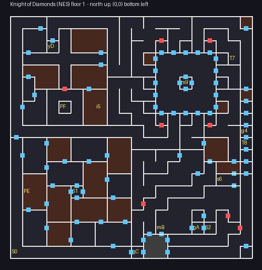
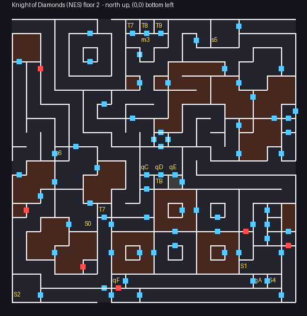
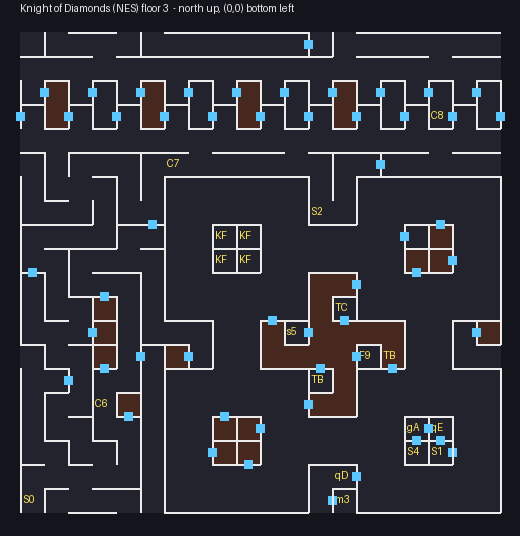
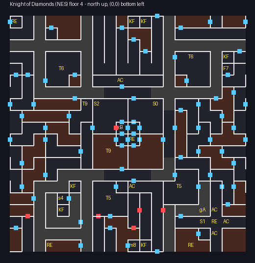
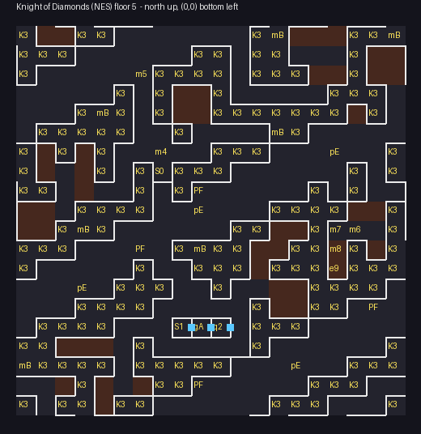
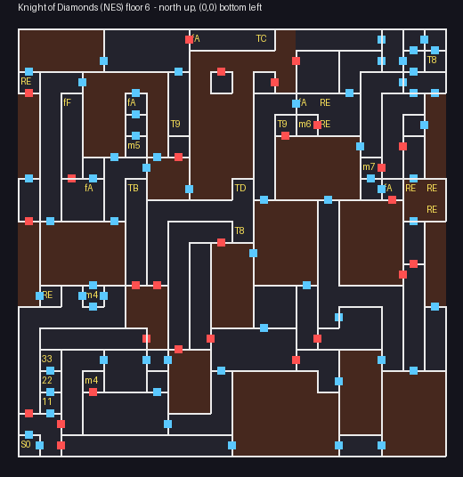

# Wizardry: Knight of Diamonds (NES) - the maze, floor by floor

## Overview
The Ruins under the Temple of Gnilda are six floors of 20 by 20 squares; every floor wraps at its edges
**(inferred: the step code wraps at 20)**. Coordinates are (x east, y north) with (0,0) the south-west square, the
way the game counts them **(RAM)**. The maps in [maps/](maps/) are drawn from the game's own floor data
(`../tools/maps.py`): white walls, blue doors, red secret doors, grey darkness, brown fight-zone rooms, and a
letter + record number (hex) on every special square. The meanings of most special types are a first reading of
the game's program and still need checking in play; stairs are checked.

## 1. Walls, doors and darkness
- Every side of a square is open, wall, door or secret door. Walking forward stops at walls and doors; the A
  button walks through doors **(verified: floor 1, door north of (5,4))**. Secret doors look like walls
  **(inferred from Wizardry I, same engine)**.
- Darkness squares draw no view; fight-zone rooms hold their own monsters **(inferred from Wizardry I)**.

## 2. Special squares
| Mark | Type | What happens | How sure |
|---|---|---|---|
| S | 01 | stairs to (a,b) on floor c (0 = castle); 'Stairs up/down --- Take them?' | verified |
| T | 02 | teleport to (a,b) on floor c, silent | verified |
| C | 03 | chute: 'It's dark!', the party falls to (a,b) on floor c | verified |
| K | 04 | solid rock: 'Rock!', the whole party dies (six tombstones), back to the castle | verified |
| P | 05 | pit: damage to every member (a dice of b sides? verified HP loss; c unclear) | verified |
| p | 06 | pit without the opening message | inferred (program) |
| R | 07 | spinner: facing set at random, silent | inferred (program) |
| m | 08 | message b | verified |
| x | 09 | message b, then teleport; c = $FF: back to the castle | verified |
| F | 0A | message b, then 'Will you pay?' a fee (a = 0: 5000 G.P. wishing well, a = 1: 100,000 G.P. sage) | verified |
| A | 0B | message b on every entry ('Come back right now!') | verified |
| q | 0C | barrier door: passes only if a member carries item a, else message b and pushed back | verified (refusal; passing inferred) |
| i | 0D | 'There is something at your feet', search: item a, then a fight | verified |
| s | 0E | trader: message b, offers item a for item c ('Not without payment!' without it) | verified |
| g | 0F | guardian fight with monster a; the winner gets item c | verified |
| f | 10 | fixed fight with monster a (+ random(b)) while armed (c = 1) | verified |
| 1 | 11 | 'One alone.': a party of more than one is sent back to the castle | verified |
| 2 | 12 | one member only, all five regalia pieces equipped, else 'room on fire' and back | verified |
| 3 | 13 | one member: with the regalia done -> Gnilda's temple (floor 1 (14,14)), the staff of Gnilda | verified |
| e | 14 | fountain: message b, 'Who will wade?' | verified |
| o | 15 | one-time event set by type 13: the regalia traded for the staff of Gnilda | verified |
| y | 16 | message b, 'Will you search?', then event a | verified |

The seven barriers (type 0C) and the keys that open them: floor 1 (10,0) 'Officers only!' (Weird emblem); floor 2 (9,9) rusting keyhole (Corroded key), (10,10) small hollow (Gory badge), (11,10) black luster (Key of ebony), (8,1) silver door (Mithril key); floor 3 (12,1) 'Keep off without permission!' (Key of cloister), (17,2) four keyholes (Master key); floor 5 (11,4) 'You aren't allowed to step in. You jump!' (item 0B? see Open questions) **(verified messages; item = argument a, inferred from the item list)**.

## 3. Connections (stairs, chutes and teleports between floors)
- floor 1 (0,0) S: to the castle **(verified: "Stairs up --- Take them?" at the start)**
- floor 1 (16,2) S: to floor 2 (16,2) **(verified, scan 2026-11-18)**
- floor 1 (5,5) S: to floor 2 (5,5) **(verified)**
- floor 2 (0,0) S: to floor 3 (0,0) **(verified, scan 2026-11-18)**
- floor 2 (18,1) S: to floor 3 (17,2) **(verified, scan 2026-11-18)**
- floor 2 (16,2) S: to floor 1 (16,2) **(verified, scan 2026-11-18)**
- floor 2 (5,5) S: to floor 1 (5,5) **(verified, scan 2026-11-18)**
- floor 3 (0,0) S: to floor 2 (0,0) **(verified, scan 2026-11-18)**
- floor 3 (16,2) S: to floor 4 (16,2) **(verified, scan 2026-11-18)**
- floor 3 (17,2) S: to floor 2 (18,1) **(verified, scan 2026-11-18)**
- floor 3 (3,4) C: to floor 4 (3,4) **(verified, scan 2026-11-18)**
- floor 3 (12,12) S: to floor 4 (12,12) **(verified, scan 2026-11-18)**
- floor 3 (6,14) C: to floor 4 (6,14) **(verified, scan 2026-11-18)**
- floor 3 (17,16) C: to floor 4 (17,16) **(verified, scan 2026-11-18)**
- floor 4 (16,2) S: to floor 3 (16,2) **(verified, scan 2026-11-18)**
- floor 4 (7,12) S: to floor 5 (7,12) **(verified, scan 2026-11-18)**
- floor 4 (12,12) S: to floor 3 (12,12) **(verified, scan 2026-11-18)**
- floor 5 (8,4) S: to floor 6 (0,0) **(verified, scan 2026-11-18)**
- floor 5 (7,12) S: to floor 4 (7,12) **(verified, scan 2026-11-18)**
- floor 6 (0,0) S: to floor 5 (8,4) **(verified, scan 2026-11-18)**

## 4. Floors

### Floor 1

Darkness: 4 squares; fight-zone rooms: 75 squares; secret-door sides: 15 **(computed from the floor data)**.

| Mark | Type | Squares | Arguments a b c |
|---|---|---|---|
| S0 | 01 | (0,0) | 00 00 00 |
| S1 | 01 | (5,5) | 05 05 02 |
| S2 | 01 | (16,2) | 10 02 02 |
| g4 | 0F | (19,10) | 54 00 83 |
| i5 | 0D | (7,12) | 82 44 82 |
| s6 | 0E | (17,6) | 85 45 82 |
| T7 | 02 | (18,16) | 0B 0A 01 |
| T8 | 02 | (19,9) | 0E 11 01 |
| m9 | 08 | (14,14) | 00 46 5B |
| gA | 0F | (15,2) | 59 00 81 |
| mB | 08 | (12,2) | 00 47 00 |
| qC | 0C | (10,0) | 84 48 84 |
| yD | 16 | (3,17) | 34 80 00 |
| PE | 05 | (1,5) | 01 05 01 |
| PF | 05 | (4,12) | 03 08 05 |

Events **(verified, capture run)**: (14,14) Gnilda's apparition, two pages ('acquire the five, and get over seven barriers'; shots `gnilda_apparition`, `gnilda_will`); later the regalia event (type 15, set by floor 6) gives the staff of Gnilda (`ending_staff`). (17,6) a small old man trades a black key for your red key (`key_trader`). (7,12) 'There is something at your feet', search: the Corroded key, then Men in Robes attack (`search_item`). (10,0) 'Officers only!' barrier (`officers_only`). (12,2) 'Are you ready? The armor you seek... lies three steps ahead but four steps away' (`armor_riddle`); (15,2) guardian Animated Object keeps KOD's armor. (19,10) guardian Kobold King, wins the Gory badge (`guardian_kobold`, `battle_found_badge`). (3,17) dusty statue, search: an Unseen Entity attacks (`statue_dusty`). (1,5) pit: RYZ, CONDI and DEDDO lost 3-5 hit points.

### Floor 2

Darkness: 1 squares; fight-zone rooms: 99 squares; secret-door sides: 12 **(computed from the floor data)**.

| Mark | Type | Squares | Arguments a b c |
|---|---|---|---|
| S0 | 01 | (5,5) | 05 05 01 |
| S1 | 01 | (16,2) | 10 02 01 |
| S2 | 01 | (0,0) | 00 00 03 |
| m3 | 08 | (9,18) | 00 49 00 |
| S4 | 01 | (18,1) | 11 02 03 |
| s5 | 0E | (14,18) | 84 4A 83 |
| s6 | 0E | (3,10) | 86 4B 85 |
| T7 | 02 | (6,6) (8,19) | 11 10 02 |
| T8 | 02 | (9,19) | 05 02 02 |
| T9 | 02 | (10,19) | 0A 0A 02 |
| gA | 0F | (17,1) | 57 00 7F |
| TB | 02 | (10,8) | 05 0F 02 |
| qC | 0C | (9,9) | 82 4C 82 |
| qD | 0C | (10,9) | 83 4D 83 |
| qE | 0C | (11,9) | 85 4E 85 |
| qF | 0C | (7,1) | 87 4F 87 |

Events **(verified)**: (9,18) 'Three roads to follow, only one you may take' (`three_roads`). (14,18) an ugly fat orc: 'Attack the saucy kobold! Do so, and I will employ you to an officer.' (trades the Weird emblem for the Gory badge; `orc_officer`). (3,10) the small man again: key of ebony for the key of cloister. (9,9) (10,10) (11,10) (8,1) four barrier doors (`barrier_rusty`). (17,1) guardian (monster 57) keeps KOD's shield. Teleports (6,6)/(8,19) -> (17,16), (9,19) -> (5,2), (10,19) -> (10,10), (10,8) -> (5,15).

### Floor 3

Darkness: 0 squares; fight-zone rooms: 37 squares; secret-door sides: 0 **(computed from the floor data)**.

| Mark | Type | Squares | Arguments a b c |
|---|---|---|---|
| S0 | 01 | (0,0) | 00 00 02 |
| S1 | 01 | (17,2) | 12 01 02 |
| S2 | 01 | (12,12) | 0C 0C 04 |
| m3 | 08 | (13,0) | 00 54 00 |
| S4 | 01 | (16,2) | 10 02 04 |
| s5 | 0E | (11,7) | 87 50 84 |
| C6 | 03 | (3,4) | 03 04 04 |
| C7 | 03 | (6,14) | 06 0E 04 |
| C8 | 03 | (17,16) | 11 10 04 |
| F9 | 0A | (14,6) | 00 51 00 |
| gA | 0F | (16,3) | 55 00 7D |
| TB | 02 | (12,5) (15,6) | 02 0D 03 |
| TC | 02 | (13,8) | 10 0B 03 |
| qD | 0C | (13,1) | 86 52 86 |
| qE | 0C | (17,3) | 88 53 88 |
| KF | 04 | (8,10) (9,10) (8,11) (9,11) | 00 00 00 |

Events **(verified)**: (14,6) the wishing well, 'Wishes: 5000 G.P.', 'The fee is 5000. Will you pay?'; paying ends with 'Thank you!' and the party back in the castle (`wishing_well`, `wishing_fee`). (11,7) a Wizardress: 'What a scoundrel! Get out of here!' (mithril key for the weird emblem; `wizardress`). (13,0) 'Ever considered another line of work?'. (16,3) 'A friendly' group guards Hrathnir. (12,1) and (17,2) barriers (`four_keyholes`). Chutes (3,4), (6,14), (17,16): 'It's dark!' and the fall to the same square of floor 4 (`chute`).

### Floor 4

Darkness: 85 squares; fight-zone rooms: 95 squares; secret-door sides: 11 **(computed from the floor data)**.

| Mark | Type | Squares | Arguments a b c |
|---|---|---|---|
| S0 | 01 | (12,12) | 0C 0C 03 |
| S1 | 01 | (16,2) | 10 02 03 |
| S2 | 01 | (7,12) | 07 0C 05 |
| s4 | 0E | (4,4) | 88 55 87 |
| T5 | 02 | (8,4) (14,5) | 08 0B 04 |
| T6 | 02 | (4,15) (15,16) | 0B 0B 04 |
| F7 | 0A | (18,15) | 01 56 01 |
| m8 | 08 | (10,0) | 00 57 5C |
| T9 | 02 | (8,8) (6,12) | 10 10 04 |
| gA | 0F | (16,3) | 56 00 7E |
| xB | 09 | (9,10) | 00 58 FF |
| AC | 0B | (17,1) (18,2) (17,3) (10,5) (9,14) | 00 59 00 |
| RE | 07 | (3,0) (15,0) (17,2) (10,9) (0,19) | 00 00 00 |
| KF | 04 | (11,0) (4,3) (5,5) (18,16) (10,19) (11,19) | 00 00 00 |

Events **(verified)**: (18,15) a wizened sage: 'For a mere 100,000 gold, many things will you be told!' ('You need more G.P.'; `sage`). (9,10) a familiar figure: 'Mapiro Mahama Diromat' sends the party to the castle (`mapiro`). (4,4) 'The man appears again... I shall make a master key for you.' (`master_key`). (16,3) guardian Animated Object (breath attack) keeps KOD's helmet. (17,1) 'Come back right now! Don't you know what's happened to you?' on every entry. (3,0) spinner.

### Floor 5

Darkness: 0 squares; fight-zone rooms: 46 squares; secret-door sides: 0 **(computed from the floor data)**.

| Mark | Type | Squares | Arguments a b c |
|---|---|---|---|
| S0 | 01 | (7,12) | 07 0C 04 |
| S1 | 01 | (8,4) | 00 00 06 |
| q2 | 0C | (10,4) | 0B 5A 80 |
| K3 | 04 | (0,0) (2,0) (3,0) (5,0) (6,0) (13,0) +152 more | 00 00 00 |
| m4 | 08 | (7,13) | 00 5D 00 |
| m5 | 08 | (6,17) | 00 5E 00 |
| m6 | 08 | (17,9) | 00 5F 00 |
| m7 | 08 | (16,9) | 00 60 00 |
| m8 | 08 | (16,8) | 00 79 00 |
| e9 | 14 | (16,7) | 00 81 FF |
| gA | 0F | (9,4) | 58 00 80 |
| mB | 08 | (0,2) (9,8) (3,9) (13,14) (4,15) (13,19) +1 more | 00 85 00 |
| pE | 06 | (14,2) (3,6) (9,10) (16,13) | 01 08 00 |
| PF | 05 | (9,1) (18,5) (6,8) (9,11) | 03 08 05 |

Events **(verified)**: (7,13) 'the entrance of what seems to be a huge cavern' (`cavern`). (6,17) a cave-in, broken bone and rusted armor. (17,9), (16,9), (16,8) the riddle 'A cavern's dark...', 'As the inside of a mountain...', 'Down the hall...', then (16,7) '... A clear blue fountain.' 'Who will wade?' (`fountain`). (0,2) 'You are almost ruined.' (11,4) 'You aren't allowed to step in. You jump!' (barrier). (9,4) guardian (monster 58) keeps KOD's gauntlets. The 158 type 04 squares are **solid rock**: 'Rock!' and the whole party dies (`rock`, `gameover` shows the same tombstones).

### Floor 6

Darkness: 0 squares; fight-zone rooms: 174 squares; secret-door sides: 52 **(computed from the floor data)**.

| Mark | Type | Squares | Arguments a b c |
|---|---|---|---|
| S0 | 01 | (0,0) | 08 04 05 |
| 11 | 11 | (1,2) | 00 82 00 |
| 22 | 12 | (1,3) | 00 83 00 |
| 33 | 13 | (1,4) | 00 00 00 |
| m4 | 08 | (3,3) (3,7) | 00 7A 00 |
| m5 | 08 | (5,14) | 00 7B 00 |
| m6 | 08 | (13,15) | 00 7C 00 |
| m7 | 08 | (16,13) | 00 7F 00 |
| T8 | 02 | (10,10) (19,18) | 00 00 06 |
| T9 | 02 | (7,15) (12,15) | 13 04 06 |
| fA | 10 | (3,12) (17,12) (5,16) (13,16) (8,19) | 45 0E 01 |
| TB | 02 | (5,12) | 08 09 06 |
| TC | 02 | (11,19) | 01 05 06 |
| TD | 02 | (10,12) | 03 0D 06 |
| RE | 07 | (1,7) (19,11) (18,12) (19,12) (14,15) (14,16) +1 more | 00 00 00 |
| fF | 10 | (2,16) | 53 00 01 |

Events **(verified)**: the trial corridor north of the stairs: (1,2) 'The apparition reappears and intones: One alone.' (a larger party is sent to the castle; `one_alone`); (1,3) 'You find the room on fire... What a foolish man! If you don't hear my order, get away.' unless the lone member wears Hrathnir and KOD's helmet, shield, gauntlets and armor (`room_fire`); (1,4) the lone knight is carried to Gnilda's room on floor 1 and trades the regalia for the staff of Gnilda (`ending_apparition` to `ending_traded`); a member who has done it before is sent to (3,3) instead. (5,14) 'The most evil voice... Where is the stuff now?' (`evil_voice`). (16,13) words in a red liquid: 'I will leave it to the brave who brought back the stuff.' (`foul_smell`). Fixed fights (type 10) at (2,16) and five squares of record A.

## Open questions
- Types 06 (silent pit) and 07 (spinner) were stepped on without a visible effect in the scan: read from the program only.
- The floor 5 barrier at (11,4) asks for item 0B (Chain mail in the item list): probably another item numbering; not tested.
- Squares the scan could not walk into (floor 1 (4,12) pit, floor 3 (8,10) area, floor 4 (10,0) (11,0) (4,3) (5,5), floor 6 (3,3) (3,7) (13,15)): reachable only by teleport or secret door; messages 7A and 7C on floor 6 unseen.
- Monster numbers of the fight types (0F, 10) -> names: Kobold King and Animated Object seen; the rest not looked up.
