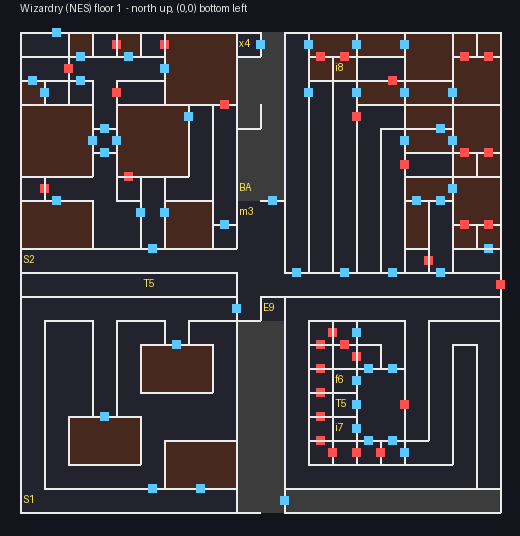
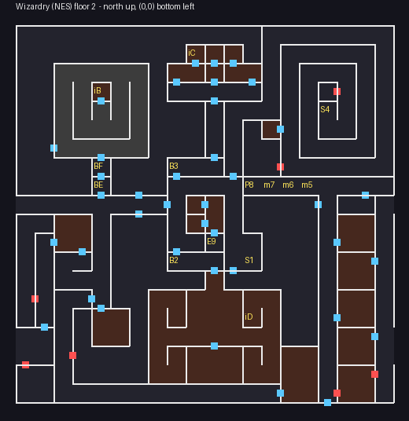
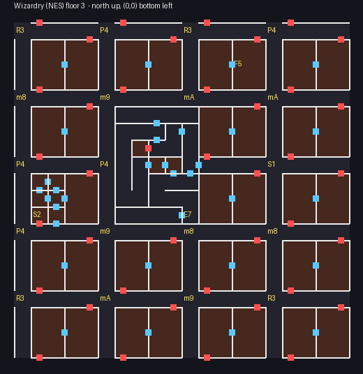
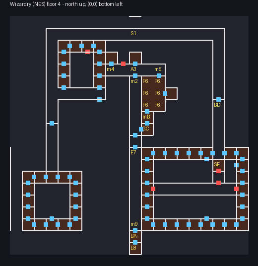
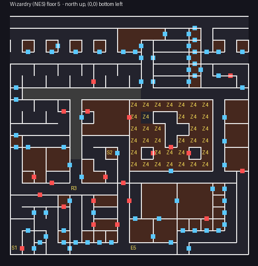
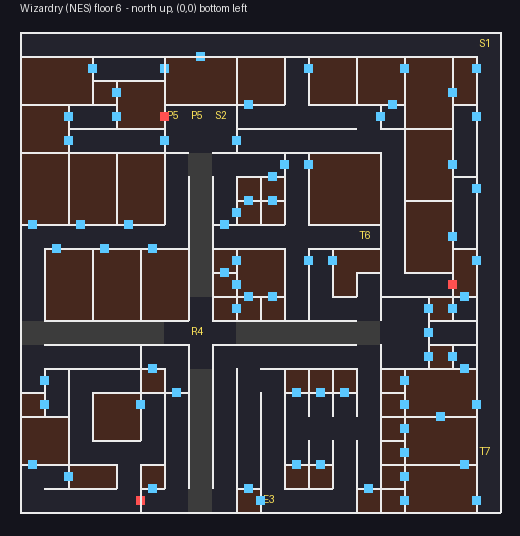
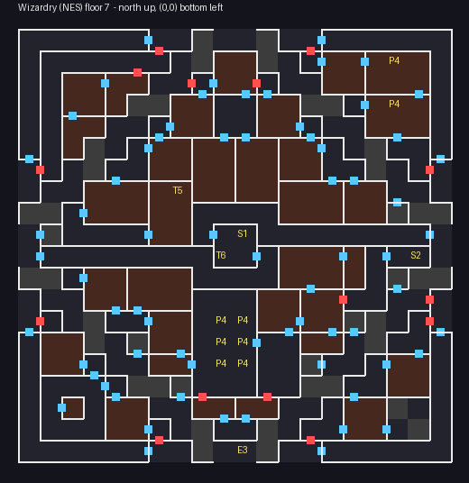
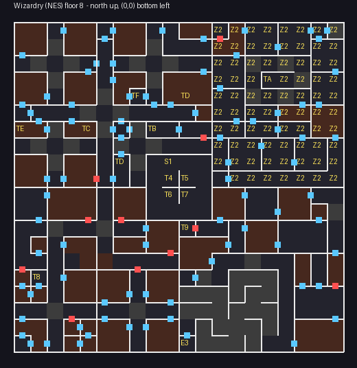
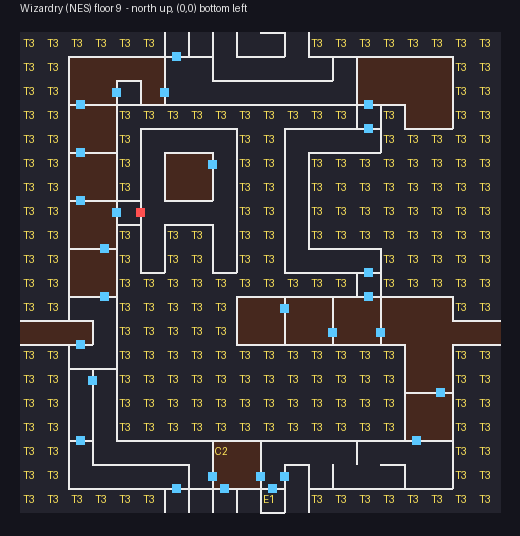
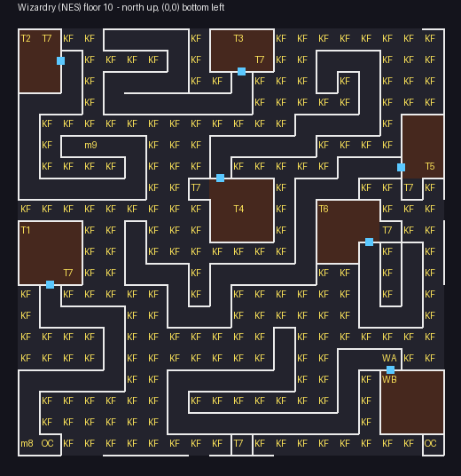

# Wizardry (NES) - the maze, floor by floor

## Overview
The Proving Grounds are ten floors of 20 by 20 squares each; every floor wraps at its edges **(verified, maze
data)**. Coordinates here are (x east, y north) with (0,0) the south-west square, the way the game counts them
**(RAM)**. The maps in [maps/](maps/) are drawn from the game's own floor data (`../tools/maps.py`): white
walls, blue doors, red secret doors, grey darkness, brown fight-zone rooms, and a letter + number on every
special square (the tables below). A view of each floor: floors 1-9 share one brick wall set, floor 10 has its
own rough stone walls **(verified: test views of every floor)**.

## 1. Walls, doors and darkness
- Every side of a square is open, wall, door or **secret door**. Walking forward (Up) stops at any wall or door
  ("Ouch!"); the A button walks through doors **(verified)**. A secret door is drawn exactly like a wall, but A
  walks through it **(verified: floor 1, west side of (2,18))**.
- Darkness squares draw no view ("It's dark!") **(verified: shot `barrier_smoke`)**.
- Fight-zone rooms (brown) give a 1 in 8 chance of a fight on each step while monsters are still there; outside
  them a fight comes on about 1 step in 128 **(inferred from the program)**. Fixed fights and room guardians are
  set up when the party arrives on a floor by stairs, elevator, chute or teleport; a party placed on a floor by
  other means meets no fixed fights there **(verified: floor 4 guardians only after arriving by elevator)**.

## 2. Special squares
| Mark | What happens | How sure |
|---|---|---|
| S | stairs: "Stairs up/down. Take them?" | verified (shot `ending` route) |
| T | teleport to a fixed square, no message | inferred |
| m | a message | verified |
| x | a message, then the party is put back in the castle | inferred |
| E | elevator: "There are buttons here, press one" (A-D on floors 1-4, A-F on floors 4-9) | verified (floor 1) |
| i | message, "Will you search?": finds an item (only while the party lacks it) | inferred |
| f | message, "Will you search?": a fight (Murphy's ghost on floor 1) | verified |
| P | pit: "A Pit!"; each member fails an agility roll or takes (floor number)d8 damage | verified |
| R | spinner: facing changed at random, without a message | inferred |
| F | fixed fight with a set monster group, once per visit to the floor | verified |
| B | barrier: without the right item a message and the party is pushed back | verified |
| A | alarm: a message, then the next step brings a fight | inferred |
| Z | anti-magic area: party spells fizzle until the next stairs or teleport | inferred |
| K | solid rock (floor 10): stepping in kills the whole party | inferred |
| C | chute: "A chute!", then a drop to a fixed square | verified |
| O | straight back to the castle | inferred |
| G | message, then an item is given (floor 4) | inferred |
| W | Werdna: the sign on his door, the fight in his lair | verified |

## 3. Connections
- Castle - floor 1 (0,0) by the stairs **(verified)**; floor 1 (0,10) stairs - floor 2 (12,7) **(inferred)**.
- Elevator floor 1 (10,8) serves floors 1-4; elevator floor 4 (10,0) serves floors 4-9 **(verified for 1-4)**.
- Floor 9 (8,2) chute - floor 10 (0,0), the only way down to Werdna's floor **(verified)**.
- Floor 10 is a teleport maze between pockets walled in by solid rock; Werdna's door sign at (17,4), his
  fight at (17,3) **(verified)**.
- Bringing Werdna's amulet up the floor 1 stairs ends the game: 50,000 G.P., 50,000 E.P. and the Chevron of
  Rank **(verified: shot `ending`)**.

## 4. Floors

## Floor 1

Darkness: 37 squares; fight-zone rooms: 98 squares; secret-door sides: 42.

| Mark | Type | Squares | Arguments a b c | Meaning |
|---|---|---|---|---|
| S1 | Stairs | (0,0) | 00 00 00 | to (0,0) on the castle (inferred) |
| S2 | Stairs | (0,10) | 0C 07 02 | to (12,7) on floor 2 (inferred) |
| m3 | Message | (9,12) | 00 00 00 | message a (waits for a button) (verified: "A large sign on the wall reads *** Area out of bounds!***" (shot `message_square`)) |
| x4 | Message, back to castle | (9,19) | 04 00 00 | message a, then the party is sent back to the castle (inferred) |
| T5 | Teleport | (13,4), (5,9) | 0F 04 01 | to (15,4) on floor 1 (inferred) |
| f6 | Search: fight | (13,5) | 01 4D 00 | message a, 'Will you search?': fight with monster b (verified: the gem-encrusted statue of a hooded man; searching starts the Unseen entity fight (Murphy's ghost; shots `statue_hooded`, `murphy_friendly`, `murphy_fight`)) |
| i7 | Search: item | (13,3) | 03 61 00 | message a (if the party lacks item b), 'Will you search?': finds item b (inferred) |
| i8 | Search: item | (13,18) | 02 62 00 | message a (if the party lacks item b), 'Will you search?': finds item b (inferred) |
| E9 | Elevator | (10,8) | 01 04 00 | floors 1-4 (verified: buttons A-D (shot `elevator`)) |
| BA | Barrier (needs item) | (9,13) | 85 63 00 | barrier: without item b, message a and pushed back (verified: dark square; "a gold smoke fills it. You feel compelled to leave immediately!", pushed back to (9,12) (shot `barrier_smoke`)) |

## Floor 2

Darkness: 24 squares; fight-zone rooms: 84 squares; secret-door sides: 9.

| Mark | Type | Squares | Arguments a b c | Meaning |
|---|---|---|---|---|
| S1 | Stairs | (12,7) | 00 0A 01 | to (0,10) on floor 1 (inferred) |
| B2 | Barrier (needs item) | (8,7) | 0B 61 00 | barrier: without item b, message a and pushed back (inferred) |
| B3 | Barrier (needs item) | (8,12) | 0A 62 00 | barrier: without item b, message a and pushed back (inferred) |
| S4 | Stairs | (16,15) | 0F 0B 03 | to (15,11) on floor 3 (inferred) |
| m5 | Message | (15,11) | 06 00 00 | message a (waits for a button) (inferred) |
| m6 | Message | (14,11) | 07 00 00 | message a (waits for a button) (inferred) |
| m7 | Message | (13,11) | 08 00 00 | message a (waits for a button) (inferred) |
| P8 | Pit | (12,11) | 02 08 00 | damage 2d8 to members failing an agility roll (inferred) |
| E9 | Elevator | (10,8) | 01 04 00 | floors 1-4 (inferred) |
| iB | Search: item | (4,16) | 03 63 00 | message a (if the party lacks item b), 'Will you search?': finds item b (inferred) |
| iC | Search: item | (9,18) | 09 5F 00 | message a (if the party lacks item b), 'Will you search?': finds item b (inferred) |
| iD | Search: item | (12,4) | 05 60 00 | message a (if the party lacks item b), 'Will you search?': finds item b (inferred) |
| BE | Barrier (needs item) | (4,11) | 0C 5F 00 | barrier: without item b, message a and pushed back (inferred) |
| BF | Barrier (needs item) | (4,12) | 0C 60 00 | barrier: without item b, message a and pushed back (inferred) |

## Floor 3

Darkness: 0 squares; fight-zone rooms: 219 squares; secret-door sides: 72.

| Mark | Type | Squares | Arguments a b c | Meaning |
|---|---|---|---|---|
| S1 | Stairs | (15,11) | 10 0F 02 | to (16,15) on floor 2 (inferred) |
| S2 | Stairs | (1,8) | 0A 12 04 | to (10,18) on floor 4 (inferred) |
| R3 | Spinner | (0,3), (15,3), (0,19), (10,19) | 00 00 00 | spinner: facing set at random, silent (verified: no message, no visible effect (facing kept south on that step: random)) |
| P4 | Pit | (0,7), (0,11), (5,11), (5,19), (15,19) | 03 08 00 | damage 3d8 to members failing an agility roll (verified: "A Pit!", three members lost hit points (shot `pit`)) |
| F5 | Fixed fight | (13,17) | 28 04 05 | fixed fight with monster a (+ random 0..b-1) while not yet beaten on this visit (inferred) |
| E7 | Elevator | (10,8) | 01 04 00 | floors 1-4 (inferred) |
| m8 | Message | (10,7), (15,7), (0,15) | 10 00 00 | message a (waits for a button) (inferred) |
| m9 | Message | (10,3), (5,7), (5,15) | 0F 00 00 | message a (waits for a button) (inferred) |
| mA | Message | (5,3), (10,15), (15,15) | 0E 00 00 | message a (waits for a button) (inferred) |

## Floor 4

Darkness: 0 squares; fight-zone rooms: 67 squares; secret-door sides: 10.

| Mark | Type | Squares | Arguments a b c | Meaning |
|---|---|---|---|---|
| S1 | Stairs | (10,18) | 01 08 03 | to (1,8) on floor 3 (inferred) |
| m2 | Message | (10,14) | 15 00 00 | message a (waits for a button) (inferred) |
| A3 | Alarm | (10,15) | 12 00 00 | alarm: message a, the next step brings a fight (inferred) |
| m4 | Message | (8,15) | 13 00 00 | message a (waits for a button) (inferred) |
| m5 | Message | (12,15) | 14 00 00 | message a (waits for a button) (inferred) |
| F6 | Fixed fight | (11,12), (12,12), (11,13), (12,13), (11,14), (12,14) | 64 00 FF | fixed fight with monster a (+ random 0..b-1) while not yet beaten on this visit - verified at (12,13): Lvl 7 Fighters, Lvl 7 Mages, High Clerics, Man in kimono (High Ninja); chest after the fight (shots `battle_fixed`, `chest`) |
| E7 | Elevator | (10,8) | 01 04 00 | floors 1-4 (verified: buttons A-D; arriving by button D (floor 1 elevator) inits the floor) |
| E8 | Elevator | (10,0) | 04 09 00 | floors 4-9 (inferred) |
| m9 | Message | (10,2) | 16 00 00 | message a (waits for a button) (inferred) |
| BA | Barrier (needs item) | (10,1) | 17 64 00 | barrier: without item b, message a and pushed back (inferred) |
| mB | Message | (11,11) | 18 00 00 | message a (waits for a button) (inferred) |
| GC | Gift item | (11,10) | 19 64 FF | message a (if the party lacks item b), then gives item b (inferred) |
| BD | Barrier (needs item) | (17,12) | 11 5F 00 | barrier: without item b, message a and pushed back (inferred) |
| SE | Stairs | (17,7) | 00 00 05 | to (0,0) on floor 5 (inferred) |

## Floor 5

Darkness: 15 squares; fight-zone rooms: 131 squares; secret-door sides: 38.

| Mark | Type | Squares | Arguments a b c | Meaning |
|---|---|---|---|---|
| S1 | Stairs | (0,0) | 11 07 04 | to (17,7) on floor 4 (inferred) |
| S2 | Stairs | (8,8) | 13 13 06 | to (19,19) on floor 6 (inferred) |
| R3 | Spinner | (5,5) | 00 00 00 | spinner: facing set at random, silent (inferred) |
| Z4 | Anti-magic | (10,7), (11,7), (12,7), (13,7), (14,7), (15,7) and 29 more | 00 00 00 | anti-magic area: party spells fizzle until the next stairs/teleport (inferred) |
| E5 | Elevator | (10,0) | 04 09 00 | floors 4-9 (inferred) |

## Floor 6

Darkness: 24 squares; fight-zone rooms: 162 squares; secret-door sides: 5.

| Mark | Type | Squares | Arguments a b c | Meaning |
|---|---|---|---|---|
| S1 | Stairs | (19,19) | 08 08 05 | to (8,8) on floor 5 (inferred) |
| S2 | Stairs | (8,16) | 0A 0A 07 | to (10,10) on floor 7 (inferred) |
| E3 | Elevator | (10,0) | 04 09 00 | floors 4-9 (inferred) |
| R4 | Spinner | (7,7) | 00 00 00 | spinner: facing set at random, silent (inferred) |
| P5 | Pit | (6,16), (7,16) | 06 08 00 | damage 6d8 to members failing an agility roll (inferred) |
| T6 | Teleport | (14,11) | 00 00 06 | to (0,0) on floor 6 (inferred) |
| T7 | Teleport | (19,2) | 02 13 06 | to (2,19) on floor 6 (inferred) |

## Floor 7

Darkness: 41 squares; fight-zone rooms: 135 squares; secret-door sides: 30.

| Mark | Type | Squares | Arguments a b c | Meaning |
|---|---|---|---|---|
| S1 | Stairs | (10,10) | 08 10 06 | to (8,16) on floor 6 (inferred) |
| S2 | Stairs | (18,9) | 09 0B 08 | to (9,11) on floor 8 (inferred) |
| E3 | Elevator | (10,0) | 04 09 00 | floors 4-9 (inferred) |
| P4 | Pit | (9,4), (10,4), (9,5), (10,5), (9,6), (10,6) and 2 more | 07 08 00 | damage 7d8 to members failing an agility roll (inferred) |
| T5 | Teleport | (7,12) | 02 08 07 | to (2,8) on floor 7 (inferred) |
| T6 | Teleport | (9,9) | 12 02 07 | to (18,2) on floor 7 (inferred) |

## Floor 8

Darkness: 51 squares; fight-zone rooms: 133 squares; secret-door sides: 22.

| Mark | Type | Squares | Arguments a b c | Meaning |
|---|---|---|---|---|
| S1 | Stairs | (9,11) | 12 09 07 | to (18,9) on floor 7 (inferred) |
| Z2 | Anti-magic | (13,10), (14,10), (15,10), (16,10), (17,10), (18,10) and 72 more | 00 00 00 | anti-magic area: party spells fizzle until the next stairs/teleport (inferred) |
| E3 | Elevator | (10,0) | 04 09 00 | floors 4-9 (inferred) |
| T4 | Teleport | (9,10) | 00 00 08 | to (0,0) on floor 8 (inferred) |
| T5 | Teleport | (10,10) | 05 0E 08 | to (5,14) on floor 8 (inferred) |
| T6 | Teleport | (9,9) | 0C 0A 08 | to (12,10) on floor 8 (inferred) |
| T7 | Teleport | (10,9) | 0A 04 08 | to (10,4) on floor 8 (inferred) |
| T8 | Teleport | (1,4) | 0B 08 08 | to (11,8) on floor 8 (inferred) |
| T9 | Teleport | (10,7) | 08 0B 08 | to (8,11) on floor 8 (inferred) |
| TA | Teleport | (15,16) | 0B 0B 08 | to (11,11) on floor 8 (inferred) |
| TB | Teleport | (8,13) | 08 08 08 | to (8,8) on floor 8 (inferred) |
| TC | Teleport | (4,13) | 08 11 08 | to (8,17) on floor 8 (inferred) |
| TD | Teleport | (6,11), (10,15) | 02 0C 08 | to (2,12) on floor 8 (inferred) |
| TE | Teleport | (0,13) | 07 0C 08 | to (7,12) on floor 8 (inferred) |
| TF | Teleport | (7,15) | 02 11 08 | to (2,17) on floor 8 (inferred) |

## Floor 9

Darkness: 0 squares; fight-zone rooms: 72 squares; secret-door sides: 1.

| Mark | Type | Squares | Arguments a b c | Meaning |
|---|---|---|---|---|
| E1 | Elevator | (10,0) | 04 09 00 | floors 4-9 (inferred) |
| C2 | Chute | (8,2) | 00 00 0A | to (0,0) on floor 10 (verified: "A chute!", lands on floor 10 (0,0) (shot `chute`)) |
| T3 | Teleport | (0,0), (1,0), (2,0), (3,0), (4,0), (5,0) and 223 more | 00 05 01 | to (0,5) on floor 1 (inferred) |

## Floor 10

Darkness: 0 squares; fight-zone rooms: 53 squares; secret-door sides: 0.

| Mark | Type | Squares | Arguments a b c | Meaning |
|---|---|---|---|---|
| T1 | Teleport | (0,10) | 02 0E 0A | to (2,14) on floor 10 (inferred) |
| T2 | Teleport | (0,19) | 04 13 0A | to (4,19) on floor 10 (inferred) |
| T3 | Teleport | (10,19) | 0E 11 0A | to (14,17) on floor 10 (inferred) |
| T4 | Teleport | (10,11) | 05 0A 0A | to (5,10) on floor 10 (inferred) |
| T5 | Teleport | (19,13) | 12 09 0A | to (18,9) on floor 10 (inferred) |
| T6 | Teleport | (14,11) | 0C 05 0A | to (12,5) on floor 10 (inferred) |
| T7 | Teleport | (10,0), (2,8), (17,10), (8,12), (18,12), (11,18) and 1 more | 00 00 0A | to (0,0) on floor 10 (inferred) |
| m8 | Message | (0,0) | 1A 00 00 | message a (waits for a button) (verified: gold plaque, "Contra-dextra avenue", "PS - Trebor sux" (shot `werdna_plaque`)) |
| m9 | Message | (3,14) | 1B 00 00 | message a (waits for a button) (inferred) |
| WA | Werdna's sign | (17,4) | 1C 5E 00 | Werdna's sign: message a (another text once the amulet is held) (verified: "Lair of the evil Wizard WERDNA ... The Wizard is *IN*" (shot `werdna_sign`)) |
| WB | Werdna's fight | (17,3) | 60 5E FF | Werdna's fight (monster a, b once the amulet is held) while not yet beaten (verified: Man in robes (Werdna), Vampire Lord, 2 Vampires; surprise round, level drain; amulet after the fight (shots `werdna_fight`, `werdna_amulet`)) |
| OC | Exit to castle | (1,0), (19,0) | 00 00 00 | back to the castle at once (inferred) |
| KF | Rock | (2,0), (3,0), (4,0), (5,0), (6,0), (7,0) and 212 more | 00 00 00 | solid rock: the whole party dies (lost), back to the castle (inferred) |
## Open questions
- Message texts of most squares (only those listed as verified were seen); item and monster numbers in the
  tables are the game's internal numbers, not yet matched with names (the floor 1 barrier needs item 63 hex).
- Spinners did not visibly change facing on the one step tried.
- Teleport, alarm, anti-magic and rock squares are read from the program only.
