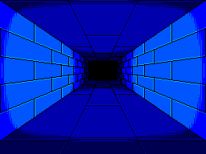
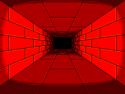
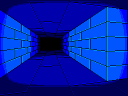
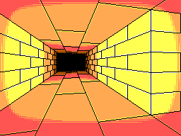

# Phantasy Star (Master System): looping movement clips

Seamless loops of first-person movement, one cycle each at game timing (made by `games/sms/phantasy-star/tools/loop.py`: hold the key from the route, record every frame, keep the first cycle that repeats exactly twice). The poster `.png` is the first picture of the cycle.

| Clip | Caption | Length | Route, held key |
|---|---|---|---|
|  | Walking down a long blue corridor (one step, loops seamlessly) | 37 frames, 0.62 s | `@start,PARTY4,INV4,DUN:16:E4:00,settle,w2`, hold `up` |
|  | Walking down a long red corridor (one step, loops seamlessly) | 36 frames, 0.6 s | `@start,PARTY4,INV4,DUN:2B:ED:00,settle,w4`, hold `up` |
|  | Turning on the spot at a blue crossroads: endless turning (corridor to identical corridor) | 48 frames, 0.8 s | `@start,PARTY4,INV4,DUN:16:64:00,settle`, hold `right` |
|  | Turning on the spot at a yellow crossroads: endless turning (corridor to identical corridor) | 48 frames, 0.8 s | `@start,PARTY4,INV4,DUN:25:AC:00,settle`, hold `right` |
