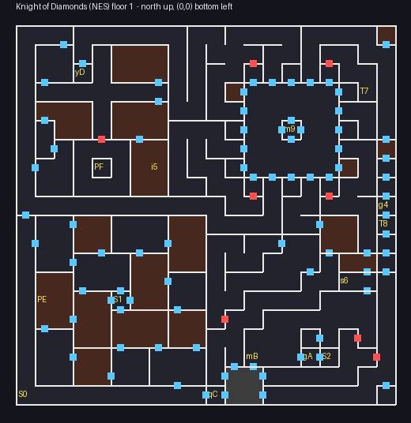
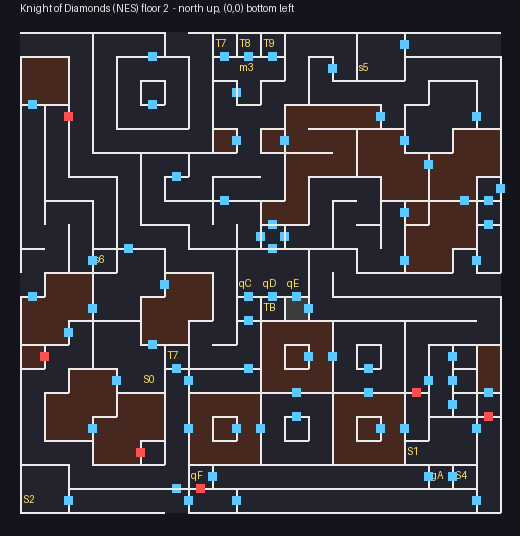
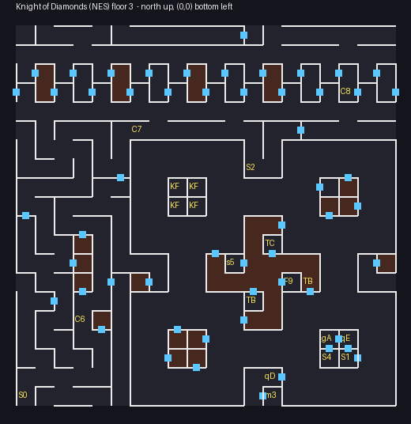
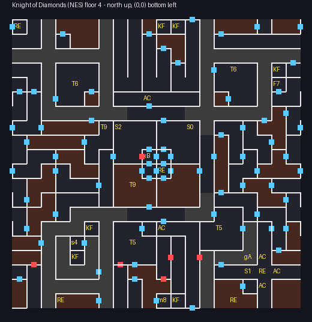
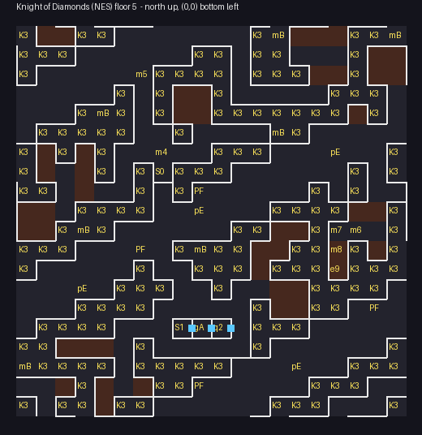
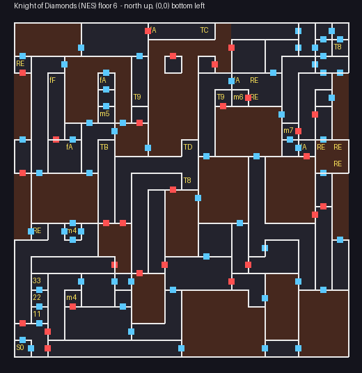

# Wizardry: Knight of Diamonds (NES) - the maze, floor by floor

## Overview
The Ruins under the Temple of Gnilda are six floors of 20 by 20 squares; every floor wraps at its edges
**(inferred: the step code wraps at 20)**. Coordinates are (x east, y north) with (0,0) the south-west square, the
way the game counts them **(RAM)**. The maps in [maps/](maps/) are drawn from the game's own floor data
(`../tools/maps.py`): white walls, blue doors, red secret doors, grey darkness, brown fight-zone rooms, and a
letter + record number (hex) on every special square. The meanings of most special types are a first reading of
the game's program and still need checking in play; stairs are checked.

## 1. Walls, doors and darkness
- Every side of a square is open, wall, door or secret door. Walking forward stops at walls and doors; the A
  button walks through doors **(verified: floor 1, door north of (5,4))**. Secret doors look like walls
  **(inferred from Wizardry I, same engine)**.
- Darkness squares draw no view; fight-zone rooms hold their own monsters **(inferred from Wizardry I)**.

## 2. Special squares
| Mark | Type | What happens | How sure |
|---|---|---|---|
| S | 01 | stairs to (a,b) on floor c (0 = castle); 'Stairs up/down --- Take them?' (cross-checked between floors) | verified (floor 1 (5,5) -> floor 2 (5,5)) |
| T | 02 | teleport to (a,b) on floor c, silent | inferred (program) |
| C | 03 | chute/trapdoor: message, then to (a,b) on floor c | inferred (program) |
| K | 04 | solid rock / deadly area: every member still alive dies | inferred (program) |
| P | 05 | pit: message, damage to the party (a, b, c dice) | inferred (program) |
| p | 06 | pit without the opening message | inferred (program) |
| R | 07 | spinner: facing set at random, silent | inferred (program) |
| m | 08 | message b (c: a second message) | inferred (program) |
| x | 09 | message b, then teleport to (b?,c) or back to the castle when c is 128 or more | inferred (program) |
| F | 0A | message b, then a fixed fight (group set a) | inferred (program) |
| A | 0B | message b, then a fight on the next step (alarm-like) | inferred (program) |
| q | 0C | message chain a..c (stops on a condition) | inferred (program) |
| i | 0D | one-time: message b, 'Search?' (Yes/No), item | inferred (program) |
| s | 0E | message b, Yes/No prompt, then a check against item c | inferred (program) |
| g | 0F | guardian fight with monster a unless a condition (item c?) holds | inferred (program) |
| f | 10 | fixed fight with monster a + random(b) while armed (c = 1) | inferred (program) |
| 1 | 11 | one-member party only: otherwise message b and back to the castle | inferred (program) |
| 2 | 12 | one-member party only, item check | inferred (program) |
| 3 | 13 | one-member party only: teleport by a member flag | inferred (program) |
| e | 14 | an event that checks every member of the party | inferred (program) |
| o | 15 | one-time messages that depend on the party size (unused on the six floors) | inferred (program) |
| y | 16 | message b, Yes/No, then event a | inferred (program) |

## 3. Connections (stairs, chutes and teleports between floors)
- floor 1 (0,0) S: to the castle **(verified: "Stairs up --- Take them?" at the start)**
- floor 1 (16,2) S: to floor 2 (16,2) **(inferred)**
- floor 1 (5,5) S: to floor 2 (5,5) **(verified)**
- floor 2 (0,0) S: to floor 3 (0,0) **(inferred)**
- floor 2 (18,1) S: to floor 3 (17,2) **(inferred)**
- floor 2 (16,2) S: to floor 1 (16,2) **(inferred)**
- floor 2 (5,5) S: to floor 1 (5,5) **(inferred)**
- floor 3 (0,0) S: to floor 2 (0,0) **(inferred)**
- floor 3 (16,2) S: to floor 4 (16,2) **(inferred)**
- floor 3 (17,2) S: to floor 2 (18,1) **(inferred)**
- floor 3 (3,4) C: to floor 4 (3,4) **(inferred)**
- floor 3 (12,12) S: to floor 4 (12,12) **(inferred)**
- floor 3 (6,14) C: to floor 4 (6,14) **(inferred)**
- floor 3 (17,16) C: to floor 4 (17,16) **(inferred)**
- floor 4 (16,2) S: to floor 3 (16,2) **(inferred)**
- floor 4 (7,12) S: to floor 5 (7,12) **(inferred)**
- floor 4 (12,12) S: to floor 3 (12,12) **(inferred)**
- floor 5 (8,4) S: to floor 6 (0,0) **(inferred)**
- floor 5 (7,12) S: to floor 4 (7,12) **(inferred)**
- floor 6 (0,0) S: to floor 5 (8,4) **(inferred)**

## 4. Floors

### Floor 1

Darkness: 4 squares; fight-zone rooms: 75 squares; secret-door sides: 15 **(computed from the floor data)**.

| Mark | Type | Squares | Arguments a b c |
|---|---|---|---|
| S0 | 01 | (0,0) | 00 00 00 |
| S1 | 01 | (5,5) | 05 05 02 |
| S2 | 01 | (16,2) | 10 02 02 |
| g4 | 0F | (19,10) | 54 00 83 |
| i5 | 0D | (7,12) | 82 44 82 |
| s6 | 0E | (17,6) | 85 45 82 |
| T7 | 02 | (18,16) | 0B 0A 01 |
| T8 | 02 | (19,9) | 0E 11 01 |
| m9 | 08 | (14,14) | 00 46 5B |
| gA | 0F | (15,2) | 59 00 81 |
| mB | 08 | (12,2) | 00 47 00 |
| qC | 0C | (10,0) | 84 48 84 |
| yD | 16 | (3,17) | 34 80 00 |
| PE | 05 | (1,5) | 01 05 01 |
| PF | 05 | (4,12) | 03 08 05 |

### Floor 2

Darkness: 1 squares; fight-zone rooms: 99 squares; secret-door sides: 12 **(computed from the floor data)**.

| Mark | Type | Squares | Arguments a b c |
|---|---|---|---|
| S0 | 01 | (5,5) | 05 05 01 |
| S1 | 01 | (16,2) | 10 02 01 |
| S2 | 01 | (0,0) | 00 00 03 |
| m3 | 08 | (9,18) | 00 49 00 |
| S4 | 01 | (18,1) | 11 02 03 |
| s5 | 0E | (14,18) | 84 4A 83 |
| s6 | 0E | (3,10) | 86 4B 85 |
| T7 | 02 | (6,6) (8,19) | 11 10 02 |
| T8 | 02 | (9,19) | 05 02 02 |
| T9 | 02 | (10,19) | 0A 0A 02 |
| gA | 0F | (17,1) | 57 00 7F |
| TB | 02 | (10,8) | 05 0F 02 |
| qC | 0C | (9,9) | 82 4C 82 |
| qD | 0C | (10,9) | 83 4D 83 |
| qE | 0C | (11,9) | 85 4E 85 |
| qF | 0C | (7,1) | 87 4F 87 |

### Floor 3

Darkness: 0 squares; fight-zone rooms: 37 squares; secret-door sides: 0 **(computed from the floor data)**.

| Mark | Type | Squares | Arguments a b c |
|---|---|---|---|
| S0 | 01 | (0,0) | 00 00 02 |
| S1 | 01 | (17,2) | 12 01 02 |
| S2 | 01 | (12,12) | 0C 0C 04 |
| m3 | 08 | (13,0) | 00 54 00 |
| S4 | 01 | (16,2) | 10 02 04 |
| s5 | 0E | (11,7) | 87 50 84 |
| C6 | 03 | (3,4) | 03 04 04 |
| C7 | 03 | (6,14) | 06 0E 04 |
| C8 | 03 | (17,16) | 11 10 04 |
| F9 | 0A | (14,6) | 00 51 00 |
| gA | 0F | (16,3) | 55 00 7D |
| TB | 02 | (12,5) (15,6) | 02 0D 03 |
| TC | 02 | (13,8) | 10 0B 03 |
| qD | 0C | (13,1) | 86 52 86 |
| qE | 0C | (17,3) | 88 53 88 |
| KF | 04 | (8,10) (9,10) (8,11) (9,11) | 00 00 00 |

### Floor 4

Darkness: 85 squares; fight-zone rooms: 95 squares; secret-door sides: 11 **(computed from the floor data)**.

| Mark | Type | Squares | Arguments a b c |
|---|---|---|---|
| S0 | 01 | (12,12) | 0C 0C 03 |
| S1 | 01 | (16,2) | 10 02 03 |
| S2 | 01 | (7,12) | 07 0C 05 |
| s4 | 0E | (4,4) | 88 55 87 |
| T5 | 02 | (8,4) (14,5) | 08 0B 04 |
| T6 | 02 | (4,15) (15,16) | 0B 0B 04 |
| F7 | 0A | (18,15) | 01 56 01 |
| m8 | 08 | (10,0) | 00 57 5C |
| T9 | 02 | (8,8) (6,12) | 10 10 04 |
| gA | 0F | (16,3) | 56 00 7E |
| xB | 09 | (9,10) | 00 58 FF |
| AC | 0B | (17,1) (18,2) (17,3) (10,5) (9,14) | 00 59 00 |
| RE | 07 | (3,0) (15,0) (17,2) (10,9) (0,19) | 00 00 00 |
| KF | 04 | (11,0) (4,3) (5,5) (18,16) (10,19) (11,19) | 00 00 00 |

### Floor 5

Darkness: 0 squares; fight-zone rooms: 46 squares; secret-door sides: 0 **(computed from the floor data)**.

| Mark | Type | Squares | Arguments a b c |
|---|---|---|---|
| S0 | 01 | (7,12) | 07 0C 04 |
| S1 | 01 | (8,4) | 00 00 06 |
| q2 | 0C | (10,4) | 0B 5A 80 |
| K3 | 04 | (0,0) (2,0) (3,0) (5,0) (6,0) (13,0) +152 more | 00 00 00 |
| m4 | 08 | (7,13) | 00 5D 00 |
| m5 | 08 | (6,17) | 00 5E 00 |
| m6 | 08 | (17,9) | 00 5F 00 |
| m7 | 08 | (16,9) | 00 60 00 |
| m8 | 08 | (16,8) | 00 79 00 |
| e9 | 14 | (16,7) | 00 81 FF |
| gA | 0F | (9,4) | 58 00 80 |
| mB | 08 | (0,2) (9,8) (3,9) (13,14) (4,15) (13,19) +1 more | 00 85 00 |
| pE | 06 | (14,2) (3,6) (9,10) (16,13) | 01 08 00 |
| PF | 05 | (9,1) (18,5) (6,8) (9,11) | 03 08 05 |

### Floor 6

Darkness: 0 squares; fight-zone rooms: 174 squares; secret-door sides: 52 **(computed from the floor data)**.

| Mark | Type | Squares | Arguments a b c |
|---|---|---|---|
| S0 | 01 | (0,0) | 08 04 05 |
| 11 | 11 | (1,2) | 00 82 00 |
| 22 | 12 | (1,3) | 00 83 00 |
| 33 | 13 | (1,4) | 00 00 00 |
| m4 | 08 | (3,3) (3,7) | 00 7A 00 |
| m5 | 08 | (5,14) | 00 7B 00 |
| m6 | 08 | (13,15) | 00 7C 00 |
| m7 | 08 | (16,13) | 00 7F 00 |
| T8 | 02 | (10,10) (19,18) | 00 00 06 |
| T9 | 02 | (7,15) (12,15) | 13 04 06 |
| fA | 10 | (3,12) (17,12) (5,16) (13,16) (8,19) | 45 0E 01 |
| TB | 02 | (5,12) | 08 09 06 |
| TC | 02 | (11,19) | 01 05 06 |
| TD | 02 | (10,12) | 03 0D 06 |
| RE | 07 | (1,7) (19,11) (18,12) (19,12) (14,15) (14,16) +1 more | 00 00 00 |
| fF | 10 | (2,16) | 53 00 01 |

## Open questions
- Every special type except stairs (01) needs checking in play; type 04 covers 158 squares of floor 5 (deadly
  rock as on Wizardry I's floor 10, or something else?).
- Message numbers (argument b of types 08-0E) -> texts: message table not found yet.
- Monster numbers of the fight types (0A, 0F, 10) -> names.
