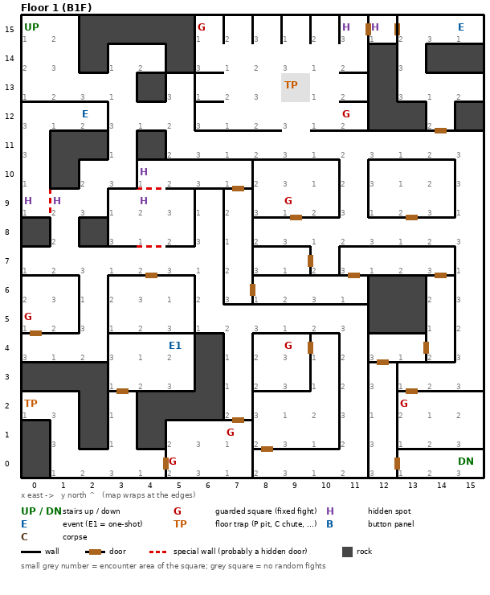

# Floor 1: map, squares, monsters

The first floor of the maze (B1F), the one every new party starts on. Map drawn from the game's own floor data;
the walls were checked against the game at the entrance (verified). Notation: [README.md](README.md#notation-and-style-binding-for-every-design-document).
General rules for squares, traps, events and chests: [dungeon.md](dungeon.md).

Regenerate the map with `python3 tools/designtables/floormap.py 1`.

## 1. Overview

- **16 × 16 squares**, wrapping at the edges like every floor. 37 squares are solid rock; the rest is corridors and
  rooms, joined by about 19 doors (computed from the map).
- **Entrance and exit:** the stairs up at (0, 15) lead back to town; the party arrives there facing south (verified).
  The stairs down to floor 2 are in the opposite corner at (15, 0).
- **8 guarded squares** with fixed fights (each fought once per visit to the floor, each with a chest), **3 events**
  (gold coins, a fairy, a magic circle), **2 pits** and **3 pairs of hidden spots**.
- **Random fights** come from three encounter areas that alternate square by square, so every corridor mixes all
  three monster sets. The chance per action is low, much higher right after a door
  ([monsters.md](monsters.md)).
- **Monsters:** levels 1-2, 1 to 7 per group: Kobolds, Goblins, Skeletons, Zombies, Orcs, a Banshee.

## 2. Squares

| Square (x, y) | What | Details |
|---|---|---|
| (0, 15) | Stairs up | To town. Start of every trip. |
| (15, 0) | Stairs down | To floor 2, same (x, y). |
| (5, 4) | Gold coins (one-shot event) | "Gold coins lie scattered. Pick them up?" They are either gold or they come alive (a fight). Once per visit to the floor. The amount of gold was not traced. |
| (2, 12) | Fairy (event) | A fairy who flees, unless the party carries the Fairy's Heart; then she offers a trip to her twin on floor 11 for 1 G. |
| (15, 15) | Magic circle (event) | "A strange pattern..." With a Summoner in the party (able to act), the circle offers a pact: the Zombie summon, from Summoner level 3 ([spells.md](spells.md)). |
| (0, 2), (9, 13) | Pit (floor trap) | Damage not traced; a floating party is not affected ([dungeon.md](dungeon.md)). (9, 13) also has no random fights. |
| (0, 9) + (1, 9), (4, 9) + (4, 10), (11, 15) + (12, 15) | Hidden spots, in pairs | Members may "notice something" (Thieves are best at it). Each pair sits on both sides of the same wall; the first two pairs face each other across a special wall (dashed red on the map), so they are probably hidden doors (inferred). How hard each one is was not traced. |
| (6, 15), (7, 1), (0, 5), (9, 9) | Guarded square, area 1 | Fixed fight drawn from area 1, then a chest. |
| (5, 0), (13, 2), (11, 12) | Guarded square, area 2 | Fixed fight from area 2, then a chest. |
| (9, 4) | Guarded square, area 3 | Fixed fight from area 3, then a chest. |

Guarded squares and the gold coins come back every time the party changes floor (for example down to floor 2 and
straight back up): a renewable source of fights and chests ([findings.md](findings.md#guards-and-one-shot-events-re-arm-on-every-floor-change)).

## 3. Monsters

A fight picks one of the area's four formations at random. Group sizes are rolled per fight.

| Area | Formations (one is picked) |
|---|---|
| 1 | Crawling Claw ×1-4, or Eye Wing ×1-4, or Gas Cloud ×1-4, or Banshee ×1 |
| 2 | Creeping Coin ×1-2, or Skeleton ×1-4, or Orc ×1-2, or Zombie ×1-2 |
| 3 | Kobold King ×1-2, or Dryad ×1-2, or Kobold ×1-7, or Goblin ×1-4 |

| Monster | Lv | HP | AC | Damage | Special | EXP | Gold |
|---|---|---|---|---|---|---|---|
| Crawling Claw | 1 | 1d6 | 8 | 1d4 | - | 30 | 20 |
| Eye Wing | 1 | 1d4 | 7 | 1d4 | flees 10% | 50 | 20 |
| Gas Cloud | 1 | 1d7 | 8 | 1d6 | - | 120 | 20 |
| Banshee | 1 | 3d3 | 8 | 1d4 | fear | 270 | 30 |
| Creeping Coin | 1 | 1 | 7 | 1d2 | lightning breath; calls for help 65% | 260 | 20 |
| Skeleton | 1 | 1d5 | 9 | 1d7 | - | 270 | 20 |
| Orc | 1 | 1d7 | 8 | 2d3 | calls 25%, flees 10% | 210 | 20 |
| Zombie | 1 | 2d5 | 8 | 1d8 | calls 25% | 230 | 30 |
| Kobold King | 2 | 4d8 | 6 | 3d3 | calls 25%, flees 10% | 240 | 30 |
| Dryad | 2 | 2d8 | 5 | 1d4 | flees 50% | 250 | 30 |
| Kobold | 1 | 1d4 | 7 | 2d2 | calls 25%, flees 20% | 230 | 20 |
| Goblin | 2 | 1d7 | 6 | 1d7 | calls 25%, flees 10% | 290 | 30 |

All monsters here swing once per round. Full stats: [monsters_table.md](monsters_table.md).

**Notes for play:** a level-1 Fighter needs 1,200 EXP for level 2 ([characters.md](characters.md)); how EXP is
shared in the party: [combat.md](combat.md). The Creeping Coin's lightning breath and the Banshee's fear are the only special attacks on the floor. The
Kobold King and Dryad (level 2, up to 32 HP) are the toughest regular monsters.

## 4. Open questions

- How much gold the coins give, and the odds that they come alive instead.
- Pit damage.
- How hard each hidden spot is to notice, and what noticing it opens.
- What the special walls between the hidden-spot pairs do.

Tech: [dungeon.md §1 Map storage](../tech/dungeon.md#1-map-storage-and-cell-format), [§2 Square types](../tech/dungeon.md#2-square-types),
[§3 Event catalogue](../tech/dungeon.md#3-event-catalogue), [§4 Floors](../tech/dungeon.md#4-floors); map generator
`tools/designtables/floormap.py`.
