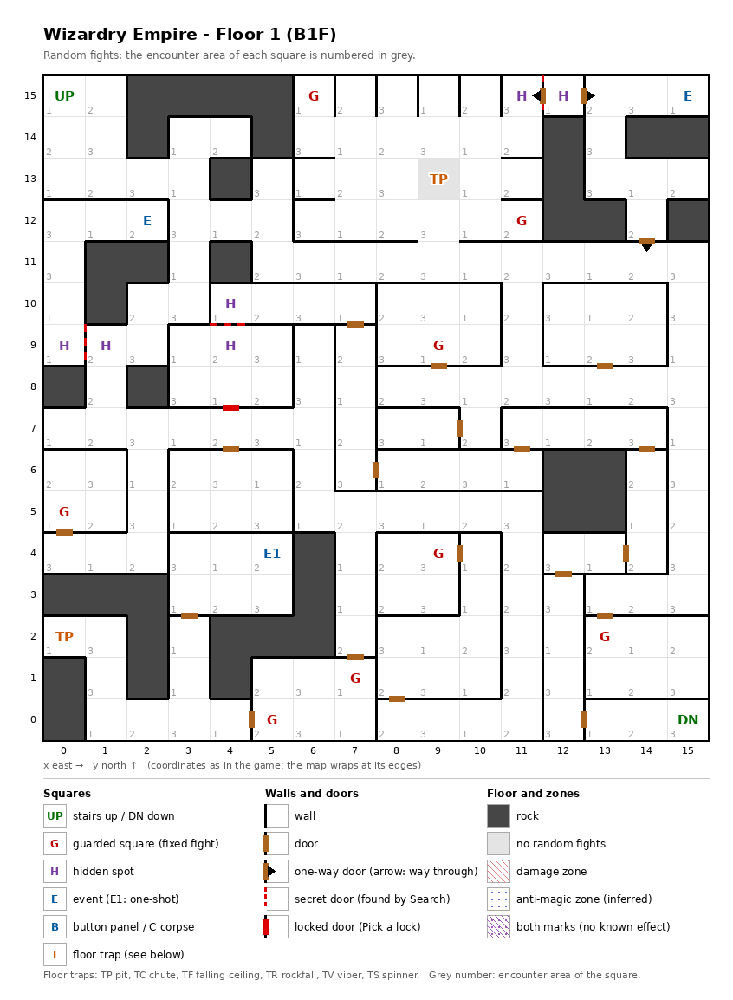

# Floor 1: map, squares, monsters

The first floor of the maze (B1F), the one every new party starts on. How to read the map, coordinates and what
each kind of square does: [maps/README.md](README.md). The walls of this map were checked against the game at the
entrance (verified).

## 1. Overview

- 37 squares are solid rock; the rest is corridors and rooms, joined by 18 doors and 3 one-way doors (computed from the map).
- **Entrance and exit:** the stairs up at (0, 15) lead back to town; the party arrives there facing south (verified).
  The stairs down to floor 2 are in the opposite corner at (15, 0).
- **8 guarded squares**, **3 events** (gold coins, a fairy, a magic circle), **2 pits** and **3 pairs of hidden
  spots**.
- **Random fights** come from three encounter areas (1, 2, 3) that alternate square by square; one square, the pit
  at (9, 13), has none.
- **Monsters:** levels 1-2, 1 to 7 per group: Kobolds, Goblins, Skeletons, Zombies, Orcs, a Banshee.

## 2. Squares

| Square (x, y) | What | On this floor |
|---|---|---|
| (0, 15) | Stairs up | To town. Start of every trip. |
| (15, 0) | Stairs down | To floor 2. |
| (5, 4) | Gold coins (one-shot event) | "Gold coins lie scattered. Pick them up?" They are either gold or they come alive (a fight). |
| (2, 12) | Fairy (event) | Flees, unless the party carries the Fairy's Heart; then she offers a trip to her twin on floor 11 for 1 G. |
| (15, 15) | Magic circle (event) | "A strange pattern..." With a Summoner in the party, a pact for the Zombie summon, from Summoner level 3 ([spells.md](../spells.md)). |
| (0, 2), (9, 13) | Pit | |
| (12, 15) → (13, 15), (14, 12) → (14, 11), (12, 15) → (11, 15) | One-way doors | Passable only in the direction given; the first two were tested in the game (verified). The third is a special wall seen from (11, 15). |
| (0, 9) + (1, 9), (4, 9) + (4, 10) | Hidden spots, in pairs | Each pair faces the other across a special wall: probably hidden doors (inferred). |
| (11, 15) + (12, 15) | Hidden spots, a pair | On both sides of a one-way door (special wall seen from the west). |
| (6, 15), (7, 1), (0, 5), (9, 9) | Guarded square | Fight from area 1, then a chest. |
| (5, 0), (13, 2), (11, 12) | Guarded square | Fight from area 2, then a chest. |
| (7, 1) + (5, 0) | Guarded squares sharing one mark | Both use the same once-per-visit mark: after one is fought, the other probably stays quiet until the next floor change (inferred). |
| (9, 4) | Guarded square | Fight from area 3, then a chest. |

## 3. Monsters

| Area | Formations (one is picked per fight) |
|---|---|
| 1 | Crawling Claw ×1-4, or Eye Wing ×1-4, or Gas Cloud ×1-4, or Banshee ×1 |
| 2 | Creeping Coin ×1-2, or Skeleton ×1-4, or Orc ×1-2, or Zombie ×1-2 |
| 3 | Kobold King ×1-2, or Dryad ×1-2, or Kobold ×1-7, or Goblin ×1-4 |

| Monster | Lv | HP | AC | Damage | Special | EXP | Gold |
|---|---|---|---|---|---|---|---|
| Crawling Claw | 1 | 1d6 | 8 | 1d4 | - | 30 | 20 |
| Eye Wing | 1 | 1d4 | 7 | 1d4 | flees 10% | 50 | 20 |
| Gas Cloud | 1 | 1d7 | 8 | 1d6 | - | 120 | 20 |
| Banshee | 1 | 3d3 | 8 | 1d4 | fear | 270 | 30 |
| Creeping Coin | 1 | 1 | 7 | 1d2 | lightning breath; calls for help 65% | 260 | 20 |
| Skeleton | 1 | 1d5 | 9 | 1d7 | - | 270 | 20 |
| Orc | 1 | 1d7 | 8 | 2d3 | calls 25%, flees 10% | 210 | 20 |
| Zombie | 1 | 2d5 | 8 | 1d8 | calls 25% | 230 | 30 |
| Kobold King | 2 | 4d8 | 6 | 3d3 | calls 25%, flees 10% | 240 | 30 |
| Dryad | 2 | 2d8 | 5 | 1d4 | flees 50% | 250 | 30 |
| Kobold | 1 | 1d4 | 7 | 2d2 | calls 25%, flees 20% | 230 | 20 |
| Goblin | 2 | 1d7 | 6 | 1d7 | calls 25%, flees 10% | 290 | 30 |

All of them swing once per round. Full stats: [monsters_table.md](../monsters_table.md).

**Notes for play:** the Creeping Coin's lightning breath and the Banshee's fear are the only special attacks on
the floor. The Kobold King and Dryad (level 2, up to 32 and 16 HP) are the toughest regular monsters. The
guarded squares re-arm on every floor change, so the down-and-up trip at (15, 0) is a way to repeat their fights and
chests.

## 4. Open questions

- How much gold the coins give, and the odds that they come alive instead.
- How hard each hidden spot here is to notice, and what noticing it opens.

Tech: [dungeon.md §4 Floors](../../tech/dungeon.md#4-floors), [§3 Event catalogue](../../tech/dungeon.md#3-event-catalogue);
`python3 tools/designtables/floormap.py 1 --list`.
