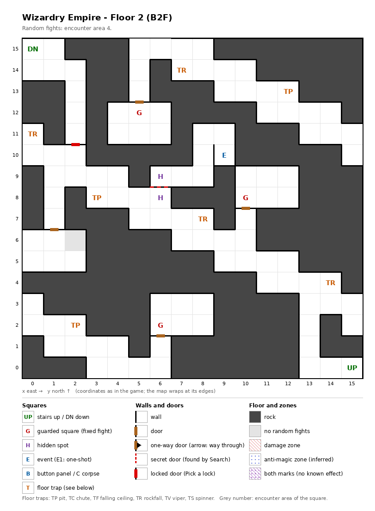

# Floor 2: map, squares, monsters

The second floor of the maze (B2F), a narrow cave cut mostly out of solid rock; how to read the map, coordinates and
what each kind of square does: [maps/README.md](README.md).

## 1. Overview

- 142 squares are solid rock; the other 114 are winding corridors and a few small rooms, joined by only 4 doors,
  plus 1 secret door and 1 locked door (computed from the map).
- **Stairs:** up at (15, 0), back to floor 1's down stairs; down at (0, 15), in the opposite corner, to floor 3.
- **Route** (computed from the map): the stairs down lie behind the locked door (2, 10) ↔ (2, 11), and Murphy behind
  the secret door between the hidden spots (6, 8) and (6, 9). With both shut the party reaches 99 of the 114 open
  squares from the up stairs; with both open, every square.
- **3 guarded squares**, **1 event** (Murphy, a recruitable adventurer), **7 traps** (4 rockfall, 3 pits) and **one
  pair of hidden spots**.
- **Random fights** come from encounter area 4 on every open square except (2, 6), which has none.
- **Monsters:** levels 1-6, 1 to 3 groups of up to 6: Kobolds with Kobold Kings, Orcs with an Orc Lord, Goblins with
  a Goblin King, or a lone Minotaur.

## 2. Squares

| Square (x, y) | What | On this floor |
|---|---|---|
| (15, 0) | Stairs up | To floor 1 (its down stairs, same square). |
| (0, 15) | Stairs down | To floor 3. Behind the locked door at (2, 10) ↔ (2, 11). |
| (9, 10) | Murphy (event) | A recruitable adventurer: he offers to join ("Add Murphy?") if the roster has fewer than 20 characters and a condition of his own (not traced) is met ([dungeon.md](../dungeon.md#7-events)). Behind the secret door at (6, 8) ↔ (6, 9). |
| (7, 14), (0, 11), (8, 7), (14, 4) | Rockfall | Damage; amount not traced. |
| (12, 13), (3, 8), (2, 2) | Pit | |
| (6, 8) + (6, 9) | Hidden spots, a pair | Each faces the secret door between them; Search here, facing the other spot, finds it (from (6, 8) facing north). Noticing difficulty 25. Behind it: Murphy's room, 7 squares from (6, 9) to (9, 11) (computed from the map). |
| (2, 10) ↔ (2, 11) | Locked door | Difficulty 10: a Thief has a real chance from level 3 (computed). Pick it from (2, 10) facing north. Behind it: the stairs down, in an 8-square pocket from (2, 11) to (0, 15) (computed from the map). |
| (5, 12), (10, 8), (6, 2) | Guarded square | Fight from area 4, then a chest. |

**Secret and locked doors** (rules: [dungeon.md](../dungeon.md) §3.6): Search finds a secret door every time;
noticing a hidden spot first is only a hint, and the noticing difficulty is what a member's noticing skill must beat
for it (§3.3). A lock of difficulty D gives a Thief a real chance from level D/5 + 1: there 10% + AGI, then 10% more
per level, at most 95%; at level D/5 only about 1%. A Ninja needs 5 levels more, a Kunoichi 10 (computed from the
rule). Found and picked doors stay open for good (inferred).

## 3. Monsters

| Area | Where | Formations (one of 4 slots picked per fight) |
|---|---|---|
| 4 | every square but (2, 6); all 3 guarded squares | Minotaur ×1, or Kobold ×2-6 + Kobold King ×2 + Kobold ×1-6, or Orc ×2-5 + Orc Lord ×1-2, or Goblin ×2-5 + Goblin King ×1-2 |

| Monster | Lv | HP | AC | Swings | Damage | Special | Spells | EXP | Gold |
|---|---|---|---|---|---|---|---|---|---|
| Minotaur | 6 | 10d8 | 6 | 1 | 2d10+1 | - | - | 680 | 70 |
| Kobold | 1 | 1d4 | 7 | 1 | 2d2 | calls 25%, flees 20% | - | 230 | 20 |
| Kobold King | 2 | 4d8 | 6 | 1 | 3d3 | calls 25%, flees 10% | - | 240 | 30 |
| Orc | 1 | 1d7 | 8 | 1 | 2d3 | calls 25%, flees 10% | - | 210 | 20 |
| Orc Lord | 3 | 3d4+14 | 4 | 3 | 2d8+2 | flees 10% | - | 320 | 30 |
| Goblin | 2 | 1d7 | 6 | 1 | 1d7 | calls 25%, flees 10% | - | 290 | 30 |
| Goblin King | 3 | 5d8 | 4 | 2 | 2d7 | calls 25%, flees 10% | - | 330 | 40 |

Full stats: [monsters_table.md](../monsters_table.md).

**Notes for play:** the Minotaur comes alone but is the big step up from floor 1: level 6, up to 80 HP, 2d10+1 per
hit, and with reach it attacks the back row from the front groups
([combat.md](../combat.md#8-monster-reach-and-targets)). The Orc Lord swings three times a round. The Kobold formation brings up to 14 monsters in three groups
(computed: 6 + 2 + 6). The guards here still give Leather bags only
([dungeon.md](../dungeon.md#54-chest-quality-by-floor)). Seven trap squares sit on a floor of narrow corridors. Going down
needs the lock at (2, 10) ↔ (2, 11) picked: a Thief of level 3 has 10% + AGI per try (computed).

## 4. Open questions

- The damage of the rockfall and pit squares (each carries a trap strength of 2; what strength does for these traps
  was not traced).
- Murphy's own join condition.

Tech: [dungeon.md §4 Floors](../../tech/dungeon.md#4-floors), [§3 Event catalogue](../../tech/dungeon.md#3-event-catalogue),
[§2.1 Secret and locked doors](../../tech/dungeon.md#21-secret-and-locked-doors-wall-value-3);
`python3 tools/designtables/floormap.py 2 --list`.
