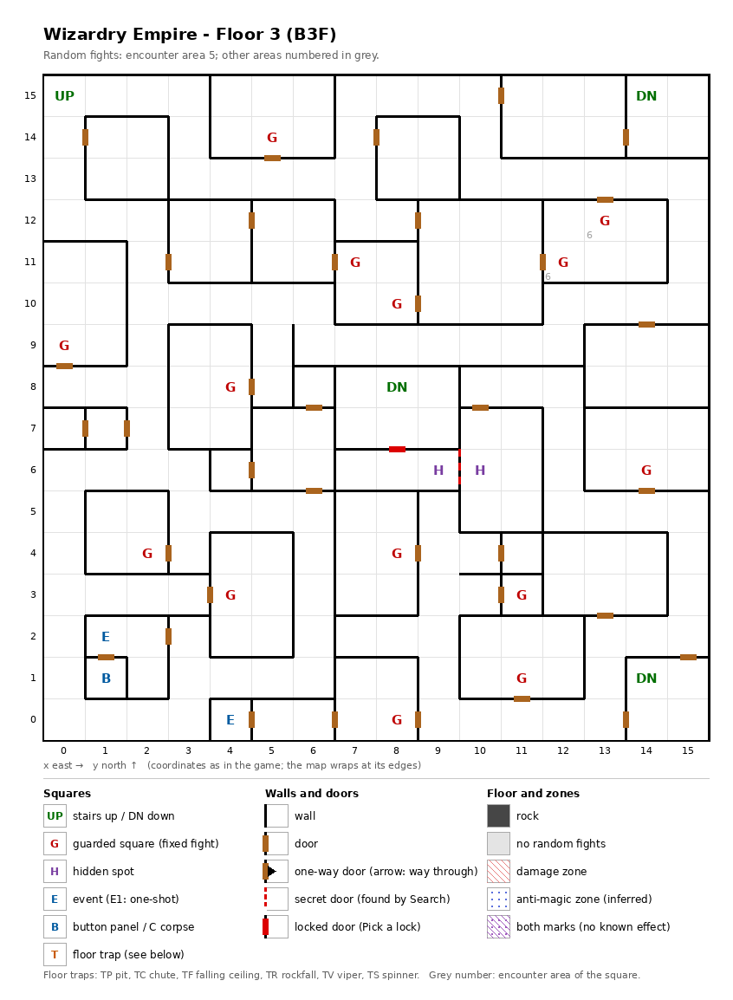

# Floor 3: map, squares, monsters

The third floor of the maze (B3F), a tangle of small walled rooms with three stairs down; how to read the map,
coordinates and what each kind of square does: [maps/README.md](README.md).

## 1. Overview

- No solid rock: all 256 squares are open, split by walls into small rooms joined by 36 doors, plus 1 secret
  door and 1 locked door (computed from the map).
- **Stairs:** up at (0, 15) to floor 2; **three stairs down**, at (14, 15), (8, 8) and (14, 1), each landing on one
  of floor 4's three up stairs at the same square.
- **Two halves** (computed from the map): from the up stairs the party reaches 175 squares, with only the stairs down
  at (14, 15), even with every secret and locked door open. The south-east part (81 squares: the stairs down at
  (8, 8) and (14, 1), the Ghoul circle, the hidden pair, 5 guards) has no way in on foot from that half; it is
  entered from floor 4, by its up stairs at (14, 1) ([floor-04.md](floor-04.md)). Arriving there, the party reaches
  72 of its 81 squares; the stairs down at (8, 8) lie behind the secret door (10, 6) ↔ (9, 6) and then the locked
  door (8, 6) ↔ (8, 7).
- **14 guarded squares**, **2 events** (the Ghoul magic circle, a key-hole door), **a button panel** and **one pair
  of hidden spots**; no traps.
- **Random fights** come from encounter area 5. The two guarded squares (13, 12) and (12, 11) carry area 6, the
  monsters of floor 4.
- **Monsters:** levels 1-8, 1 or 2 groups of up to 4 (area 5): Skeletons with Skeleton Warriors, Mudmen, Treants,
  Cerberus.

## 2. Squares

| Square (x, y) | What | On this floor |
|---|---|---|
| (0, 15) | Stairs up | To floor 2. |
| (14, 15), (8, 8), (14, 1) | Stairs down | To floor 4, onto the up stairs at the same square. (8, 8) is behind the secret door at (10, 6) ↔ (9, 6) and the locked door at (8, 6) ↔ (8, 7). |
| (4, 0) | Magic circle (event) | "A strange pattern..." With a Summoner in the party, a pact for the Ghoul summon, from Summoner level 4 ([spells.md](../spells.md#6-summoner-pacts)). |
| (1, 1) | Button panel | "A row of buttons. Which one will you press? A B C D E": the Maze Elevator (inferred); where the buttons lead was not traced. |
| (1, 2) | Key-hole (event) | On the square in front of the door to the panel's room: "Beside the door is a hole for slipping something in". The door is inferred to need an item; which one was not traced. |
| (10, 6) + (9, 6) | Hidden spots, a pair | Each faces the secret door between them; Search here, facing the other spot, finds it (from (10, 6) facing west). Noticing difficulty 20. Behind it, seen from the stairs at (14, 1): 3 squares, (7, 6) to (9, 6), in front of the locked door below (computed from the map). |
| (8, 6) ↔ (8, 7) | Locked door | Difficulty 15: a Thief has a real chance from level 4 (computed). Pick it from (8, 6) facing north. Behind it: the 6-square room (7, 7) to (9, 8) with the stairs down at (8, 8) (computed from the map). |
| (13, 12) + (12, 11) | Guarded squares, a pair | Fight from area 6, then a chest. One once-per-visit mark for both (below). |
| (7, 11) + (8, 10), (4, 8) + (14, 6) | Guarded squares, pairs | Fight from area 5, then a chest. One once-per-visit mark per pair (below); (4, 8) and (14, 6) lie in different halves. |
| (5, 14), (0, 9), (2, 4), (8, 4), (4, 3), (11, 3), (11, 1), (8, 0) | Guarded square | Fight from area 5, then a chest. |

**Paired guards:** the squares of a pair share one once-per-visit mark, so after one has fought, the other probably
stays quiet until the next floor change (inferred, not tested). The floor then holds 11 guard fights per visit, not 14.

**Secret and locked doors** (rules: [dungeon.md](../dungeon.md) §3.6): Search finds a secret door every time;
noticing a hidden spot first is only a hint, and the noticing difficulty is what a member's noticing skill must beat
for it (§3.3). A lock of difficulty D gives a Thief a real chance from level D/5 + 1: there 10% + AGI, then 10% more
per level, at most 95%; at level D/5 only about 1%. A Ninja needs 5 levels more, a Kunoichi 10 (computed from the
rule). Found and picked doors stay open for good (inferred).

## 3. Monsters

| Area | Where | Formations (one of 4 slots picked per fight) |
|---|---|---|
| 5 | every square except the two area-6 guards (254 squares); 12 guarded squares | Skeleton ×1-4 + Skel.Warrior ×3-4, or Mudman ×1-4 + Mudman ×0-3, or Treant ×2-3, or Cerberus ×1-2 + Cerberus ×1 |
| 6 | guarded squares only: (13, 12) and (12, 11) | Zombie ×2-6 + Zombie Lord ×2-3, or Kobold ×5-8 + Kobold King ×4-8 + Kobold ×5-8, or Dark Elf ×2-5 + Dark Elf ×3, or Dark Elf ×3 + Dark Elf ×2-5 |

| Monster | Lv | HP | AC | Swings | Damage | Special | Spells | EXP | Gold |
|---|---|---|---|---|---|---|---|---|---|
| Skeleton | 1 | 1d5 | 9 | 1 | 1d7 | - | - | 270 | 20 |
| Skel.Warrior | 4 | 7d8 | 4 | 2 | 2d9 | - | - | 370 | 40 |
| Mudman | 1 | 2d5 | 10 | 1 | 1d5 | stone | - | 250 | 20 |
| Treant | 8 | 10d8 | 2 | 2 | 3d7 | - | - | 710 | 80 |
| Cerberus | 7 | 10d8 | -2 | 3 | 3d9 | - | - | 730 | 70 |
| Zombie | 1 | 2d5 | 8 | 1 | 1d8 | calls 25% | - | 230 | 30 |
| Zombie Lord | 6 | 8d8 | 6 | 2 | 3d5 | calls 25% | - | 610 | 60 |
| Kobold | 1 | 1d4 | 7 | 1 | 2d2 | calls 25%, flees 20% | - | 230 | 20 |
| Kobold King | 2 | 4d8 | 6 | 1 | 3d3 | calls 25%, flees 10% | - | 240 | 30 |
| Dark Elf | 4 | 5d8 | 4 | 1 | 1d9 | calls 25%, flees 10% | Mage 3 | 410 | 40 |

Full stats: [monsters_table.md](../monsters_table.md).

**Notes for play:** Cerberus (AC −2, three swings of 3d9, up to 80 HP) and the level-8 Treant are the toughest
monsters so far. The Mudman's hit can turn a member to stone: it is the first monster in the maze with that special
hit (computed from the bestiary). Mudmen and Treants have reach and Dark Elves are ranged, so all three can
attack the back row ([combat.md](../combat.md#8-monster-reach-and-targets)). The two area-6 guards can bring the Kobold horde, up to 24 monsters (computed:
8 + 8 + 8). The guards still give Leather bags only ([dungeon.md](../dungeon.md#54-chest-quality-by-floor)).

## 4. Open questions

- Which item the key-hole at (1, 2) takes, and where the buttons at (1, 1) lead.
- Whether paired guarded squares really share one fight (from the data; not tested in the game).

Tech: [dungeon.md §4 Floors](../../tech/dungeon.md#4-floors), [§3 Event catalogue](../../tech/dungeon.md#3-event-catalogue),
[§2 Square types](../../tech/dungeon.md#2-square-types), [§2.1 Secret and locked doors](../../tech/dungeon.md#21-secret-and-locked-doors-wall-value-3);
`python3 tools/designtables/floormap.py 3 --list`.
