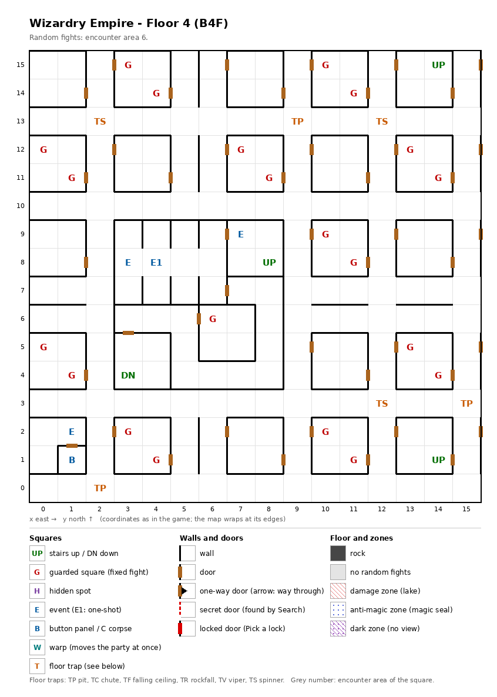

# Floor 4: map, squares, monsters

The fourth floor of the maze (B4F), a regular grid of small rooms that holds the most guarded squares of any floor;
how to read the map, coordinates and what each kind of square does: [maps/README.md](README.md).

## 1. Overview

- No solid rock: small rooms (most of them 2 × 2 squares) in a grid of straight corridors, joined by 46 doors;
  no one-way, secret or locked doors (computed from the map).
- **Stairs:** three up, at (14, 15), (8, 8) and (14, 1), back to floor 3's three down stairs; one down at (3, 4), to
  floor 5.
- **Route** (computed from the map): the outer grid (220 squares, up stairs (14, 15) and (14, 1), 20 guards) and the
  walled centre (36 squares: up stairs (8, 8), stairs down (3, 4), the robed monster, the sign, the guard at (6, 6))
  do not connect: the centre has no way in on foot from the grid. The way down zig-zags: floor 3 (14, 15) → here →
  up at (14, 1) to the walled-off half of floor 3 → through its secret door (10, 6) ↔ (9, 6) and its locked door
  (8, 6) ↔ (8, 7), difficulty 15 → down at (8, 8) into the centre → down at (3, 4)
  ([floor-03.md](floor-03.md)). So the way to floor 5 needs a member who can pick a lock of difficulty 15 (a Thief
  from level 4, computed).
- **21 guarded squares** (the most of any floor), **3 events** (a weird robed monster, its drop, a sign), **a button
  panel with a key-hole**, **6 traps** (3 spinners, 3 pits); no hidden spots.
- **Random fights** come from encounter area 6 on every square.
- **Monsters:** levels 1-6, 2 or 3 groups of up to 8: Zombies with Zombie Lords, Kobold hordes with Kobold Kings,
  Dark Elves.

## 2. Squares

| Square (x, y) | What | On this floor |
|---|---|---|
| (14, 15), (8, 8), (14, 1) | Stairs up | To floor 3, onto its down stairs at the same square. |
| (3, 4) | Stairs down | To floor 5. |
| (4, 8) | Weird robed monster (one-shot event) | "A weird robed monster cries out": a fight; the monster drops something. |
| (3, 8) | Monster's drop (event) | Next to the robed monster: "You found what the monster dropped earlier". What it drops was not traced. |
| (7, 9) | Sign (event) | Its text was not traced. |
| (1, 1) | Button panel | Buttons A-E: the Maze Elevator (inferred); where they lead was not traced. |
| (1, 2) | Key-hole (event) | In front of the door to the panel's room; the door is inferred to need an item (not traced which). |
| (2, 13), (12, 13), (12, 3) | Spinner | |
| (9, 13), (15, 3), (2, 0) | Pit | |
| (3, 15) + (4, 14), (10, 15) + (11, 14), (0, 12) + (1, 11), (7, 12) + (8, 11), (13, 12) + (14, 11), (10, 9) + (11, 8), (0, 5) + (1, 4), (13, 5) + (14, 4), (3, 2) + (4, 1), (10, 2) + (11, 1) | Guarded squares, 10 pairs | Fight from area 6, then a chest. The two squares of a pair sit in opposite corners of one room and share one once-per-visit mark (below). |
| (6, 6) | Guarded square | Fight from area 6, then a chest. |

**Paired guards:** the squares of a pair share one once-per-visit mark, so after one has fought, the other probably
stays quiet until the next floor change (inferred, not tested). The floor then holds 11 guard fights per visit, not 21.

## 3. Monsters

| Area | Where | Formations (one of 4 slots picked per fight) |
|---|---|---|
| 6 | every square; all 21 guarded squares | Zombie ×2-6 + Zombie Lord ×2-3, or Kobold ×5-8 + Kobold King ×4-8 + Kobold ×5-8, or Dark Elf ×2-5 + Dark Elf ×3, or Dark Elf ×3 + Dark Elf ×2-5 |

| Monster | Lv | HP | AC | Swings | Damage | Special | Spells | EXP | Gold |
|---|---|---|---|---|---|---|---|---|---|
| Zombie | 1 | 2d5 | 8 | 1 | 1d8 | calls 25% | - | 230 | 30 |
| Zombie Lord | 6 | 8d8 | 6 | 2 | 3d5 | calls 25% | - | 610 | 60 |
| Kobold | 1 | 1d4 | 7 | 1 | 2d2 | calls 25%, flees 20% | - | 230 | 20 |
| Kobold King | 2 | 4d8 | 6 | 1 | 3d3 | calls 25%, flees 10% | - | 240 | 30 |
| Dark Elf | 4 | 5d8 | 4 | 1 | 1d9 | calls 25%, flees 10% | Mage 3 | 410 | 40 |

Full stats: [monsters_table.md](../monsters_table.md).

**Notes for play:** two of the four formations are all Dark Elves, ranged Mage-spell casters in two groups of up to
5 and 3, so the back row is not safe from them
([combat.md](../combat.md#8-monster-reach-and-targets)). The Kobold horde brings up to 24 monsters in three groups (computed:
8 + 8 + 8). The many guards give Leather bags only ([dungeon.md](../dungeon.md#54-chest-quality-by-floor)). The
robed monster at (4, 8) stands right next to the square where its drop is found, both in the walled centre on the
way down.

## 4. Open questions

- The robed monster's fight (which monsters) and what it drops.
- The text of the sign at (7, 9); which item the key-hole at (1, 2) takes; where the buttons at (1, 1) lead.
- The damage of the pits (each carries a trap strength of 4; what strength does for a pit was not traced).
- Whether paired guarded squares really share one fight (from the data; not tested in the game).

Tech: [dungeon.md §4 Floors](../../tech/dungeon.md#4-floors), [§3 Event catalogue](../../tech/dungeon.md#3-event-catalogue),
[§2 Square types](../../tech/dungeon.md#2-square-types), [§2.1 Secret and locked doors](../../tech/dungeon.md#21-secret-and-locked-doors-wall-value-3);
`python3 tools/designtables/floormap.py 4 --list`.
