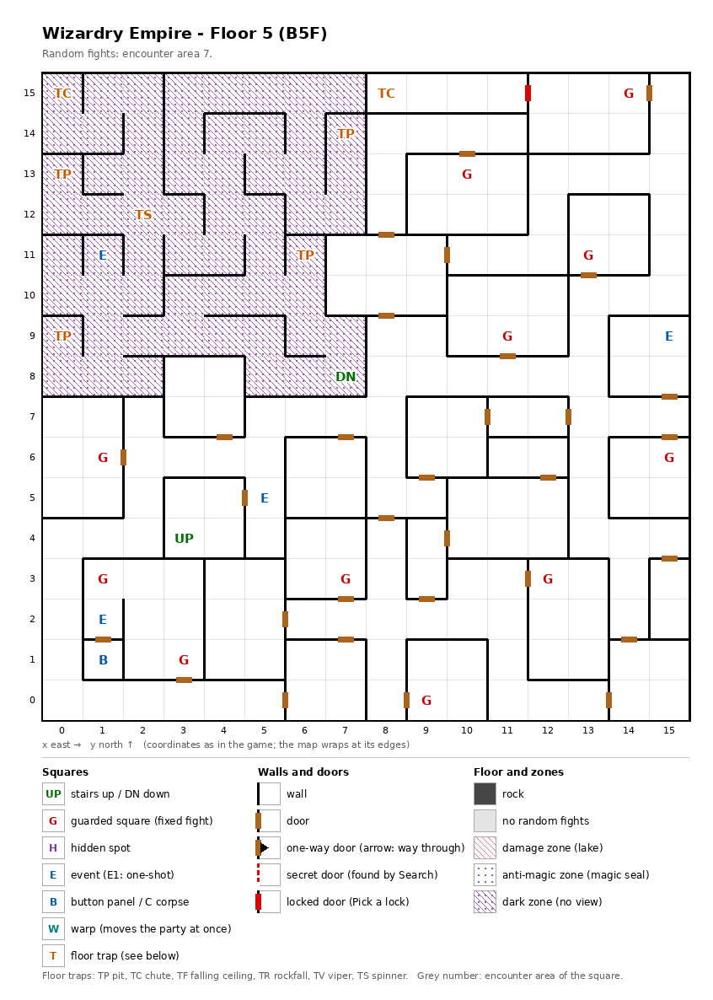

# Floor 5: map, squares, monsters

The fifth floor of the maze (B5F), whose north-west quarter is a closed block of traps under a zone mark with no
known effect; how to read the map, coordinates and what each kind of square does: [maps/README.md](README.md).

## 1. Overview

- No solid rock: rooms and corridors joined by 31 doors and 1 locked door; no one-way or secret doors (computed
  from the map).
- **Stairs:** up at (3, 4), back to floor 4; down at (7, 8), to floor 6, at the corner of the north-west block.
  Two **chutes** also drop the party to a lower floor (how far: not traced).
- **11 guarded squares**, **4 events** (Lloyd, a recruitable adventurer; the Lion of Hell magic circle; a monster on
  the ceiling; a key-hole door), **a button panel**, **7 traps** (2 chutes, 4 pits, a spinner); no hidden spots.
- **The north-west block:** 60 squares (x 0-7, y 8-15, except (3, 8), (4, 8), (7, 10) and (7, 11)) carry both zone
  marks, which have no known effect beyond a different set of wall pictures
  ([findings](../findings.md#33-dark-zones-are-not-drawn-on-the-auto-map)). Inside are six of the traps, Lloyd and the stairs
  down. By the map's walls the block is **closed**: no square of it connects to the rest of the floor, and it has no
  secret or locked door, so it has no way in on foot (computed from the map, not tested). It is entered from floor
  6, by its up stairs at (7, 8). From the up stairs at (3, 4) the party reaches 192 of the 196 squares outside the
  block; the only way down on foot is the chute at (8, 15), behind the locked door (12, 15) ↔ (11, 15).
- **Random fights** come from encounter area 7 on every square. **Monsters:** levels 1-8, 2 to 4 groups of up to 7.

## 2. Squares

| Square (x, y) | What | On this floor |
|---|---|---|
| (3, 4) | Stairs up | To floor 4. |
| (7, 8) | Stairs down | To floor 6. Inside the north-west block. |
| (1, 11) | Lloyd (event) | A recruitable adventurer: he offers to join if the roster has fewer than 20 characters and a condition of his own (not traced) is met ([dungeon.md](../dungeon.md#7-events)). Inside the north-west block. |
| (15, 9) | Magic circle (event) | With a Summoner in the party, a pact for the Lion of Hell summon, from Summoner level 6 ([spells.md](../spells.md#6-summoner-pacts)). |
| (5, 5) | Small monster on the ceiling (event) | "Something clings to the ceiling: a small monster"; what follows was not traced. |
| (1, 1) | Button panel | Buttons A-E: the Maze Elevator (inferred); where they lead was not traced. |
| (1, 2) | Key-hole (event) | In front of the door to the panel's room; the door is inferred to need an item (not traced which). |
| (0, 15), (8, 15) | Chute | Drops the party to a lower floor; how far was not traced. (0, 15) is inside the block, (8, 15) just outside it, behind the locked door at (12, 15) ↔ (11, 15). |
| (12, 15) ↔ (11, 15) | Locked door | Difficulty 25: a Thief has a real chance from level 6 (computed). Pick it from (12, 15) facing west. Behind it: the 4-square corridor (8, 15) to (11, 15) that ends at the chute (computed from the map). |
| (7, 14), (0, 13), (6, 11), (0, 9) | Pit | All inside the block. |
| (2, 12) | Spinner | Inside the block. |
| (1, 3) + (3, 1) | Guarded squares, a pair | Fight from area 7, then a chest. The two share one once-per-visit mark: after one has fought, the other probably stays quiet until the next floor change (inferred, not tested). |
| (14, 15), (10, 13), (13, 11), (11, 9), (1, 6), (15, 6), (7, 3), (12, 3), (9, 0) | Guarded square | Fight from area 7, then a chest. |

**Locked doors** (rules: [dungeon.md](../dungeon.md) §3.6): a lock of difficulty D gives a Thief a real chance from
level D/5 + 1: there 10% + AGI, then 10% more per level, at most 95%; at level D/5 only about 1%. A Ninja needs 5
levels more, a Kunoichi 10 (computed from the rule). A picked lock stays open for good (inferred).

## 3. Monsters

| Area | Where | Formations (one of 4 slots picked per fight) |
|---|---|---|
| 7 | every square; all 11 guarded squares | Dryad ×3-4 + Treant ×2-4, or Ogre ×3-4 + Ogre Lord ×2-4, or Skeleton ×4 + Wight ×3 + Zombie ×1-4 + Ghoul ×0-3, or Goblin ×5-7 + Goblin King ×0-4 + Dark Elf ×3-4 |

| Monster | Lv | HP | AC | Swings | Damage | Special | Spells | EXP | Gold |
|---|---|---|---|---|---|---|---|---|---|
| Dryad | 2 | 2d8 | 5 | 1 | 1d4 | flees 50% | Mage 4 | 250 | 30 |
| Treant | 8 | 10d8 | 2 | 2 | 3d7 | - | - | 710 | 80 |
| Ogre | 3 | 4d8+2 | 5 | 2 | 1d10 | calls 25%, flees 10% | - | 300 | 30 |
| Ogre Lord | 7 | 10d8 | 4 | 3 | 2d10+8 | - | - | 670 | 70 |
| Skeleton | 1 | 1d5 | 9 | 1 | 1d7 | - | - | 270 | 20 |
| Wight | 6 | 4d8+5 | 8 | 1 | 1d5 | level drain 1 | - | 220 | 20 |
| Zombie | 1 | 2d5 | 8 | 1 | 1d8 | calls 25% | - | 230 | 30 |
| Ghoul | 3 | 2d8 | 6 | 3 | 1d4 | paralysis, flees 5% | - | 360 | 40 |
| Goblin | 2 | 1d7 | 6 | 1 | 1d7 | calls 25%, flees 10% | - | 290 | 30 |
| Goblin King | 3 | 5d8 | 4 | 2 | 2d7 | calls 25%, flees 10% | - | 330 | 40 |
| Dark Elf | 4 | 5d8 | 4 | 1 | 1d9 | calls 25%, flees 10% | Mage 3 | 410 | 40 |

Full stats: [monsters_table.md](../monsters_table.md).

**Notes for play:** the undead formation brings the first level drain of the maze, the Wight
([monsters.md](../monsters.md#2-the-bestiary)), and the Ghoul's paralysis. The Ogre Lord swings three times for
2d10+8 each, up to 84 a round (computed), in groups of 2 to 4. The guards give Leather bags at best
([dungeon.md](../dungeon.md#54-chest-quality-by-floor)). A party coming down from floor 4 meets none of the block's
traps; a party climbing up from floor 6 arrives inside the block, among six traps, with Lloyd. Dryads cast Mage
spells up to level 4 and Dark Elves up to level 3; Treants have reach and Dark Elves are ranged, so both can attack
the back row ([combat.md](../combat.md#8-monster-reach-and-targets)).

## 4. Open questions

- Where the two chutes land. The chute at (0, 15) sits directly above floor 6's chute at (0, 15), the one square of
  floor 6 that cannot be walked onto ([floor-06.md](floor-06.md)).
- What the small monster on the ceiling does; which item the key-hole at (1, 2) takes; where the buttons at (1, 1)
  lead; Lloyd's own join condition.
- The damage of the pits (each carries a trap strength of 5; what strength does for a pit was not traced).
- What the double zone mark does, if anything, and whether the block's walls (drawn with the other wall pictures) are as solid as they
  look. If they are, the block is reached only from floor 6.

Tech: [dungeon.md §4 Floors](../../tech/dungeon.md#4-floors), [§3 Event catalogue](../../tech/dungeon.md#3-event-catalogue),
[§1 Cell format and zones](../../tech/dungeon.md#1-map-storage-and-cell-format), [§2.1 Secret and locked doors](../../tech/dungeon.md#21-secret-and-locked-doors-wall-value-3);
`python3 tools/designtables/floormap.py 5 --list`.
