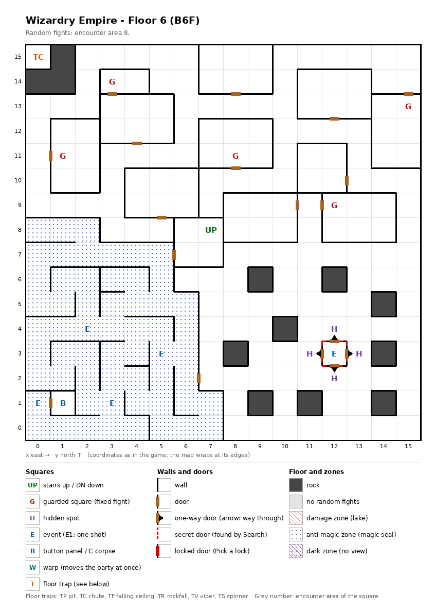

# Floor 6: map, squares, monsters

The sixth floor of the maze (B6F), with an anti-magic quarter, a hidden room for Louie and no stairs down; how to
read the map, coordinates and what each kind of square does: [maps/README.md](README.md).

## 1. Overview

- 12 squares are solid rock: a corner pocket around (0, 15) and nine single pillars in the south-east. The rest is
  rooms and corridors joined by 14 doors and 4 one-way doors, plus 4 secret doors and no locked doors; the one-way
  and the secret doors are the same four sides of Louie's room, seen from inside and from outside (computed from the
  map).
- **Stairs:** up at (7, 8), back to floor 5 (into its closed north-west block, [floor-05.md](floor-05.md)); **no
  stairs down**. The chute at (0, 15) is inferred to lead to floor 7 ([dungeon.md](../dungeon.md#2-how-floors-connect)),
  but it has a wall on all four sides, so the party cannot walk onto it (computed from the map, not tested).
- **Route** (computed from the map): from the up stairs the party reaches 242 of the 244 open squares with the secret
  doors shut. Louie's one-square room is behind any of its four secret doors; the chute at (0, 15) has no way in on
  foot even with them open.
- **5 guarded squares**, **5 events** (Louie, a recruitable adventurer; three alarms; a key-hole door), **a button
  panel**, **4 hidden spots** around Louie, one trap (the chute).
- **Anti-magic zone:** 58 squares in the south-west (x 0-7, y 0-8), with the three alarms and the key-hole inside.
  Entering it cancels the party's spell effects ([dungeon.md](../dungeon.md#34-zones-lake-magic-seal-dark-zone)).
- **Random fights** come from encounter area 8 on every square. **Monsters:** levels 1-8, 2 to 4 groups of up to 4.

## 2. Squares

| Square (x, y) | What | On this floor |
|---|---|---|
| (7, 8) | Stairs up | To floor 5. |
| (0, 15) | Chute | Drops the party to a lower floor (how far: not traced). Walled in on all four sides. |
| (12, 3) | Louie (event) | A recruitable adventurer: he offers to join if the roster has fewer than 20 characters and a condition of his own (not traced) is met ([dungeon.md](../dungeon.md#7-events)). His one-square room is closed by four secret doors. |
| (12, 3) → (12, 4), (13, 3), (12, 2), (11, 3) | One-way doors | Out of Louie's room in all four directions, so the way out is always open; seen from outside, each is a secret door. |
| (12, 4), (13, 3), (12, 2), (11, 3) | Hidden spots, a ring | Around Louie's room, each facing one of its secret doors; Search here, facing the room, finds it. Noticing difficulty 55. All four belong to one door mark, so finding one opens all four (from the data, not tested). |
| (2, 4), (5, 3), (3, 1) | Alarm (event) | "Suddenly an alarm blared": a fight from area 8. Inside the anti-magic zone. |
| (1, 1) | Button panel | Buttons A-E: the Maze Elevator (inferred); where they lead was not traced. |
| (0, 1) | Key-hole (event) | In front of the door to the panel's room, inside the anti-magic zone; the door is inferred to need an item (not traced which). |
| (3, 14), (15, 13), (1, 11), (8, 11), (12, 9) | Guarded square | Fight from area 8, then a chest. |

**Secret doors** (rules: [dungeon.md](../dungeon.md) §3.6): Search finds a secret door every time; noticing a hidden
spot first is only a hint, and the noticing difficulty is what a member's noticing skill must beat for it (§3.3). A
found door stays open for good (inferred).

## 3. Monsters

| Area | Where | Formations (one of 4 slots picked per fight) |
|---|---|---|
| 8 | every square; all 5 guarded squares and the 3 alarms | Lizard Man ×3-4 + Lizard King ×2-4, or Eye Wing ×3-4 + CrawlingClaw ×1-2 + Lion of Hell ×0-3 + Cerberus ×3, or Assassin ×4 + Dark Lord ×0-4 + Berserker ×0-2 + Warlock ×3, or Orc ×4 + Ogre ×1-2 + Dark Elf ×0-2 + Ogre Lord ×2-3 |

| Monster | Lv | HP | AC | Swings | Damage | Special | Spells | EXP | Gold |
|---|---|---|---|---|---|---|---|---|---|
| Lizard Man | 3 | 3d8+5 | 5 | 3 | 1d5 | flees 5% | - | 350 | 40 |
| Lizard King | 8 | 8d8+7 | 3 | 1 | 3d6+5 | - | - | 790 | 80 |
| Eye Wing | 1 | 1d4 | 7 | 1 | 1d4 | flees 10% | - | 50 | 20 |
| CrawlingClaw | 1 | 1d6 | 8 | 1 | 1d4 | - | - | 30 | 20 |
| Lion of Hell | 5 | 7d8 | 4 | 1 | 1d12+3 | - | - | 500 | 50 |
| Cerberus | 7 | 10d8 | -2 | 3 | 3d9 | - | - | 730 | 70 |
| Assassin | 3 | 7d6 | 6 | 1 | 2d7 | decapitation, flees 10% | - | 280 | 30 |
| Dark Lord | 3 | 7d8 | 3 | 1 | 1d9 | flees 10% | Priest 1 | 290 | 30 |
| Berserker | 4 | 7d8 | 4 | 2 | 2d9 | - | - | 400 | 40 |
| Warlock | 5 | 8d4 | 9 | 1 | 1d5 | flees 10% | Mage 3 | 480 | 50 |
| Orc | 1 | 1d7 | 8 | 1 | 2d3 | calls 25%, flees 10% | - | 210 | 20 |
| Ogre | 3 | 4d8+2 | 5 | 2 | 1d10 | calls 25%, flees 10% | - | 300 | 30 |
| Dark Elf | 4 | 5d8 | 4 | 1 | 1d9 | calls 25%, flees 10% | Mage 3 | 410 | 40 |
| Ogre Lord | 7 | 10d8 | 4 | 3 | 2d10+8 | - | - | 670 | 70 |

Full stats: [monsters_table.md](../monsters_table.md).

**Notes for play:** the Assassin's hit can decapitate (instant death), the first monster in the maze with that
special hit (computed from the bestiary); four of them come together. Every formation now has two to four groups.
The guards can give a Bronze chest, a step up from the Leather bags above
([dungeon.md](../dungeon.md#54-chest-quality-by-floor)). The alarms sit inside the anti-magic zone, so the party
fights them after its spell effects are gone. Lizard Kings have reach and Dark Elves are ranged, so both can
attack the back row ([combat.md](../combat.md#8-monster-reach-and-targets)); Warlocks and Dark Elves cast Mage spells
up to level 3, Dark Lords Priest spells of level 1.

## 4. Open questions

- **How the party gets from floor 6 to floor 7.** There are no stairs down, and the chute at (0, 15) cannot be
  walked onto. The chute at (0, 15) on floor 5, inside that floor's closed block, sits directly above it; where
  either chute lands was not traced.
- Whether each alarm fires on every visit to its square; which item the key-hole at (0, 1) takes; where the buttons
  at (1, 1) lead; Louie's own join condition.

Tech: [dungeon.md §4 Floors](../../tech/dungeon.md#4-floors), [§3 Event catalogue](../../tech/dungeon.md#3-event-catalogue),
[§1 Cell format and zones](../../tech/dungeon.md#1-map-storage-and-cell-format), [§2.1 Secret and locked doors](../../tech/dungeon.md#21-secret-and-locked-doors-wall-value-3);
`python3 tools/designtables/floormap.py 6 --list`.
