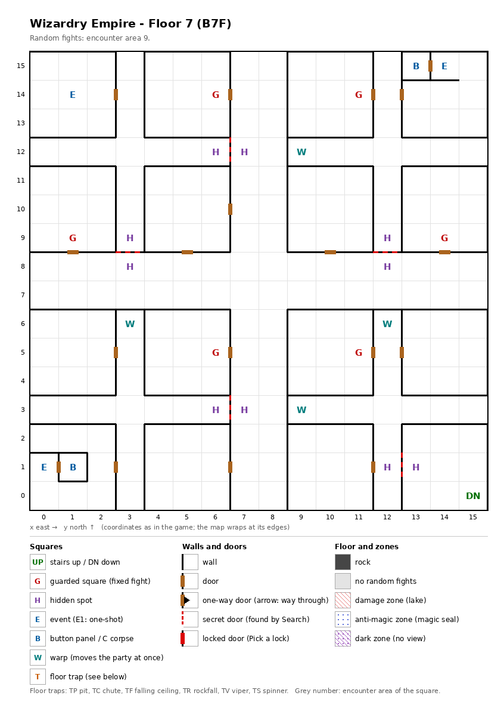

# Floor 7: map, squares, monsters

The seventh floor of the maze (B7F), four quarters of rooms around a central cross, with no stairs up; how to read
the map, coordinates and what each kind of square does: [maps/README.md](README.md).

## 1. Overview

- No solid rock: four quarters of rooms around central corridors, joined by 18 doors and 5 secret
  doors; no one-way or locked doors (computed from the map).
- **Stairs:** **no stairs up**; down at (15, 0), to floor 8. How the party arrives (inferred: the chute from floor
  6) and how it climbs back up (inferred: the elevator) were not traced
  ([dungeon.md](../dungeon.md#2-how-floors-connect)).
- **6 guarded squares**, **3 events** (the maid, two key-hole doors), **two button panels**, **10 hidden spots** in
  5 pairs, **4 warps**; no traps.
- **Route** (computed from the map): the floor is three parts joined only by secret doors. From the stairs down the
  party reaches 9 squares with them shut. The secret door (13, 1) ↔ (12, 1) opens part A (124 squares: the maid,
  both button panels, the guards at (11, 14) and (11, 5)); any one of four more secret doors leads on from part A to
  part B (123 squares: the guards at (6, 14), (1, 9), (14, 9) and (6, 5)). With them open, every square is reached.
- **Warps** (computed from the map): the four warps are shortcuts inside part A. Each stands at the dead end of a
  part-A corridor beside the central cross and moves the party at once to the diagonally opposite quarter of the
  floor, onto the hidden spot in front of one of the four secret doors into part B. They do not open part B or the
  stairs' corner: the walk numbers above already follow them. Once a warp has been stepped on, the auto-map shows
  where it leads ([dungeon.md](../dungeon.md) §9).
- **Random fights** come from encounter area 9 on every square. **Monsters:** levels 3-9, 2 to 4 groups of up to 5.

## 2. Squares

| Square (x, y) | What | On this floor |
|---|---|---|
| (15, 0) | Stairs down | To floor 8. |
| (1, 14) | Maid (event) | "A pretty girl in a maid's outfit is here. 'If you...'": she offers a service, not traced. |
| (1, 1), (13, 15) | Button panels | Buttons A-E: the Maze Elevator (inferred); where they lead was not traced. |
| (0, 1), (14, 15) | Key-holes (events) | Each in front of the door to a panel's room; the doors are inferred to need an item (not traced which). |
| (9, 12) | Warp | To (6, 3) on this floor: the hidden spot in front of the secret door (6, 3) ↔ (7, 3). |
| (3, 6) | Warp | To (12, 9) on this floor: the hidden spot in front of the secret door (12, 9) ↔ (12, 8). |
| (12, 6) | Warp | To (3, 9) on this floor: the hidden spot in front of the secret door (3, 9) ↔ (3, 8). |
| (9, 3) | Warp | To (6, 12) on this floor: the hidden spot in front of the secret door (6, 12) ↔ (7, 12). |
| (13, 1) + (12, 1) | Hidden spots, a pair | Each faces the secret door between them; Search here, facing the other spot, finds it (from (13, 1) facing west). Noticing difficulty 35. The only way from the stairs' 9-square corner, (13, 0) to (15, 2), into part A (computed from the map). |
| (6, 12) + (7, 12), (3, 9) + (3, 8), (12, 9) + (12, 8), (6, 3) + (7, 3) | Hidden spots, in pairs | Each pair faces the secret door between them; Search on the first spot, facing the second (east, south, south, east), finds it from part A. Noticing difficulty 35 each. Each of the four doors links part A to part B; one is enough (computed from the map). |
| (6, 14), (11, 14), (1, 9), (14, 9), (6, 5), (11, 5) | Guarded square | Fight from area 9, then a chest. (11, 14) and (11, 5) are in part A, the other four in part B. |

**Secret doors** (rules: [dungeon.md](../dungeon.md) §3.6): Search finds a secret door every time; noticing a hidden
spot first is only a hint, and the noticing difficulty is what a member's noticing skill must beat for it (§3.3). A
found door stays open for good (inferred).

## 3. Monsters

| Area | Where | Formations (one of 4 slots picked per fight) |
|---|---|---|
| 9 | every square; all 6 guarded squares | Ogre ×4 + Orc Lord ×0-3 + Dark Elf ×1-2 + Ogre Lord ×2-3, or Medusa ×3 + Gr. Medusa ×2 + Gorgon ×0-2, or Mystic ×2 + Tsujigiri ×2 + Freya ×2-3 + Bowman ×0-2, or Centaur ×4-5 + Treant ×1-2 + Couatl ×1 |

| Monster | Lv | HP | AC | Swings | Damage | Special | Spells | EXP | Gold |
|---|---|---|---|---|---|---|---|---|---|
| Ogre | 3 | 4d8+2 | 5 | 2 | 1d10 | calls 25%, flees 10% | - | 300 | 30 |
| Orc Lord | 3 | 3d4+14 | 4 | 3 | 2d8+2 | flees 10% | - | 320 | 30 |
| Dark Elf | 4 | 5d8 | 4 | 1 | 1d9 | calls 25%, flees 10% | Mage 3 | 410 | 40 |
| Ogre Lord | 7 | 10d8 | 4 | 3 | 2d10+8 | - | - | 670 | 70 |
| Medusa | 6 | 8d8 | 5 | 1 | 1d5 | poison, stone, calls 25% | - | 570 | 60 |
| Gr. Medusa | 7 | 9d8 | 3 | 1 | 3d6 | poison, stone | - | 700 | 70 |
| Gorgon | 7 | 8d8 | 2 | 1 | 3d7 | stone, stone breath | - | 800 | 70 |
| Mystic | 5 | 8d6 | 6 | 1 | 1d7 | flees 10% | Mage 1, Priest 1 | 530 | 50 |
| Tsujigiri | 5 | 8d8 | 4 | 1 | 2d9 | calls 25%, flees 10% | Mage 1 | 470 | 50 |
| Freya | 5 | 5d6 | 4 | 1 | 1d7 | flees 10% | Priest 3 | 520 | 50 |
| Bowman | 5 | 5d6 | 7 | 2 | 3d9 | calls 25%, flees 10% | - | 550 | 60 |
| Centaur | 4 | 6d8 | 5 | 3 | 3d6 | flees 10% | - | 440 | 50 |
| Treant | 8 | 10d8 | 2 | 2 | 3d7 | - | - | 710 | 80 |
| Couatl | 9 | 11d8 | 5 | 2 | 2d5 | poison | Mage 3, Priest 5 | 990 | 90 |

Full stats: [monsters_table.md](../monsters_table.md).

**Notes for play:** stone is the threat here: the Medusa formation brings up to seven stoning monsters (computed:
3 + 2 + 2), and the Gorgon also breathes stone. Four monsters are ranged and reach the back row from any group: Dark Elf,
Greater Medusa, Bowman and Centaur ([combat.md](../combat.md#8-monster-reach-and-targets)). The Couatl (level 9, up to 88 HP) is the strongest monster of the floor. The guards can
give a Bronze chest ([dungeon.md](../dungeon.md#54-chest-quality-by-floor)). A party that arrives here has no
known way back up.

## 4. Open questions

- Where the party arrives on this floor and how it gets back up (no stairs up).
- What the maid offers; which items the two key-holes take; where the buttons lead.

Tech: [dungeon.md §4 Floors](../../tech/dungeon.md#4-floors), [§3 Event catalogue](../../tech/dungeon.md#3-event-catalogue),
[§2 Square types](../../tech/dungeon.md#2-square-types), [§2.1 Secret and locked doors](../../tech/dungeon.md#21-secret-and-locked-doors-wall-value-3);
`python3 tools/designtables/floormap.py 7 --list`.
