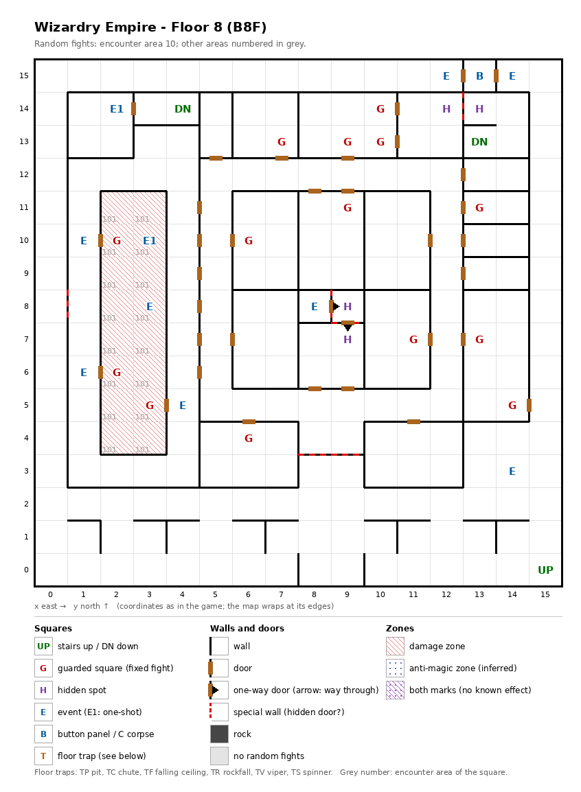

# Floor 8: map, squares, monsters

The eighth floor of the maze (B8F), with a damage-zone corridor that holds its own undead, a magic circle and a
pond, and two stairs down; how to read the map, coordinates and what each kind of square does:
[maps/README.md](README.md).

## 1. Overview

- No solid rock: rooms and corridors joined by 33 doors and 2 one-way doors, plus 3 secret doors and 3 locked
  doors; the 2 one-way doors, out of Siegfried's room, are 2 of the secret doors seen from the far side (computed
  from the map).
- **Stairs:** up at (15, 0), back to floor 7; down at (4, 14) and (13, 13), each to one of floor 9's two up stairs.
  **Route** (computed from the map): from the up stairs the party reaches 244 of the 256 squares with every secret
  and locked door shut, 250 with all of them open. (13, 13) lies behind the secret door between the hidden spots
  (12, 14) and (13, 14). (4, 14) and the hermit at (2, 14) are in a closed room of 6 squares with no way in on foot
  even then: it is entered only from floor 9's up stairs at (4, 14), themselves behind a secret door on floor 9
  ([floor-09.md](floor-09.md)), and left only by them. The three locked doors are shortcuts: nothing lies behind
  them alone.
- **14 guarded squares** (3 in the damage zone), **10 events** (the hermit, the pond, the Minotaur magic circle,
  Siegfried, a well, three signs; two key-hole doors), **a button panel**, **4 hidden spots**; no traps.
- **Damage zone:** 16 squares at x 2-3, y 4-11. Each action there costs every member a quarter of max HP plus 1
  ([dungeon.md](../dungeon.md#34-damage-zones-and-anti-magic-zones)). Random fights there come from area 101,
  undead only.
- **Random fights** elsewhere come from area 10. **Monsters:** levels 1-10, 2 to 4 groups of up to 4; the damage
  zone adds undead of levels 6-13.

## 2. Squares

| Square (x, y) | What | On this floor |
|---|---|---|
| (15, 0) | Stairs up | To floor 7. |
| (4, 14), (13, 13) | Stairs down | To floor 9, onto its up stairs at the same squares. (13, 13) is behind the secret door at (12, 14) ↔ (13, 14); (4, 14) has no way in on foot from this floor. |
| (2, 14) | Hermit in seiza (one-shot event) | "In the hermitage, a man sits quietly in seiza.": a fight. In the closed room by the stairs (4, 14), reached only from floor 9. |
| (3, 10) | Pond (one-shot event) | "Something rose from the bottom of the pond.": an encounter (not traced). Inside the damage zone. |
| (3, 8) | Magic circle (event) | With a Summoner in the party, a pact for the Minotaur summon, from Summoner level 10 ([spells.md](../spells.md#6-summoner-pacts)). Inside the damage zone. |
| (8, 8) | Siegfried (event) | A recruitable adventurer: he offers to join if the roster has fewer than 20 characters and a condition of his own (not traced) is met ([dungeon.md](../dungeon.md#7-events)). His one-square room is closed by walls and a secret door. |
| (8, 8) → (9, 8), (9, 8) → (9, 7) | One-way doors | The way out of Siegfried's room, always open; seen from the far side each is a secret door. |
| (9, 7), (9, 8) | Hidden spots | The way in: Search at (9, 7) facing north finds the secret door to (9, 8) (noticing difficulty 50), then Search at (9, 8) facing west finds the one into Siegfried's room (noticing difficulty 55) (computed from the map). |
| (14, 3) | Well (event) | "There is water in a well. Drink from it?": one random outcome (HP restored, poison, cure, heavy damage or paralysis; odds not traced). |
| (1, 10), (1, 6), (4, 5) | Signs (events) | One outside each of the three doors into the damage zone (from the map). All three show the same sign (inferred: they use the same sign number); its text was not traced. |
| (13, 15) | Button panel | Between the two key-holes. Buttons A-E: the Maze Elevator (inferred); where they lead was not traced. |
| (12, 15), (14, 15) | Key-holes (events) | Each at a door of the panel's room; the doors are inferred to need an item (not traced which). |
| (12, 14) + (13, 14) | Hidden spots, a pair | Each faces the secret door between them; Search here, facing the other spot, finds it (from (12, 14) facing east). Noticing difficulty 45. Behind it: the stairs down at (13, 13), in the 4-square corner (13, 13) to (14, 14) (computed from the map). |
| (0, 8) ↔ (1, 8) | Locked door | Difficulty 40: a Thief has a real chance from level 9 (computed). A shortcut: both sides are reached without it, 47 steps apart the long way (computed from the map). |
| (8, 3) ↔ (8, 4), (9, 3) ↔ (9, 4) | Locked doors, side by side | Difficulty 45: a Thief has a real chance from level 10 (computed). Both belong to one lock mark, so picking one opens both (from the data, not tested). Shortcuts: the long way round is 23 and 21 steps (computed from the map). |
| (10, 14) + (9, 13) + (10, 13) | Guarded squares, a trio | Fight from area 10, then a chest. One once-per-visit mark for the three (below). |
| (7, 13), (9, 11), (13, 11), (6, 10), (11, 7), (13, 7), (14, 5), (6, 4) | Guarded square | Fight from area 10, then a chest. |
| (2, 6) + (3, 5) | Guarded squares, a pair, in the damage zone | Fight from area 101, then a chest. One once-per-visit mark for both (below). |
| (2, 10) | Guarded square, in the damage zone | Fight from area 101, then a chest. |

**Shared guards:** squares listed together share one once-per-visit mark, so after one has fought, the others
probably stay quiet until the next floor change (inferred, not tested). The floor then holds 11 guard fights per visit,
not 14. Each of the three doors into the damage zone opens straight onto a guarded square: (2, 10), (2, 6) and
(3, 5) (from the map).

**Secret and locked doors** (rules: [dungeon.md](../dungeon.md) §3.6): Search finds a secret door every time;
noticing a hidden spot first is only a hint, and the noticing difficulty is what a member's noticing skill must beat
for it (§3.3). A lock of difficulty D gives a Thief a real chance from level D/5 + 1: there 10% + AGI, then 10% more
per level, at most 95%; at level D/5 only about 1%. A Ninja needs 5 levels more, a Kunoichi 10 (computed from the
rule). Found and picked doors stay open for good (inferred).

## 3. Monsters

| Area | Where | Formations (one of 4 slots picked per fight) |
|---|---|---|
| 10 | everywhere outside the damage zone (240 squares); 11 guarded squares | Kobold King ×3-4 + Nagpa ×2-3 + Mind Flayer ×1-2, or Lizard Man ×1-3 + Pachydermion ×2-3 + Minotaur ×0-1 + Dark Naga ×2, or Earth Elem. ×2 + Air Elem. ×2 + Fire Elem. ×0-1, or Eye Wing ×3-4 + Cerberus ×1 + Gorgimera ×2-3 |
| 101 | the damage zone (16 squares); its 3 guarded squares | Ghost ×2-3 + Specter ×1 + Wight ×1 (3 of 4), or Damned ×2 + Ghost ×1-2 + Specter ×1-2 + Wight ×1 |

| Monster | Lv | HP | AC | Swings | Damage | Special | Spells | EXP | Gold |
|---|---|---|---|---|---|---|---|---|---|
| Kobold King | 2 | 4d8 | 6 | 1 | 3d3 | calls 25%, flees 10% | - | 240 | 30 |
| Nagpa | 9 | 9d8 | 3 | 1 | 1d9 | - | Mage 5 | 950 | 90 |
| Mind Flayer | 9 | 10d8+5 | 5 | 4 | 1d5 | paralysis | Mage 5 | 960 | 90 |
| Lizard Man | 3 | 3d8+5 | 5 | 3 | 1d5 | flees 5% | - | 350 | 40 |
| Pachydermion | 6 | 10d8 | 3 | 3 | 2d11+4 | - | - | 640 | 70 |
| Minotaur | 6 | 10d8 | 6 | 1 | 2d10+1 | - | - | 680 | 70 |
| Dark Naga | 8 | 9d8 | 4 | 1 | 4d9 | fear | - | 730 | 80 |
| Earth Elem. | 8 | 10d8 | 2 | 1 | 5d9 | - | - | 850 | 80 |
| Air Elem. | 8 | 10d8 | 2 | 1 | 3d11 | - | - | 760 | 80 |
| Fire Elem. | 8 | 10d8 | 2 | 1 | 4d9 | - | - | 800 | 80 |
| Eye Wing | 1 | 1d4 | 7 | 1 | 1d4 | flees 10% | - | 50 | 20 |
| Cerberus | 7 | 10d8 | -2 | 3 | 3d9 | - | - | 730 | 70 |
| Gorgimera | 10 | 13d8 | 2 | 5 | 3d4+2 | stone, stone breath | - | 2200 | 100 |
| Ghost | 10 | 11d8 | 0 | 1 | 1d3 | fear, calls 25%, flees 20% | - | 1000 | 100 |
| Specter | 6 | 7d8+7 | 3 | 1 | 1d9 | level drain 1, calls 25% | - | 800 | 60 |
| Wight | 6 | 4d8+5 | 8 | 1 | 1d5 | level drain 1 | - | 220 | 20 |
| Damned | 13 | 15d8 | -3 | 1 | 3d9 | paralysis | - | 5300 | 130 |

Full stats: [monsters_table.md](../monsters_table.md).

**Notes for play:** the damage zone is the danger and the prize. Without protection a full-HP character dies after
at most 4 actions there ([dungeon.md](../dungeon.md#34-damage-zones-and-anti-magic-zones)), yet the Minotaur circle
and the pond lie inside, and the guards at the doors fight with the zone's undead: the Damned (level 13, AC −3,
paralysis, 5300 EXP) and level-draining Specters and Wights. Those guards can give chests up to Gold, against
Bronze for the rest of the floor ([dungeon.md](../dungeon.md#54-chest-quality-by-floor)). Outside the zone the
Gorgimera (five swings, stone touch and stone breath, 2200 EXP) and the Mind Flayer (four swings with paralysis,
Mage spells up to level 5) are the hardest monsters. The Minotaur and the three elementals have reach and
attack the back row from the front groups ([combat.md](../combat.md#8-monster-reach-and-targets)). In the damage zone
three of the four formation slots bring Ghosts, Specters and a Wight, the fourth the Damned.

## 4. Open questions

- What the pond encounter is, and the text of the three signs.
- What protects a party in the damage zone (inferred: levitation or a ward), which matters for the circle and the
  pond.
- Which items the key-holes take; where the buttons lead; Siegfried's own join condition.
- Whether squares that share a once-per-visit mark really share one fight (from the data; not tested in the game).

Tech: [dungeon.md §4 Floors](../../tech/dungeon.md#4-floors), [§3 Event catalogue](../../tech/dungeon.md#3-event-catalogue),
[§1 Cell format and zones](../../tech/dungeon.md#1-map-storage-and-cell-format), [§2.1 Secret and locked doors](../../tech/dungeon.md#21-secret-and-locked-doors-wall-value-3);
`python3 tools/designtables/floormap.py 8 --list`.
