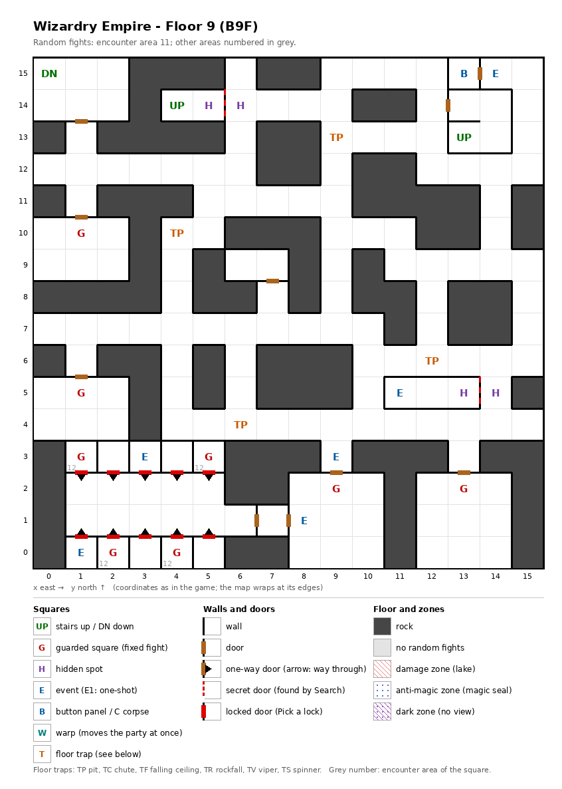

# Floor 9: map, squares, monsters

The ninth floor of the maze (B9F); how to read the map, coordinates and what each kind of square does:
[maps/README.md](README.md).

## 1. Overview

- 89 squares are solid rock; the rest is corridors and rooms with 10 doors and 10 one-way doors (computed from the
  map).
- **Entrance and exits:** two stairs up to floor 8, at (13, 13) and (4, 14); the stairs down to floor 10 at (0, 15).
  The stair at (4, 14) lands in a closed two-square room (below).
- **8 guarded squares**, **6 events** (a magic circle, two recruitable adventurers, two signs, a key-hole), **a button
  panel**, **4 pits** and **2 pairs of hidden spots**.
- **Ten one-square cells** in the south-west, in two rows at (1-5, 0) and (1-5, 3), hold two adventurers and four
  guarded squares. Each cell opens outward only, by a one-way door; from the room between the rows the same side is a
  special wall, so the cells are entered only through special walls (computed from the map).
- **Random fights** all come from area 11 (163 squares). Area 12, the monster set of floor 10, appears only on the
  four guarded squares in the cells.
- **Monsters:** levels 1-10, 1 to 7 per group: elementals, Medusas, undead (Wights, Mummies), Nagpas and Mind Flayers
  with Mage spells up to level 5.
- **Chests:** the guard fights rate 10-12, so the best chest is Bronze (computed from the Chest column below; tiers in
  [dungeon.md](../dungeon.md)).

## 2. Squares

| Square (x, y) | What | On this floor |
|---|---|---|
| (13, 13), (4, 14) | Stairs up | To floor 8 (its two stairs down). The room at (4, 14)-(5, 14) has no way out but the special wall east of (5, 14) (computed from the map); on floor 8 the same stair ends in the closed room of the hermit ([floor-08.md](floor-08.md)). |
| (0, 15) | Stairs down | To floor 10. |
| (11, 5) | Magic circle (event) | Djinni pact, from Summoner level 14 ([spells.md](../spells.md)). Its room, (11, 5) to (13, 5), is closed by the special wall east of (13, 5) (computed from the map). |
| (1, 0) | Adventurer (event) | Laila offers to join ([dungeon.md](../dungeon.md)). In a cell. |
| (3, 3) | Adventurer (event) | Kojiro offers to join. In a cell. |
| (9, 3), (8, 1) | Sign (event) | Text not traced. |
| (13, 15) | Button panel | Buttons A-E: the elevator (inferred); destinations not traced. Its only door opens onto the key-hole square (14, 15). |
| (14, 15) | Key-hole (event) | "Beside the door is a hole for slipping something in": the door to the button panel. Which item it takes: not traced. |
| (9, 13), (4, 10), (12, 6), (6, 4) | Pit | |
| (5, 14) + (6, 14), (13, 5) + (14, 5) | Hidden spots, in pairs | Each pair faces the other across a special wall; these two walls are the only ways into the stair room at (4, 14) and the circle room (computed from the map). |
| (1, 0) → (1, 1) to (5, 0) → (5, 1); (1, 3) → (1, 2) to (5, 3) → (5, 2) | One-way doors | The ten cell doors, passable only out of the cell (northward from the lower row, southward from the upper row). Each is a special wall seen from the room. |
| (1, 10), (1, 5), (9, 2), (13, 2) | Guarded square | Fight from area 11, then a chest. |
| (1, 3), (5, 3), (2, 0), (4, 0) | Guarded square | Fight from area 12 (floor 10's monsters), then a chest. In cells. |

The cells at (3, 0), (5, 0), (2, 3) and (4, 3) are empty.

## 3. Monsters

| Area | Formations (one is picked per fight) |
|---|---|
| 11 | Earth Elem. ×2 + Water Elem. ×0-1 + Air Elem. ×2 + Water Elem. ×1, or Lion of Hell ×3 + Medusa ×1 + Gr. Medusa ×2-3 + Cerberus ×0-2, or Wight ×3 + Mummy ×3-4 + Wight ×0-2, or Kobold ×2 + Dark Elf ×2-3 + Nagpa ×2-4 + Mind Flayer ×1 |
| 12 (cell guards only) | Lizard Man ×2 + Yuan-ti ×2 + Water Elem. ×2-3 + Lizard King ×1-2, or Goblin King ×3-4 + Dark Elf ×3-5 + Nagpa ×2 + Mind Flayer ×0-1, or Orc ×4 + Troll ×2 + Nagpa ×2 + Mind Flayer ×0-2, or Nightmare ×3-7 + Mummy ×2 + Vampire ×1 |

| Monster | Lv | HP | AC | Swings | Damage | Special | EXP | Gold | Chest |
|---|---|---|---|---|---|---|---|---|---|
| Earth Elem. | 8 | 10d8 | 2 | 1 | 5d9 | - | 850 | 80 | 9 |
| Water Elem. | 8 | 10d8 | 2 | 1 | 6d7 | - | 840 | 80 | 10 |
| Air Elem. | 8 | 10d8 | 2 | 1 | 3d11 | - | 760 | 80 | 9 |
| Lion of Hell | 5 | 7d8 | 4 | 1 | 1d12+3 | - | 500 | 50 | 10 |
| Medusa | 6 | 8d8 | 5 | 1 | 1d5 | poison, stone, calls 25% | 570 | 60 | 8 |
| Gr. Medusa | 7 | 9d8 | 3 | 1 | 3d6 | poison, stone | 700 | 70 | 9 |
| Cerberus | 7 | 10d8 | -2 | 3 | 3d9 | - | 730 | 70 | 3 |
| Wight | 6 | 4d8+5 | 8 | 1 | 1d5 | level drain 1 | 220 | 20 | 4 |
| Mummy | 7 | 6d8+5 | 3 | 1 | 1d13 | fear, paralysis | 650 | 70 | 10 |
| Kobold | 1 | 1d4 | 7 | 1 | 2d2 | calls 25%, flees 20% | 230 | 20 | 2 |
| Dark Elf | 4 | 5d8 | 4 | 1 | 1d9 | Mage spells to level 3, calls 25%, flees 10% | 410 | 40 | 4 |
| Nagpa | 9 | 9d8 | 3 | 1 | 1d9 | Mage spells to level 5 | 950 | 90 | 11 |
| Mind Flayer | 9 | 10d8+5 | 5 | 4 | 1d5 | Mage spells to level 5, paralysis | 960 | 90 | 9 |
| Lizard Man | 3 | 3d8+5 | 5 | 3 | 1d5 | flees 5% | 350 | 40 | 7 |
| Yuan-ti | 6 | 10d8 | 0 | 2 | 2d8+1 | - | 600 | 60 | 10 |
| Lizard King | 8 | 8d8+7 | 3 | 1 | 3d6+5 | - | 790 | 80 | 5 |
| Goblin King | 3 | 5d8 | 4 | 2 | 2d7 | calls 25%, flees 10% | 330 | 40 | 3 |
| Orc | 1 | 1d7 | 8 | 1 | 2d3 | calls 25%, flees 10% | 210 | 20 | 2 |
| Troll | 7 | 8d8+6 | 4 | 2 | 2d5+4 | - | 720 | 70 | 11 |
| Nightmare | 6 | 10d8 | -4 | 3 | 3d7 | paralysis | 630 | 60 | 11 |
| Vampire | 10 | 10d8+5 | 1 | 1 | 2d7+4 | paralysis, level drain 1 | 1000 | 80 | 12 |

Swings: per round. Chest: the monster's chest rating; a guard fight uses the highest one present ([dungeon.md](../dungeon.md)). Full stats: [monsters_table.md](../monsters_table.md).

**Notes for play:** Medusas and Greater Medusas can turn a member to stone; Mummies, Mind Flayers and Nightmares
paralyze; Wights and the Vampire drain levels. The Mind Flayer swings four times a round. The cell guards use floor
10's set, whose Vampire (level 10) is the strongest monster on the floor.

## 4. Open questions

- What opens the special walls: the cells, the stair room at (4, 14) and the circle room depend on them.
- The text of the two signs.
- Which item the key-hole at (14, 15) takes, and where the button panel leads.
- What Laila and Kojiro need, besides room in the roster, to join.

Tech: [dungeon.md §4 Floors](../../tech/dungeon.md#4-floors), [§3 Event catalogue](../../tech/dungeon.md#3-event-catalogue),
[§2 Square types](../../tech/dungeon.md#2-square-types); `python3 tools/designtables/floormap.py 9 --list`.
