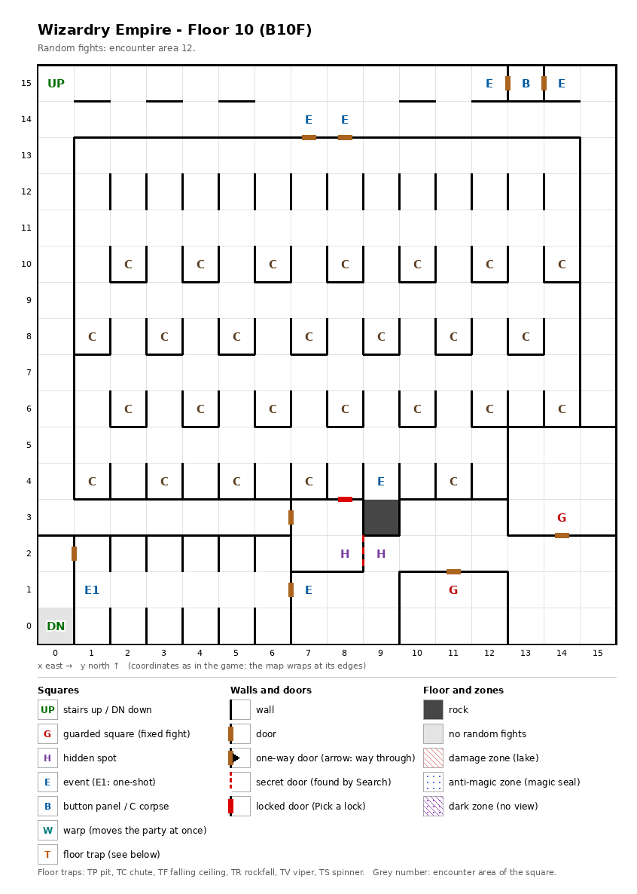

# Floor 10: map, squares, monsters

The tenth floor of the maze (B10F), the cemetery; how to read the map, coordinates and what each kind of square does:
[maps/README.md](README.md).

## 1. Overview

- 1 square is solid rock, (9, 3); the rest is open, with 9 doors and no one-way doors (computed from the map).
- **Entrance and exits:** the stairs up to floor 9 at (0, 15); the stairs down to floor 11 at (0, 0), the only square
  of the floor without random fights.
- **The cemetery:** 26 corpses lie in a grid over the middle of the floor (rows 4, 6, 8 and 10); any of them may rise
  and attack.
- **The south part** (rows 0-2 apart from (7, 2) and (8, 2), plus the rooms from (10, 3) to (15, 5)) holds the stairs
  down, the priest of the netherworld, both guarded squares and one sign. It is reached only through the special wall
  between the hidden spots (8, 2) and (9, 2) (computed from the map).
- **2 guarded squares**, **26 corpses**, **7 events** (a priest of the netherworld, four signs, two key-holes), **a
  button panel** and **a pair of hidden spots**; no traps.
- **Random fights** all come from area 12 (254 squares).
- **Monsters:** levels 1-10, 1 to 7 per group: Lizard Men and Lizard Kings, Goblin Kings and Dark Elves, Nagpas and Mind Flayers,
  Trolls, and undead (Nightmares, Mummies, a Vampire).
- **Chests:** the guard fights rate 10-12, so the best chest is Bronze (computed from the Chest column below; tiers in
  [dungeon.md](../dungeon.md)).

## 2. Squares

| Square (x, y) | What | On this floor |
|---|---|---|
| (0, 15) | Stairs up | To floor 9. |
| (0, 0) | Stairs down | To floor 11. No random fights on this square. In the south part. |
| (2, 10) to (14, 10), (1, 8) to (13, 8), (2, 6) to (14, 6) (every second square); (1, 4), (3, 4), (5, 4), (7, 4), (11, 4) | Corpse (26) | "A monster's corpse lies here": nothing, or "The corpse began to move!" and a fight. Odds and monsters not traced. |
| (9, 4) | Sign (event) | In the corpse grid, where a corpse would be. Text not traced. |
| (7, 14), (8, 14) | Sign (event) | At the two doors into the cemetery; both squares show the same sign (inferred: the same event). Text not traced. |
| (7, 1) | Sign (event) | In the south part. Text not traced. |
| (1, 1) | Priest of the netherworld (one-shot event) | "A priest of the netherworld stands silently." What follows was not traced. In the south part. |
| (13, 15) | Button panel | Buttons A-E: the elevator (inferred); destinations not traced. Its two doors open onto the key-hole squares on either side. |
| (12, 15), (14, 15) | Key-hole (event) | "Beside the door is a hole for slipping something in": the doors to the button panel. Which item they take: not traced. |
| (8, 2) + (9, 2) | Hidden spots, a pair | Facing each other across the special wall that is the only way into the south part. |
| (14, 3), (11, 1) | Guarded square | Fight from area 12, then a chest. In the south part. |

## 3. Monsters

| Area | Formations (one is picked per fight) |
|---|---|
| 12 | Lizard Man ×2 + Yuan-ti ×2 + Water Elem. ×2-3 + Lizard King ×1-2, or Goblin King ×3-4 + Dark Elf ×3-5 + Nagpa ×2 + Mind Flayer ×0-1, or Orc ×4 + Troll ×2 + Nagpa ×2 + Mind Flayer ×0-2, or Nightmare ×3-7 + Mummy ×2 + Vampire ×1 |

| Monster | Lv | HP | AC | Swings | Damage | Special | EXP | Gold | Chest |
|---|---|---|---|---|---|---|---|---|---|
| Lizard Man | 3 | 3d8+5 | 5 | 3 | 1d5 | flees 5% | 350 | 40 | 7 |
| Yuan-ti | 6 | 10d8 | 0 | 2 | 2d8+1 | - | 600 | 60 | 10 |
| Water Elem. | 8 | 10d8 | 2 | 1 | 6d7 | - | 840 | 80 | 10 |
| Lizard King | 8 | 8d8+7 | 3 | 1 | 3d6+5 | - | 790 | 80 | 5 |
| Goblin King | 3 | 5d8 | 4 | 2 | 2d7 | calls 25%, flees 10% | 330 | 40 | 3 |
| Dark Elf | 4 | 5d8 | 4 | 1 | 1d9 | Mage spells to level 3, calls 25%, flees 10% | 410 | 40 | 4 |
| Nagpa | 9 | 9d8 | 3 | 1 | 1d9 | Mage spells to level 5 | 950 | 90 | 11 |
| Mind Flayer | 9 | 10d8+5 | 5 | 4 | 1d5 | Mage spells to level 5, paralysis | 960 | 90 | 9 |
| Orc | 1 | 1d7 | 8 | 1 | 2d3 | calls 25%, flees 10% | 210 | 20 | 2 |
| Troll | 7 | 8d8+6 | 4 | 2 | 2d5+4 | - | 720 | 70 | 11 |
| Nightmare | 6 | 10d8 | -4 | 3 | 3d7 | paralysis | 630 | 60 | 11 |
| Mummy | 7 | 6d8+5 | 3 | 1 | 1d13 | fear, paralysis | 650 | 70 | 10 |
| Vampire | 10 | 10d8+5 | 1 | 1 | 2d7+4 | paralysis, level drain 1 | 1000 | 80 | 12 |

Swings: per round. Chest: the monster's chest rating; a guard fight uses the highest one present ([dungeon.md](../dungeon.md)). Full stats: [monsters_table.md](../monsters_table.md).

**Notes for play:** the same monster set guards the cells on floor 9. Mummies, Mind Flayers, Nightmares and the
Vampire paralyze, and the Vampire also drains levels; Nagpas and Mind Flayers cast Mage spells up to level 5. The
Nightmare formation can bring up to 10 monsters (computed from the group sizes).

## 4. Open questions

- What the corpses do: the odds that one rises, which monsters it brings, and whether a corpse that has risen
  stays quiet afterwards.
- What the priest of the netherworld does after the first message.
- The text of the four signs.
- What opens the special wall between (8, 2) and (9, 2), the only way to the stairs down on foot.
- Which item the key-holes at (12, 15) and (14, 15) take, and where the button panel leads.

Tech: [dungeon.md §4 Floors](../../tech/dungeon.md#4-floors), [§3 Event catalogue](../../tech/dungeon.md#3-event-catalogue),
[§2 Square types](../../tech/dungeon.md#2-square-types); `python3 tools/designtables/floormap.py 10 --list`.
