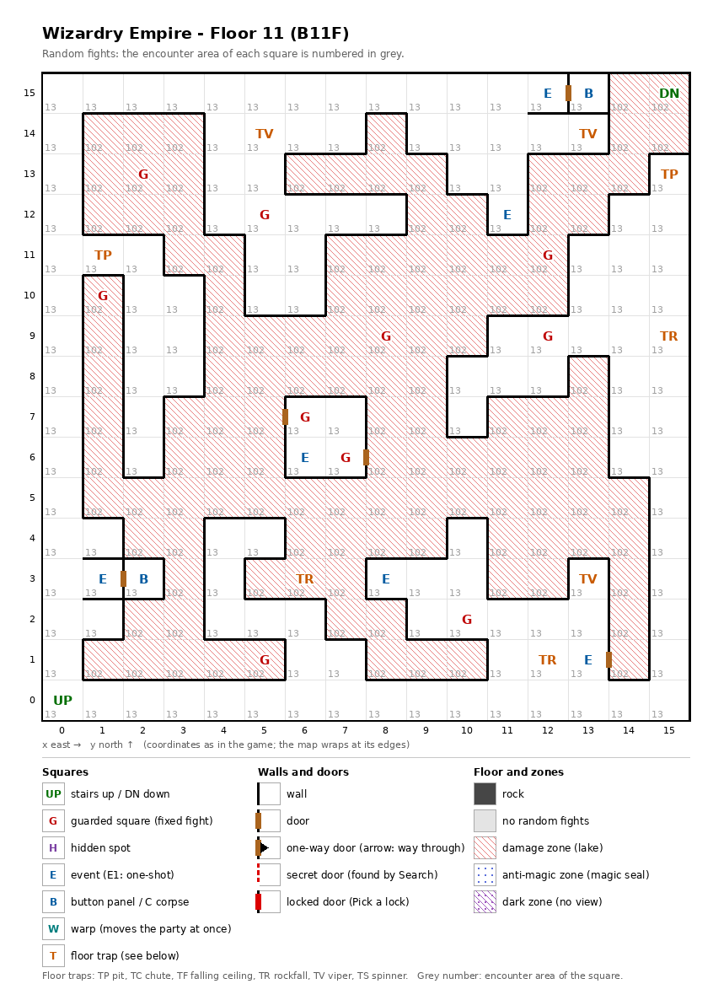

# Floor 11: map, squares, monsters

The eleventh floor of the maze (B11F), half of it a damage zone; how to read the map, coordinates and what each kind
of square does: [maps/README.md](README.md).

## 1. Overview

- No solid rock: the whole floor is open, with 5 doors and no one-way doors (computed from the map).
- **Entrance and exits:** the stairs up to floor 10 at (0, 0); the stairs down to floor 12 at (15, 15), inside the
  damage zone.
- **Damage zone:** 121 squares, about half the floor, in one winding band that runs through the middle of the map and
  ends in the north-east corner at the stairs down. Every action in it costs each member a quarter of max HP plus 1
  ([dungeon.md](../dungeon.md)). The shortest walk from the stairs up to the stairs down crosses at least 26 zone
  squares (computed from the map), far more than the 4 actions after which an unprotected full-HP character is dead.
  What protects the party was not traced (inferred: the levitation sold on this floor, at (8, 3)).
- **10 guarded squares** (5 of them in the zone), **6 events** (the fairy twin, a recruitable adventurer, the
  levitation sorcerer, a sign, two key-holes), **2 button panels** and **8 floor traps** (3 vipers, 3 rockfalls,
  2 pits); no hidden spots.
- **Random fights** come from area 13 outside the zone (135 squares) and area 102 inside it (121 squares).
- **Monsters:** levels 3-13, 1 to 7 per group: Kirin, Djinni and Ifrit formations outside the zone; Ghosts, Specters, Wights,
  the Damned and a Scylla formation inside it.
- **Chests:** the guard fights outside the zone rate 12-13 (best chest Copper); those inside rate 15-25 (best chest
  Gold) (computed from the Chest column below; tiers in [dungeon.md](../dungeon.md)).

## 2. Squares

| Square (x, y) | What | On this floor |
|---|---|---|
| (0, 0) | Stairs up | To floor 10. |
| (15, 15) | Stairs down | To floor 12. In the damage zone, at least 26 zone squares from the stairs up (computed from the map). |
| (11, 12) | Fairy twin (event) | The twin of the fairy on floor 1 ([floor-01.md](floor-01.md)): flees, unless the party carries the Fairy's Heart; then she offers a trip to her twin on floor 1 for 1 G. Outside the zone. |
| (6, 6) | Adventurer (event) | Badick offers to join ([dungeon.md](../dungeon.md)). In a four-square room, (6, 6) to (7, 7), ringed by the zone: at least 12 zone squares from the stairs up (computed from the map). |
| (8, 3) | Sorcerer (event) | Sells levitation for 500 G: the party floats over pits and chutes. Outside the zone. |
| (13, 1) | Sign (event) | Text not traced. |
| (2, 3), (13, 15) | Button panel | Buttons A-E: the elevator (inferred); destinations not traced. Each panel's only door opens onto its key-hole square. |
| (1, 3), (12, 15) | Key-hole (event) | "Beside the door is a hole for slipping something in": the doors to the two button panels. Which item they take: not traced. |
| (5, 14), (13, 14), (13, 3) | Viper | Trap strength 12: each member's save is `level/2 + LUK − 12`, so a level-12 member with LUK 15 escapes the poison 5% of the time (computed). |
| (15, 9), (12, 1), (6, 3) | Rockfall | (6, 3) is in the damage zone. |
| (15, 13), (1, 11) | Pit | Skipped when floating. |
| 121 squares (see map) | Damage zone | One connected band across the floor between x 1 and 15 and y 1 and 15, ending in the north-east corner at the stairs down. Random fights here use area 102. |
| (5, 12), (12, 9), (10, 2) | Guarded square | Fight from area 13, then a chest. |
| (6, 7), (7, 6) | Guarded square | Fight from area 13, then a chest. In Badick's room. The two share one once-per-visit mark: after one has fought, the other probably stays quiet until the next floor change (inferred). |
| (2, 13), (12, 11), (1, 10), (8, 9), (5, 1) | Guarded square, in the zone | Fight from area 102, then a chest. Each is 15 to 23 zone squares from the stairs up (computed from the map). |

## 3. Monsters

| Area | Formations (one is picked per fight) |
|---|---|
| 13 | Kirin ×2-3 + Kirin ×2-3, or Air Elem. ×4-6 + Djinni ×1-2, or Rogue ×2 + Kugutsu ×2 + Sorcerer ×2 + Highwayman ×0-2, or Fire Elem. ×3-4 + Ifrit ×2-3 |
| 102 (damage zone) | Ghost ×2-3 + Specter ×1 + Wight ×1, or Damned ×2 + Ghost ×1-2 + Specter ×1-2 + Wight ×1, or Scylla ×4-7 + Couatl ×3-6 + Lizard King ×3-4 + Lizard Man ×2-5 |

| Monster | Lv | HP | AC | Swings | Damage | Special | EXP | Gold | Chest |
|---|---|---|---|---|---|---|---|---|---|
| Kirin | 12 | 15d8 | -5 | 3 | 3d7 | Mage spells to level 7, decapitation | 4630 | 130 | 13 |
| Air Elem. | 8 | 10d8 | 2 | 1 | 3d11 | - | 760 | 80 | 9 |
| Djinni | 12 | 14d8 | -2 | 1 | 5d11 | lightning breath | 4800 | 120 | 12 |
| Rogue | 5 | 5d4 | 7 | 1 | 3d5 | calls 25%, flees 20% | 490 | 50 | 12 |
| Kugutsu | 6 | 7d8 | 4 | 1 | 1d9 | decapitation | 590 | 60 | 13 |
| Sorcerer | 10 | 13d4 | 5 | 2 | 2d4+6 | Mage spells to level 5 | 2210 | 100 | 13 |
| Highwayman | 10 | 13d8 | 0 | 3 | 2d9+5 | - | 1810 | 100 | 12 |
| Fire Elem. | 8 | 10d8 | 2 | 1 | 4d9 | - | 800 | 80 | 8 |
| Ifrit | 12 | 14d8 | -2 | 1 | 7d9 | fire breath | 4900 | 130 | 13 |
| Ghost | 10 | 11d8 | 0 | 1 | 1d3 | fear, calls 25%, flees 20% | 1000 | 100 | 15 |
| Specter | 6 | 7d8+7 | 3 | 1 | 1d9 | level drain 1, calls 25% | 800 | 60 | 14 |
| Wight | 6 | 4d8+5 | 8 | 1 | 1d5 | level drain 1 | 220 | 20 | 4 |
| Damned | 13 | 15d8 | -3 | 1 | 3d9 | paralysis | 5300 | 130 | 25 |
| Scylla | 10 | 13d8 | 7 | 8 | 2d5 | fear, paralysis | 1300 | 100 | 24 |
| Couatl | 9 | 11d8 | 5 | 2 | 2d5 | Mage spells to level 3, Priest spells to level 5, poison | 990 | 90 | 7 |
| Lizard King | 8 | 8d8+7 | 3 | 1 | 3d6+5 | - | 790 | 80 | 5 |
| Lizard Man | 3 | 3d8+5 | 5 | 3 | 1d5 | flees 5% | 350 | 40 | 7 |

Swings: per round. Chest: the monster's chest rating; a guard fight uses the highest one present ([dungeon.md](../dungeon.md)). Full stats: [monsters_table.md](../monsters_table.md).

**Notes for play:** outside the zone, the Kirin (AC -5, Mage spells up to level 7, decapitation) and the Djinni and
Ifrit breaths are the main threats. Inside it, every fight is a race against the zone damage: the Damned (level 13)
is the floor's strongest monster, Ghosts cause fear, Specters and Wights drain levels, and a Scylla swings eight
times a round. Area 102 lists three different formations, so one of them fills two of the four places and comes up
twice as often (inferred; the generated table does not show which).

## 4. Open questions

- What protects the party from the zone damage, and whether the sorcerer's levitation does.
- What the sign says.
- Which items the key-holes at (1, 3) and (12, 15) take, and where the two button panels lead.
- What Badick needs, besides room in the roster, to join.
- The damage of the pits and rockfalls.

Tech: [dungeon.md §4 Floors](../../tech/dungeon.md#4-floors), [§3 Event catalogue](../../tech/dungeon.md#3-event-catalogue),
[§1 Zones](../../tech/dungeon.md#1-map-storage-and-cell-format), [§2 Square types](../../tech/dungeon.md#2-square-types);
`python3 tools/designtables/floormap.py 11 --list`.
