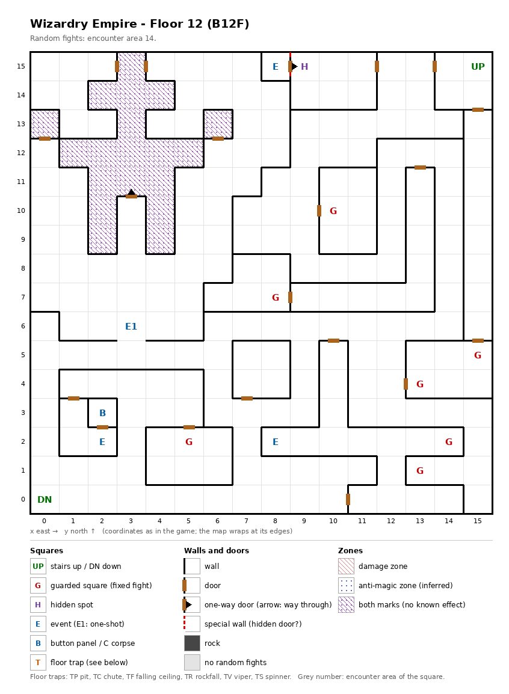

# Floor 12: map, squares, monsters

The twelfth floor of the maze (B12F); how to read the map, coordinates and what each kind of square does:
[maps/README.md](README.md).

## 1. Overview

- No solid rock: the whole floor is open, with 18 doors and 2 one-way doors (computed from the map).
- **Entrance and exits:** the stairs up to floor 11 at (15, 15); the stairs down to floor 13 at (0, 0).
- **7 guarded squares**, **4 events** (a magic circle, a huge creature, a recruitable adventurer, a key-hole), **a
  button panel** and **1 hidden spot**; no traps.
- **A cross of 19 squares** in the north-west, between x 0 and 6 and y 9 and 15, is marked as both zone kinds, which
  has no known effect ([findings.md](../findings.md)); a one-way door leads into it from (3, 10).
- **Random fights** all come from area 14 (256 squares).
- **Monsters:** levels 3-13, 1 to 7 per group: Assassins and archers, Marids and Daos with their elementals, and
  undead (Specters, Death Knights, a Giant Zombie).
- **Chests:** the guard fights rate 14-23, so the best chest is Silver (computed from the Chest column below; tiers in
  [dungeon.md](../dungeon.md)).

## 2. Squares

| Square (x, y) | What | On this floor |
|---|---|---|
| (15, 15) | Stairs up | To floor 11. |
| (0, 0) | Stairs down | To floor 13. |
| (8, 15) | Magic circle (event) | Ifrit pact, from Summoner level 15 ([spells.md](../spells.md)). The circle square opens east by a one-way door, out only; from (9, 15) that side is a special wall, the only way in (computed from the map). |
| (9, 15) | Hidden spot | Next to the special wall into the circle square; it has no partner on the other side. |
| (3, 6) | Huge creature (one-shot event) | Something huge asks for help ("HELP US"). What follows was not traced. |
| (8, 2) | Adventurer (event) | Warnard offers to join ([dungeon.md](../dungeon.md)). |
| (2, 3) | Button panel | Buttons A-E: the elevator (inferred); destinations not traced. Its only door opens onto the key-hole square (2, 2). |
| (2, 2) | Key-hole (event) | "Beside the door is a hole for slipping something in": the door to the button panel. Which item it takes: not traced. |
| (3, 10) → (3, 11) | One-way door | Northward only, into the cross. |
| (8, 15) → (9, 15) | One-way door | Out of the circle square only; a special wall seen from (9, 15). |
| 19 squares (see map) | Both zone marks | The cross between x 0 and 6 and y 9 and 15. No known effect; the walls look different there. |
| (10, 10), (8, 7), (15, 5), (13, 4), (5, 2), (14, 2), (13, 1) | Guarded square | Fight from area 14, then a chest. Two pairs, (10, 10) + (13, 1) and (15, 5) + (13, 4), each share one once-per-visit mark: after one of a pair has fought, the other probably stays quiet until the next floor change (inferred). |

## 3. Monsters

| Area | Formations (one is picked per fight) |
|---|---|
| 14 | Assassin ×5-7 + Bowman ×2-5 + Highwayman ×1 + Shooter ×1, or Water Elem. ×2 + Marid ×1 + Water Elem. ×1 + Marid ×1-2, or Earth Elem. ×2 + Dao ×1 + Earth Elem. ×1 + Dao ×1-2, or Specter ×3-4 + Skel.Warrior ×0-3 + Death Knight ×2 + Giant Zombie ×1 |

| Monster | Lv | HP | AC | Swings | Damage | Special | EXP | Gold | Chest |
|---|---|---|---|---|---|---|---|---|---|
| Assassin | 3 | 7d6 | 6 | 1 | 2d7 | decapitation, flees 10% | 280 | 30 | 5 |
| Bowman | 5 | 5d6 | 7 | 2 | 3d9 | calls 25%, flees 10% | 550 | 60 | 6 |
| Highwayman | 10 | 13d8 | 0 | 3 | 2d9+5 | - | 1810 | 100 | 12 |
| Shooter | 11 | 13d6 | 3 | 3 | 3d9+5 | calls 25% | 2890 | 110 | 14 |
| Water Elem. | 8 | 10d8 | 2 | 1 | 6d7 | - | 840 | 80 | 10 |
| Marid | 13 | 14d8 | -2 | 1 | 11d7 | frost breath | 5200 | 130 | 15 |
| Earth Elem. | 8 | 10d8 | 2 | 1 | 5d9 | - | 850 | 80 | 9 |
| Dao | 13 | 14d8 | -2 | 1 | 9d9 | stone breath | 5300 | 130 | 14 |
| Specter | 6 | 7d8+7 | 3 | 1 | 1d9 | level drain 1, calls 25% | 800 | 60 | 14 |
| Skel.Warrior | 4 | 7d8 | 4 | 2 | 2d9 | - | 370 | 40 | 3 |
| Death Knight | 9 | 10d8 | 2 | 3 | 2d11 | - | 880 | 90 | 11 |
| Giant Zombie | 12 | 14d8 | 3 | 2 | 4d13 | poison, poison breath, calls 25% | 5000 | 120 | 23 |

Swings: per round. Chest: the monster's chest rating; a guard fight uses the highest one present ([dungeon.md](../dungeon.md)). Full stats: [monsters_table.md](../monsters_table.md).

**Notes for play:** Marids (frost breath) and Daos (stone breath) are the strongest monsters (level 13). The Giant
Zombie poisons by hit and by breath and carries the floor's best chest rating (23), so the undead formation gives the
best guard chests. The Assassin formation can bring up to 14 monsters (computed from the group sizes), with
decapitation.

## 4. Open questions

- What opens the special wall between (9, 15) and the circle square.
- What the huge creature wants and what happens when the party helps it.
- Which item the key-hole at (2, 2) takes, and where the button panel leads.
- What Warnard needs, besides room in the roster, to join.

Tech: [dungeon.md §4 Floors](../../tech/dungeon.md#4-floors), [§3 Event catalogue](../../tech/dungeon.md#3-event-catalogue),
[§2 Square types](../../tech/dungeon.md#2-square-types); `python3 tools/designtables/floormap.py 12 --list`.
