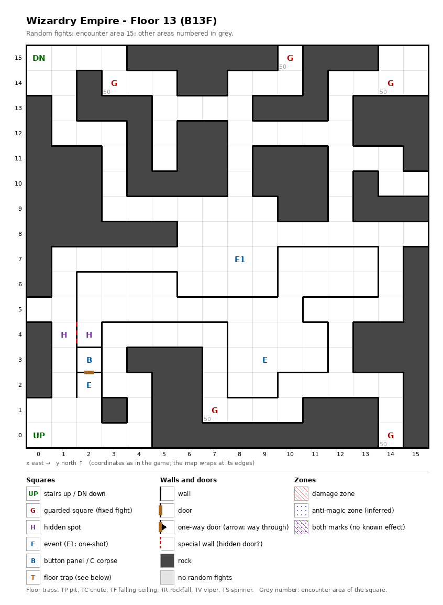

# Floor 13: map, squares, monsters

The thirteenth floor of the maze (B13F), home of the Umber Hulks; how to read the map, coordinates and what each kind
of square does: [maps/README.md](README.md).

## 1. Overview

- 102 squares are solid rock: narrow corridors with a single door (computed from the map).
- **Entrance and exits:** the stairs up to floor 12 at (0, 0); the stairs down to floor 14 at (0, 15).
- **5 guarded squares**, all the same fixed Umber Hulk fight; **3 events** (the town of Umber Hulks, a magic circle, a
  key-hole), **a button panel** and **a pair of hidden spots**; no traps.
- **A closed block** of 32 squares south of the middle, between x 2 and 13 and y 2 and 7, holds the
  magic circle. It is entered only through the special wall between the hidden spots (1, 4) and (2, 4) (computed from
  the map).
- **Random fights** come from area 15 (149 squares); area 50, the Umber Hulk formation, is only on the five guarded
  squares.
- **Monsters:** random fights at levels 1-12, 1 to 6 per group (undead, golems, Gorgons and Gorgimeras, Behemoths,
  Ropers); the guards bring 6 to 11 Umber Hulks (computed from the formation).
- **Chests:** the Umber Hulk's chest rating is 39, so a guard chest can be as good as Paulownia, far above anything
  else on floors 1-20 ([dungeon.md](../dungeon.md), [findings.md](../findings.md)).

## 2. Squares

| Square (x, y) | What | On this floor |
|---|---|---|
| (0, 0) | Stairs up | To floor 12. |
| (0, 15) | Stairs down | To floor 14. The guarded square (3, 14) is 4 squares away (computed from the map). |
| (8, 7) | Town of Umber Hulks (one-shot event) | "Many Umber Hulks have gathered." What follows was not traced. |
| (9, 3) | Magic circle (event) | Dao pact, from Summoner level 16 ([spells.md](../spells.md)). In the closed block. |
| (2, 3) | Button panel | Buttons A-E: the elevator (inferred); destinations not traced. Its only door opens onto the key-hole square (2, 2). |
| (2, 2) | Key-hole (event) | "Beside the door is a hole for slipping something in": the door to the button panel. Which item it takes: not traced. |
| (1, 4) + (2, 4) | Hidden spots, a pair | Facing each other across the special wall that is the only way into the closed block. |
| (10, 15), (3, 14), (14, 14), (7, 1), (14, 0) | Guarded square | The fixed Umber Hulk fight (area 50), then a chest. |

## 3. Monsters

| Area | Formations (one is picked per fight) |
|---|---|
| 15 | Ghast ×3-6 + Skel.Warrior ×0-3 + Specter ×4-5 + Zombie Lord ×3, or Gas Cloud ×4 + Banshee ×2-4 + Specter ×2-5 + Ghost ×3-4, or Gargoyle ×3 + Glass Golem ×2-3 + Doll Golem ×2 + Stone Golem ×0-1, or Gorgon ×2 + Behemoth ×0-2 + Gorgimera ×1 + Roper ×2 |
| 50 (guards only) | Umber Hulk ×3 + Umber Hulk ×3 + Umber Hulk ×0-2 + Umber Hulk ×0-3 |

| Monster | Lv | HP | AC | Swings | Damage | Special | EXP | Gold | Chest |
|---|---|---|---|---|---|---|---|---|---|
| Ghast | 4 | 4d8 | 4 | 3 | 1d5 | paralysis, flees 5% | 390 | 40 | 14 |
| Skel.Warrior | 4 | 7d8 | 4 | 2 | 2d9 | - | 370 | 40 | 3 |
| Specter | 6 | 7d8+7 | 3 | 1 | 1d9 | level drain 1, calls 25% | 800 | 60 | 14 |
| Zombie Lord | 6 | 8d8 | 6 | 2 | 3d5 | calls 25% | 610 | 60 | 4 |
| Gas Cloud | 1 | 1d7 | 8 | 1 | 1d6 | - | 120 | 20 | 2 |
| Banshee | 1 | 3d3 | 8 | 1 | 1d4 | fear | 270 | 30 | 2 |
| Ghost | 10 | 11d8 | 0 | 1 | 1d3 | fear, calls 25%, flees 20% | 1000 | 100 | 15 |
| Gargoyle | 4 | 6d8 | 5 | 4 | 1d5 | - | 430 | 50 | 16 |
| Glass Golem | 9 | 11d8 | 4 | 1 | 3d13 | - | 920 | 90 | 16 |
| Doll Golem | 10 | 12d8 | 4 | 1 | 4d7 | decapitation | 1100 | 100 | 17 |
| Stone Golem | 12 | 16d8+4 | 0 | 1 | 5d7+8 | - | 3960 | 120 | 16 |
| Gorgon | 7 | 8d8 | 2 | 1 | 3d7 | stone, stone breath | 800 | 70 | 6 |
| Behemoth | 9 | 10d8 | -4 | 3 | 4d9 | - | 900 | 90 | 15 |
| Gorgimera | 10 | 13d8 | 2 | 5 | 3d4+2 | stone, stone breath | 2200 | 100 | 8 |
| Roper | 12 | 15d8 | 0 | 1 | 6d7 | - | 3560 | 110 | 15 |
| Umber Hulk | 9 | 8d8+10 | 2 | 3 | 3d4+1 | fear | 890 | 90 | 39 |

Swings: per round. Chest: the monster's chest rating; a guard fight uses the highest one present ([dungeon.md](../dungeon.md)). Full stats: [monsters_table.md](../monsters_table.md).

**Notes for play:** each Umber Hulk is level 9 with 18-74 HP, swings three times a round and causes fear; a guard
fight is 6 to 11 of them. Guards come back on every floor change, so the guard at (3, 14), 4 squares from the stairs
down, can be fought again and again by going down to floor 14 and back up ([findings.md](../findings.md)). In the
random fights, Gorgons and Gorgimeras turn members to stone, Ghasts paralyze and Specters drain levels.

## 4. Open questions

- What happens in the town of Umber Hulks after the first message, and whether it is a fight.
- What opens the special wall between (1, 4) and (2, 4), the only way to the Dao circle on foot.
- Which item the key-hole at (2, 2) takes, and where the button panel leads.

Tech: [dungeon.md §4 Floors](../../tech/dungeon.md#4-floors), [§3 Event catalogue](../../tech/dungeon.md#3-event-catalogue),
[§2 Square types](../../tech/dungeon.md#2-square-types); `python3 tools/designtables/floormap.py 13 --list`.
