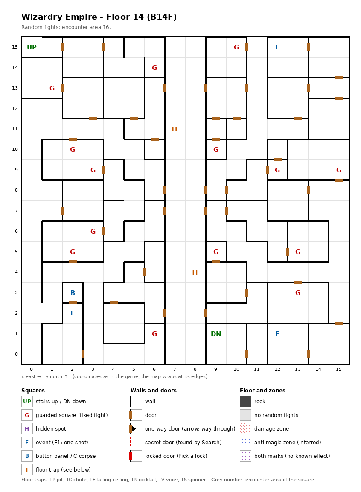

# Floor 14: map, squares, monsters

The fourteenth floor of the maze (B14F), a floor of small rooms; how to read the map, coordinates and what each kind
of square does: [maps/README.md](README.md).

## 1. Overview

- No solid rock: small rooms joined by 46 doors, with no one-way doors, no secret doors and no locked doors (computed
  from the map), on both sides of a long north-south hall at x 7-8. Every square can be reached on foot from either
  stairs (computed from the map).
- **Entrance and exits:** the stairs up to floor 13 at (0, 15); the stairs down to floor 15 at (9, 1).
- **14 guarded squares**, **3 events** (a man in a cloak, a magic circle, a key-hole), **a button panel** and **2
  ceiling traps**; no hidden spots.
- **Random fights** all come from area 16 (256 squares).
- **Monsters:** levels 3-13, 1 to 5 per group: thieves and ninjas, ogres and giants, Gorgons with demons.
- **Chests:** the guard fights rate 16-19, so the best chest is Silver ([dungeon.md](../dungeon.md), chest quality by
  floor).

## 2. Squares

| Square (x, y) | What | On this floor |
|---|---|---|
| (0, 15) | Stairs up | To floor 13. |
| (9, 1) | Stairs down | To floor 15. The guarded square (10, 15) is 5 squares away, across the south edge of the map (computed from the map). |
| (12, 15) | Handsome man in a cloak (event) | "A handsome man in a cloak stands here": a hint at a vampire. What follows was not traced. |
| (12, 1) | Magic circle (event) | Marid pact, from Summoner level 17 ([spells.md](../spells.md)). |
| (2, 3) | Button panel | Buttons A-E: the elevator (inferred); destinations not traced. Its only door opens onto the key-hole square (2, 2). |
| (2, 2) | Key-hole (event) | "Beside the door is a hole for slipping something in": the door to the button panel. Which item it takes: not traced. |
| (7, 11), (8, 4) | Ceiling trap | In the north-south hall. |
| (10, 15), (6, 14), (1, 13), (9, 10), (12, 9), (15, 9), (9, 5), (13, 5), (13, 3), (6, 1) | Guarded square | Fight from area 16, then a chest. |
| (2, 10) + (3, 9), (3, 6) + (2, 5) | Guarded square, in pairs | Fight from area 16, then a chest. Each pair shares one once-per-visit mark: after one of a pair has fought, the other probably stays quiet until the next floor change (inferred). |

## 3. Monsters

| Area | Where | Formations (one of 4 slots picked per fight) |
|---|---|---|
| 16 | Everywhere (256 squares) and the 14 guarded squares | High Thief ×1-4 + Master Thief ×3-4, or Ogre ×5 + Ogre Lord ×3-5 + Ettin ×2 + Hill Giant ×0-1, or Gorgon ×4 + Gorgimera ×2 + Lesser Demon ×1 + Succubus ×0-2, or High Thief ×2 + High Ninja ×1-2 + Cleric ×1-2 + Cutthroat ×1 |

| Monster | Lv | HP | AC | Swings | Damage | Special | Spells | EXP | Gold |
|---|---|---|---|---|---|---|---|---|---|
| High Thief | 10 | 12d4 | 3 | 2 | 3d5+5 | calls 25% | - | 1400 | 100 |
| Master Thief | 13 | 17d4 | -1 | 3 | 3d5+7 | - | - | 5710 | 130 |
| Ogre | 3 | 4d8+2 | 5 | 2 | 1d10 | calls 25%, flees 10% | - | 300 | 30 |
| Ogre Lord | 7 | 10d8 | 4 | 3 | 2d10+8 | - | - | 670 | 70 |
| Ettin | 11 | 12d8 | 3 | 2 | 4d19 | - | - | 3020 | 110 |
| Hill Giant | 11 | 14d8 | 3 | 1 | 3d7+7 | - | - | 3420 | 110 |
| Gorgon | 7 | 8d8 | 2 | 1 | 3d7 | stone, stone breath | - | 800 | 70 |
| Gorgimera | 10 | 13d8 | 2 | 5 | 3d4+2 | stone, stone breath | - | 2200 | 100 |
| Lesser Demon | 10 | 15d8 | 0 | 4 | 2d11 | calls 25% | Mage 3 | 1530 | 100 |
| Succubus | 12 | 14d8 | -2 | 1 | 3d9 | level drain 1 | Mage 5 | 4000 | 120 |
| High Ninja | 10 | 12d6 | -2 | 3 | 2d7+5 | decapitation | - | 1950 | 100 |
| Cleric | 11 | 11d6 | 0 | 2 | 1d6+6 | calls 25% | Priest 5 | 2340 | 110 |
| Cutthroat | 11 | 12d8 | 0 | 3 | 2d9+5 | calls 25% | Mage 4 | 2620 | 110 |

Full stats: [monsters_table.md](../monsters_table.md).

**Notes for play:** the Ettin hits for 4d19 (4-76) per swing, twice a round, the hardest hits on the floor. Gorgons
and Gorgimeras turn members to stone, the Succubus drains levels and the High Ninja decapitates; the Lesser Demon,
Succubus, Cleric and Cutthroat cast spells. The Master Thief (level 13) is the strongest monster here.

## 4. Open questions

- What the man in the cloak does after the first message.
- Which item the key-hole at (2, 2) takes, and where the button panel leads.
- The damage of the ceiling traps.

Tech: [dungeon.md §4 Floors](../../tech/dungeon.md#4-floors), [§3 Event catalogue](../../tech/dungeon.md#3-event-catalogue),
[§2 Square types](../../tech/dungeon.md#2-square-types); `python3 tools/designtables/floormap.py 14 --list`.
