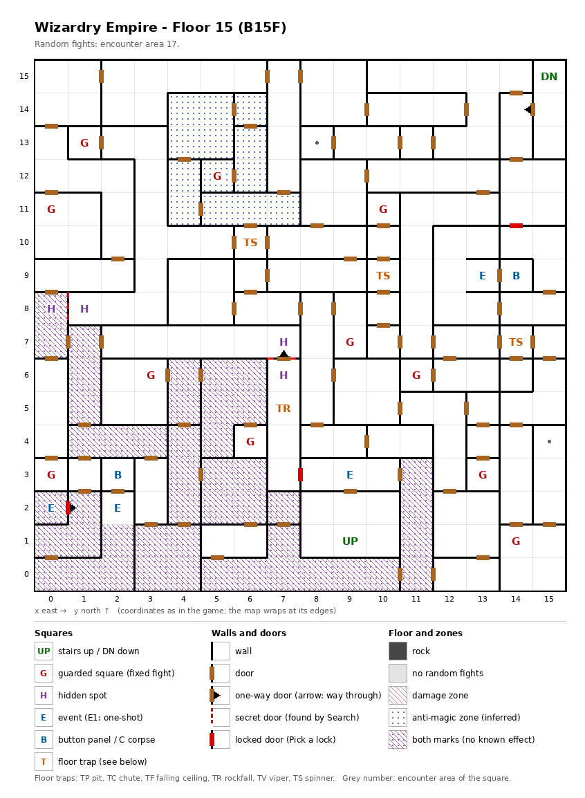

# Floor 15: map, squares, monsters

The fifteenth floor of the maze (B15F), a maze of small rooms; how to read the map, coordinates and what each
kind of square does: [maps/README.md](README.md).

## 1. Overview

- No solid rock: small rooms joined by 84 doors, with 3 one-way doors, 2 secret doors and 3 locked doors (computed
  from the map). Two of the one-way doors have a secret or locked door as their way back.
- **Entrance and exits:** the stairs up to floor 14 at (9, 1); the stairs down to floor 16 at (15, 15). The stairs
  down sit in a closed pocket, (15, 13) to (15, 15), whose only opening is a one-way door out of it, so they cannot be
  reached on foot from this floor, even with every secret and locked door open (computed from the map). A party coming
  up from floor 16 can leave the pocket; how a party on floor 15 goes down was not traced.
- **11 guarded squares**, **4 events** (a small monster on the ceiling, a magic circle, two key-holes), **2 button panels**, **4 floor traps** (3 spinners, a rockfall), **2 pairs of hidden spots** and **2
  marker squares**.
- **Zones:** 13 anti-magic squares in the north-west quarter, (4, 11) to (6, 14) plus (7, 11); 46 squares marked as both zone
  kinds (no known effect) in the south-west, between x 0 and 11 and y 0 and 8.
- **Behind secret and locked doors** (computed from the map): the east block (12, 8) to (15, 10), with a button
  panel, behind the locked door between (14, 11) and (14, 10); the column (7, 3) to (7, 6), behind either the secret
  door found from (7, 7) or the locked door between (8, 3) and (7, 3); the Titan circle at (0, 2), behind the locked
  door at (1, 2). From the stairs up, 236 squares can be reached with these doors shut and 253 with all of them open:
  everything but the stairs-down pocket.
- **Random fights** all come from area 17 (256 squares).
- **Monsters:** levels 5-17, 1 to 7 per group: Phoenixes, Live Ceilings, Necromancers, the Spider Queen.
- **Chests:** the guard fights rate 19-20, so the best chest is Silver ([dungeon.md](../dungeon.md), chest quality by
  floor).

## 2. Squares

| Square (x, y) | What | On this floor |
|---|---|---|
| (9, 1) | Stairs up | To floor 14. |
| (15, 15) | Stairs down | To floor 16 (its stairs up). In the closed pocket (15, 13)-(15, 15). |
| (15, 14) → (14, 14) | One-way door | Westward only: the way out of the pocket. |
| (0, 2) | Magic circle (event) | Titan pact, from Summoner level 20 ([spells.md](../spells.md)). On a square marked as both zone kinds. |
| (0, 2) → (1, 2) | One-way door | Out of the circle square only; seen from (1, 2) it is the locked door below, the only way in (computed from the map). |
| (1, 2) ↔ (0, 2) | Locked door | Difficulty 10. Guards the Titan circle; picked from (1, 2) facing west. The easiest lock on floors 11-20: a Thief from level 3 (a Ninja from 8, a Kunoichi from 13, anyone else from 42) has a real chance, 10% + AGI for the Thief at level 3 (computed from [dungeon.md](../dungeon.md), secret and locked doors). Data oddity: this lock stands on a plain square, not a lock square, and shares its open/closed mark with the secret door at (11, 15) on floor 1, so opening one probably opens the other (inferred; untested). |
| (9, 3) | Small monster on the ceiling (event) | "Something clings to the ceiling: a small monster." What follows was not traced. |
| (14, 9) | Button panel | Buttons A-E: the elevator (inferred); destinations not traced. Its only door opens onto the key-hole square (13, 9). In the east block, behind the locked door between (14, 11) and (14, 10) (computed from the map). |
| (14, 11) ↔ (14, 10) | Locked door | Difficulty 80. The only way into the east block (12, 8)-(15, 10) with the key-hole (13, 9) and the button panel (14, 9); picked from (14, 11) facing south. A Thief needs level 17 (a Ninja 22, a Kunoichi 27) for a real chance: 10% + AGI at that level, 10% more per further Thief level (computed from [dungeon.md](../dungeon.md), secret and locked doors). |
| (13, 9) | Key-hole (event) | "Beside the door is a hole for slipping something in": the door to the panel at (14, 9). Which item it takes: not traced. |
| (2, 3) | Button panel | As above; its only door opens onto the key-hole square (2, 2). |
| (2, 2) | Key-hole (event) | The door to the panel at (2, 3). Which item it takes: not traced. |
| (6, 10), (10, 9), (14, 7) | Spinner | |
| (7, 5) | Rockfall | In the column (7, 3)-(7, 6). |
| (8, 3) ↔ (7, 3) | Locked door | Difficulty 80. One of the two ways into the column (7, 3)-(7, 6) (the other is the secret door searched from (7, 7)); picked from (8, 3) facing west. Same chances as the lock at (14, 11). |
| (0, 8) + (1, 8) | Hidden spots, a pair | Each faces a secret door: the two faces of one door between them; Search on either spot, facing the other, finds it. Both sides can be reached anyway (computed from the map). (0, 8) is marked as both zone kinds. Noticing difficulty 80 ([dungeon.md](../dungeon.md), hidden spots). |
| (7, 7) + (7, 6) | Hidden spots, a pair | (7, 7) faces a secret door to the south; Search there, facing south, finds it and opens the way into the column (7, 3)-(7, 6). From (7, 6), at the top of the column, the same side is a one-way door, (7, 6) → (7, 7), passable northward only. The column is entered only through this secret door or the locked door between (8, 3) and (7, 3) (computed from the map). Noticing difficulty 80 ([dungeon.md](../dungeon.md), hidden spots). |
| (8, 13), (15, 4) | Marker | Nothing visible; notes the visit (inferred: memory for the auto-map). |
| (4, 11) to (6, 14), (7, 11) | Anti-magic zone | 13 squares, including the guarded square (5, 12). Entering cancels the party's spell effects. |
| 46 squares (see map) | Both zone marks | The south-west, between x 0 and 11 and y 0 and 8. No known effect; the walls look different there. |
| (1, 13), (5, 12), (0, 11), (10, 11), (9, 7), (3, 6), (11, 6), (6, 4), (0, 3), (13, 3), (14, 1) | Guarded square | Fight from area 17, then a chest. (5, 12) is in the anti-magic zone. |

## 3. Monsters

| Area | Where | Formations (one of 4 slots picked per fight) |
|---|---|---|
| 17 | Everywhere (256 squares) and the 11 guarded squares | Fire Elem. ×4-5 + Phoenix ×3-4, or Live Ceiling ×4 + Live Ceiling ×1, or Warlock ×4 + Freya ×0-2 + Rogue ×4 + Necromancer ×3, or Pachydermion ×5-7 + Dark Naga ×2 + Man Scorpion ×2 + Spider Queen ×1 |

| Monster | Lv | HP | AC | Swings | Damage | Special | Spells | EXP | Gold |
|---|---|---|---|---|---|---|---|---|---|
| Fire Elem. | 8 | 10d8 | 2 | 1 | 4d9 | - | - | 800 | 80 |
| Phoenix | 15 | 21d8 | -2 | 3 | 3d9 | fire breath | Mage 7 | 8000 | 150 |
| Live Ceiling | 17 | 23d8 | 7 | 1 | 3d20+1 | - | - | 8800 | 160 |
| Warlock | 5 | 8d4 | 9 | 1 | 1d5 | flees 10% | Mage 3 | 480 | 50 |
| Freya | 5 | 5d6 | 4 | 1 | 1d7 | flees 10% | Priest 3 | 520 | 50 |
| Rogue | 5 | 5d4 | 7 | 1 | 3d5 | calls 25%, flees 20% | - | 490 | 50 |
| Necromancer | 16 | 26d4 | -1 | 3 | 2d5+10 | - | Mage 7 | 8120 | 160 |
| Pachydermion | 6 | 10d8 | 3 | 3 | 2d11+4 | - | - | 640 | 70 |
| Dark Naga | 8 | 9d8 | 4 | 1 | 4d9 | fear | - | 730 | 80 |
| Man Scorpion | 8 | 9d8 | 1 | 2 | 4d5+2 | poison | - | 870 | 90 |
| Spider Queen | 15 | 20d8 | -2 | 3 | 2d9 | poison, poison breath, calls 25% | Mage 5 | 8300 | 150 |

Full stats: [monsters_table.md](../monsters_table.md).

**Notes for play:** Live Ceilings (level 17, 3d20+1 per hit) are the strongest monsters, and one formation is made
of them alone. Phoenixes and Necromancers cast Mage spells up to level 7; the Spider Queen and Man Scorpions poison.
The guard at (5, 12) is fought inside the anti-magic zone, so the party fights it without its party-wide spell effects.
Bring a Thief: the Titan circle's lock (difficulty 10) opens for a Thief from level 3, the two others (difficulty
80, the east block and the column) only from level 17 (computed from [dungeon.md](../dungeon.md), secret and locked
doors).

## 4. Open questions

- How a party on floor 15 reaches the stairs down at (15, 15), and so floor 16: the pocket stays closed even with
  every secret and locked door open.
- Whether the lock at (1, 2) and the secret door at (11, 15) on floor 1 really open together (data oddity, untested).
- What the small monster on the ceiling does after the first message.
- Which items the key-holes at (13, 9) and (2, 2) take, and where the two button panels lead.
- The damage of the rockfall.

Tech: [dungeon.md §4 Floors](../../tech/dungeon.md#4-floors), [§3 Event catalogue](../../tech/dungeon.md#3-event-catalogue),
[§1 Zones](../../tech/dungeon.md#1-map-storage-and-cell-format), [§2 Square types](../../tech/dungeon.md#2-square-types), [§2.1 Secret and locked doors](../../tech/dungeon.md#21-secret-and-locked-doors-wall-value-3);
`python3 tools/designtables/floormap.py 15 --list`.
