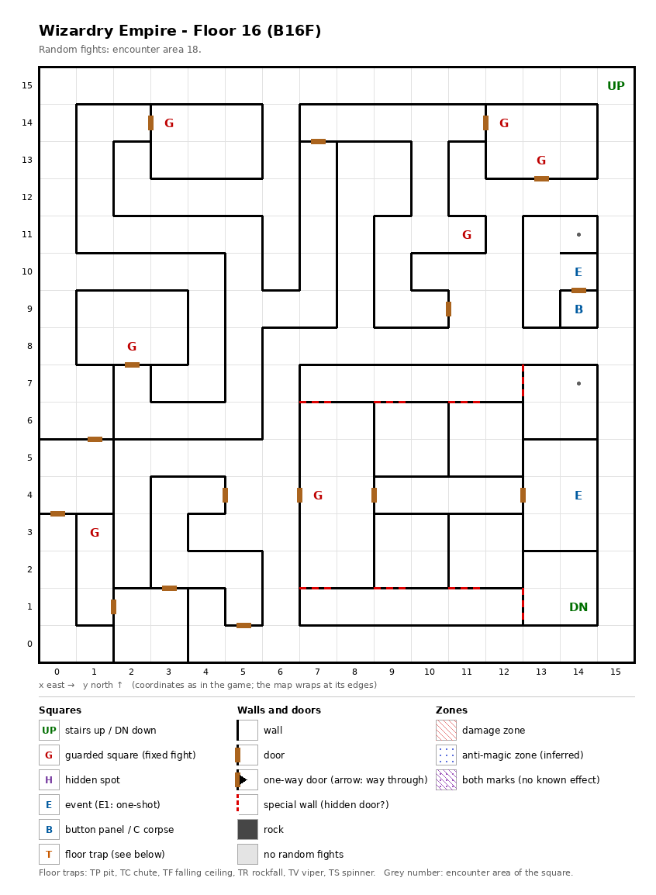

# Floor 16: map, squares, monsters

The sixteenth floor of the maze (B16F), home of the Queen of Darkness, whose stairs down sit in a block closed off by
special walls; how to read the map, coordinates and what each kind of square does: [maps/README.md](README.md).

## 1. Overview

- No solid rock: corridors and rooms joined by 16 doors, plus 8 special walls (red dashed lines) and no one-way doors
  (computed from the map).
- **Stairs:** up at (15, 15), back to floor 15; down at (14, 1), to floor 17. The stairs down are inside the
  **south-east block** (7, 1)-(14, 7), a set of small rooms with no door to the rest of the floor: on foot it can
  only be entered through the special walls, and the way passes the guarded square (7, 4) (computed from the map,
  special walls counted as passable). What a special wall does was not traced; this floor has no hidden spots.
- **7 guarded squares**, **2 events** (the Queen of Darkness, a key-hole door), **a button panel** and 2 markers; no
  traps.
- **The key-hole room** (13, 9)-(14, 11), with the button panel, the key-hole and a marker, has no way in on foot,
  even through the special walls (computed from the map).
- **Random fights** come from encounter area 18 on every square.
- **Monsters:** levels 3-18, up to 4 groups of 1 to 6 (computed from the formations): nagas and scorpions, undead
  with level drain, spellcasting beasts, the Juggernaut. Guard chests here are Silver at best
  ([dungeon.md](../dungeon.md), chest quality by floor).

## 2. Squares

| Square (x, y) | What | On this floor |
|---|---|---|
| (15, 15) | Stairs up | To floor 15. |
| (14, 1) | Stairs down | To floor 17. Inside the south-east block (see the overview). |
| (14, 4) | Queen of Darkness (event) | An encounter with the Queen of Darkness; what follows was not traced ([dungeon.md](../dungeon.md)). |
| (14, 9) | Button panel | Buttons A-E: the Maze Elevator (inferred); where they lead was not traced. Inside the closed key-hole room. |
| (14, 10) | Key-hole (event) | "Beside the door is a hole for slipping something in": a door that is inferred to need an item (not traced which). Inside the closed key-hole room. |
| (14, 11), (14, 7) | Marker | Nothing visible (auto-map memory, inferred). (14, 7) is in the south-east block. |
| Sides (7, 1)/(7, 2), (9, 1)/(9, 2), (11, 1)/(11, 2), (12, 1)/(13, 1), (7, 6)/(7, 7), (9, 6)/(9, 7), (11, 6)/(11, 7), (12, 7)/(13, 7) | Special walls | The 8 walls that close the south-east block. No hidden spot stands next to them. |
| (3, 14), (11, 11), (2, 8), (7, 4), (1, 3) | Guarded square | Fight from area 18, then a chest. (7, 4) is on the only way into the south-east block. |
| (12, 14) + (13, 13) | Guarded squares, a pair | Fight from area 18, then a chest. One once-per-visit mark for both (see Open questions). |

## 3. Monsters

| Area | Where | Formations (one is picked per fight) |
|---|---|---|
| 18 | everywhere, 7 guarded squares | Dark Naga ×4 + Man Scorpion ×1-2 + Lizard King ×0-1 + Spider Queen ×3, or Wight ×2 + Ghoul ×0-3 + Specter ×5-6 + DragonZombie ×2, or Couatl ×3 + Sleipnir ×3-4 + Kirin ×1 + Snow Lady ×1, or Juggernaut ×1 + Skel.Warrior ×2-3 + Dullahan ×2 + Night Rider ×2 |

| Monster | Lv | HP | AC | Swings | Damage | Spells | Special | EXP | Gold |
|---|---|---|---|---|---|---|---|---|---|
| Dark Naga | 8 | 9d8 | 4 | 1 | 4d9 | - | fear | 730 | 80 |
| Man Scorpion | 8 | 9d8 | 1 | 2 | 4d5+2 | - | poison | 870 | 90 |
| Lizard King | 8 | 8d8+7 | 3 | 1 | 3d6+5 | - | - | 790 | 80 |
| Spider Queen | 15 | 20d8 | -2 | 3 | 2d9 | Mage 5 | poison, poison breath, calls 25% | 8300 | 150 |
| Wight | 6 | 4d8+5 | 8 | 1 | 1d5 | - | level drain 1 | 220 | 20 |
| Ghoul | 3 | 2d8 | 6 | 3 | 1d4 | - | paralysis, flees 5% | 360 | 40 |
| Specter | 6 | 7d8+7 | 3 | 1 | 1d9 | - | level drain 1, calls 25% | 800 | 60 |
| DragonZombie | 18 | 25d8 | -2 | 3 | 4d9 | Mage 5 | poison, poison breath | 12000 | 170 |
| Couatl | 9 | 11d8 | 5 | 2 | 2d5 | Mage 3, Priest 5 | poison | 990 | 90 |
| Sleipnir | 9 | 10d8 | -5 | 5 | 3d7 | Priest 7 | - | 970 | 90 |
| Kirin | 12 | 15d8 | -5 | 3 | 3d7 | Mage 7 | decapitation | 4630 | 130 |
| Snow Lady | 13 | 16d8 | -3 | 2 | 3d5 | Mage 6 | frost breath, flees 10% | 5800 | 130 |
| Juggernaut | 17 | 40d8 | 0 | 1 | 11d11 | - | - | 9470 | 170 |
| Skel.Warrior | 4 | 7d8 | 4 | 2 | 2d9 | - | - | 370 | 40 |
| Dullahan | 11 | 14d8 | 0 | 2 | 4d9 | - | - | 3290 | 110 |
| Night Rider | 15 | 22d8 | -5 | 3 | 4d9 | - | paralysis | 7180 | 150 |

Spells: the school and the highest spell level cast. Full stats and resistances:
[monsters_table.md](../monsters_table.md).

**Notes for play:** the Juggernaut has the most HP (40d8, up to 320) and the hardest hit (11d11, 11-121); the Dragon
Zombie is the highest level (18) and breathes poison. The undead formation brings two level drainers (Wight,
Specter); the beast formation casts high spells (Sleipnir Priest 7, Kirin Mage 7) and the Sleipnir swings 5 times
(all computed from the table).

## 4. Open questions

- What the special walls do. The stairs down depend on them: without a way through, floor 17 cannot be reached on
  foot from this floor.
- How the party gets into the key-hole room (13, 9)-(14, 11), which item the key-hole asks for, and where the
  buttons lead.
- What the Queen of Darkness event does (a fight, a talk, an item).
- The guarded squares (12, 14) and (13, 13) share one "already fought" mark; whether beating one also clears the
  other for that visit was not traced.
- The walls of this map were not checked in the game.

Tech: [dungeon.md §4 Floors](../../tech/dungeon.md#4-floors), [§3 Event catalogue](../../tech/dungeon.md#3-event-catalogue),
[§2 Square types](../../tech/dungeon.md#2-square-types); `python3 tools/designtables/floormap.py 16 --list`.
