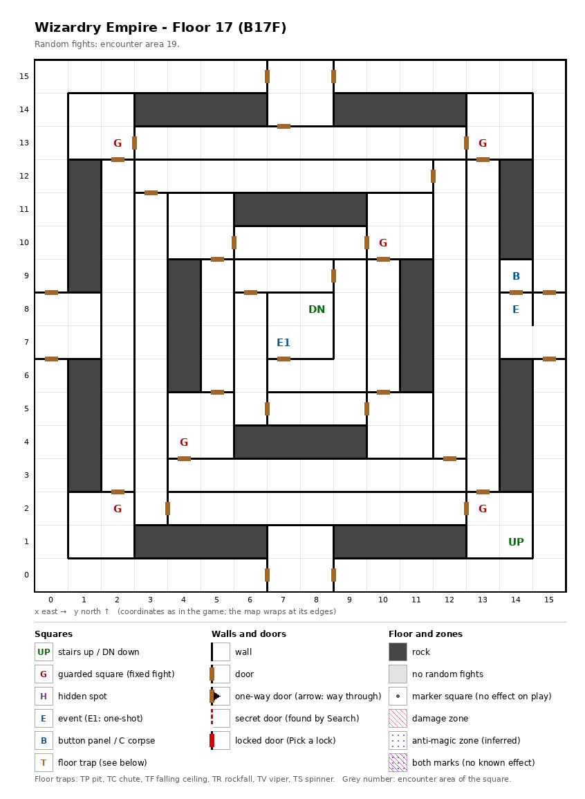

# Floor 17: map, squares, monsters

The seventeenth floor of the maze (B17F), nested rings of corridor around the Demon King's throne and the stairs
down at the center; how to read the map, coordinates and what each kind of square does: [maps/README.md](README.md).

## 1. Overview

- 47 squares are solid rock (the dark blocks between the rings); the corridors are joined by 33 doors, with no
  one-way doors, no secret doors and no locked doors (computed from the map). Every open square can be reached on
  foot from either stairs (computed from the map).
- **Stairs:** up at (14, 1), back to floor 16, in the south-east corner; down at (8, 8), to floor 18, at the very
  center.
- **The way down:** the shortest walk from the stairs up to the stairs down is 85 moves, and every way to the center
  passes the guarded squares (13, 2), (4, 4) and (10, 10) and then the **Demon King** at (7, 7), next to the stairs
  down (computed from the map). One-shot events re-arm with the guards on every floor change; whether the Demon
  King stays gone for good after his fight was not traced.
- **6 guarded squares**, **1 one-shot event** (the Demon King), **a key-hole door** and **a button panel**; no traps
  and no hidden spots.
- **Random fights** come from encounter area 19 on every square.
- **Monsters:** levels 4-17, up to 4 groups of 1 to 5 (computed from the formations): undead knights, golems,
  priests and archers, zombies with a Nightcrawler. Guard chests here are Silver at best
  ([dungeon.md](../dungeon.md), chest quality by floor).

## 2. Squares

| Square (x, y) | What | On this floor |
|---|---|---|
| (14, 1) | Stairs up | To floor 16. |
| (8, 8) | Stairs down | To floor 18. Reached only through the Demon King's square (see the overview). |
| (7, 7) | Demon King on his throne (one-shot event) | A fight; he withdraws ([dungeon.md](../dungeon.md)). Which monsters the fight holds was not traced. |
| (14, 9) | Button panel | Buttons A-E: the Maze Elevator (inferred); where they lead was not traced. |
| (14, 8) | Key-hole (event) | "Beside the door is a hole for slipping something in": a door that is inferred to need an item (not traced which). |
| (13, 2), (4, 4), (10, 10) | Guarded square | Fight from area 19, then a chest. On the way to the stairs down. |
| (2, 13), (13, 13), (2, 2) | Guarded square | Fight from area 19, then a chest. Not on the way down. |

## 3. Monsters

| Area | Where | Formations (one of 4 slots picked per fight) |
|---|---|---|
| 19 | Everywhere (209 squares) and the 6 guarded squares | Juggernaut ×1 + Skel.Warrior ×2-3 + Dullahan ×2 + Night Rider ×2, or Glass Golem ×2 + Doll Golem ×4-5 + Stone Golem ×2, or Shooter ×2 + Priest ×3 + Labor Lord ×3 + Master Thief ×0-1, or Specter ×3 + Zombie Lord ×3 + Giant Zombie ×3 + Nightcrawler ×1 |

| Monster | Lv | HP | AC | Swings | Damage | Special | Spells | EXP | Gold |
|---|---|---|---|---|---|---|---|---|---|
| Juggernaut | 17 | 40d8 | 0 | 1 | 11d11 | - | - | 9470 | 170 |
| Skel.Warrior | 4 | 7d8 | 4 | 2 | 2d9 | - | - | 370 | 40 |
| Dullahan | 11 | 14d8 | 0 | 2 | 4d9 | - | - | 3290 | 110 |
| Night Rider | 15 | 22d8 | -5 | 3 | 4d9 | paralysis | - | 7180 | 150 |
| Glass Golem | 9 | 11d8 | 4 | 1 | 3d13 | - | - | 920 | 90 |
| Doll Golem | 10 | 12d8 | 4 | 1 | 4d7 | decapitation | - | 1100 | 100 |
| Stone Golem | 12 | 16d8+4 | 0 | 1 | 5d7+8 | - | - | 3960 | 120 |
| Shooter | 11 | 13d6 | 3 | 3 | 3d9+5 | calls 25% | - | 2890 | 110 |
| Priest | 11 | 12d6 | 2 | 2 | 1d7+6 | - | Mage 4, Priest 4 | 2750 | 110 |
| Labor Lord | 11 | 13d8 | -1 | 3 | 2d8+7 | - | Priest 5 | 2480 | 110 |
| Master Thief | 13 | 17d4 | -1 | 3 | 3d5+7 | - | - | 5710 | 130 |
| Specter | 6 | 7d8+7 | 3 | 1 | 1d9 | level drain 1, calls 25% | - | 800 | 60 |
| Zombie Lord | 6 | 8d8 | 6 | 2 | 3d5 | calls 25% | - | 610 | 60 |
| Giant Zombie | 12 | 14d8 | 3 | 2 | 4d13 | poison, poison breath, calls 25% | - | 5000 | 120 |
| Nightcrawler | 17 | 36d8 | -4 | 2 | 3d9 | poison, level drain 1 | - | 13000 | 160 |

Full stats: [monsters_table.md](../monsters_table.md).

**Notes for play:** only two monsters cast spells (Priest, Labor Lord), both at level 5 or below. The Juggernaut has
the most HP (40d8, up to 320) and the hardest hit (11d11, 11-121); the Nightcrawler (36d8, up to 288) poisons and
drains a level, like the Specter. The Doll Golems, up to 5 in a group, can decapitate (all computed from the
table).

## 4. Open questions

- Which monsters the Demon King fight holds, and whether he is met again after he withdraws.
- Which item the key-hole asks for and where the buttons lead.
- The walls of this map were not checked in the game.

Tech: [dungeon.md §4 Floors](../../tech/dungeon.md#4-floors), [§3 Event catalogue](../../tech/dungeon.md#3-event-catalogue),
[§2 Square types](../../tech/dungeon.md#2-square-types); `python3 tools/designtables/floormap.py 17 --list`.
