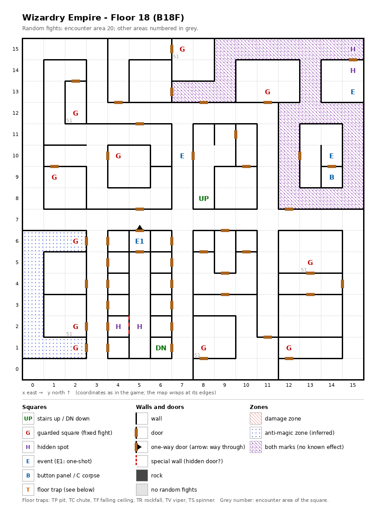

# Floor 18: map, squares, monsters

The eighteenth floor of the maze (B18F), with the Greater Demon magic circle, Succubus guards and a hidden corridor
leading to the peerless beauty; how to read the map, coordinates and what each kind of square does:
[maps/README.md](README.md).

## 1. Overview

- No solid rock: rooms and corridors joined by 45 doors, 1 one-way door and 1 special wall (computed from the map).
- **Stairs:** up at (8, 8), back to floor 17; down at (6, 1), to floor 19. They are 13 moves apart, and the shortest
  way passes no guarded square (computed from the map).
- **11 guarded squares** (5 of them hold Succubi), **4 events** (the Greater Demon magic circle, the peerless beauty,
  giggling laughter, a key-hole door; the beauty is a one-shot event), **a button panel** and **2 pairs of hidden
  spots**; no traps.
- **The beauty's corridor** (5, 1)-(5, 6) has no door: on foot it can only be entered through the special wall
  between the hidden spots (4, 2) and (5, 2), and it is left by the one-way door north of (5, 6) (computed from the
  map). Everything else can be reached from the stairs.
- **Zones:** 27 squares marked as both zone kinds (no known effect,
  [findings](../findings.md)) in the north-east corridors, and 10 anti-magic squares along the west edge (details
  below).
- **Random fights** come from encounter area 20 on every square except five guarded squares, which use area 51 (the
  Succubi).
- **Monsters:** levels 6-21, up to 4 groups of 1 to 4 (computed from the formations): undead, frost creatures,
  spellcasters with a Mist Dragon, and the Succubi. Guard chests here are Gold at best ([dungeon.md](../dungeon.md),
  chest quality by floor).

## 2. Squares

| Square (x, y) | What | On this floor |
|---|---|---|
| (8, 8) | Stairs up | To floor 17. |
| (6, 1) | Stairs down | To floor 19. |
| (15, 13) | Magic circle (event) | With a Summoner in the party, a pact for the Greater Demon summon, from Summoner level 23 (spell level 5) ([spells.md](../spells.md)). |
| (5, 6) | Peerless beauty (one-shot event) | "A peerless beauty sits in a chair": the town of succubi and the Succubus Queen ([dungeon.md](../dungeon.md)); what follows was not traced. At the north end of the hidden corridor. |
| (7, 10) | Giggling (event) | "From somewhere comes giggling laughter. 'A man?'"; what follows was not traced. |
| (14, 9) | Button panel | Buttons A-E: the Maze Elevator (inferred); where they lead was not traced. |
| (14, 10) | Key-hole (event) | "Beside the door is a hole for slipping something in": a door that is inferred to need an item (not traced which). |
| (5, 6) → (5, 7) | One-way door | Passable only northward: the way out of the beauty's corridor. |
| (4, 2) + (5, 2) | Hidden spots, a pair | They face each other across a special wall, the only way into the beauty's corridor: probably a hidden door (inferred). |
| (15, 15) + (15, 14) | Hidden spots, a pair | On both sides of an ordinary door; what noticing them gives was not traced. (15, 15) is in the both-marks zone. |
| (11, 13), (4, 10), (1, 9), (12, 1) | Guarded square | Fight from area 20, then a chest. |
| (2, 6) + (2, 1) | Guarded squares, a pair | Fight from area 20, then a chest. Both in the anti-magic zone; one once-per-visit mark for both (see Open questions). |
| (7, 15), (2, 12), (13, 5), (2, 2), (8, 1) | Guarded square | Fight from area 51 (Succubi), then a chest. |
| (9, 15)-(15, 15), (7, 13)-(9, 13), (9, 14), (13, 13), (13, 14), and the ring (12, 8)-(15, 12) around the key-hole room | Both zone marks | 27 squares; no known effect beyond a different set of wall pictures. |
| (0, 1)-(0, 6), (1, 1), (2, 1), (1, 6), (2, 6) | Anti-magic zone | 10 squares, a C-shaped band along the west edge; entering it cancels the party's spell effects. Holds the guards (2, 1) and (2, 6). |

## 3. Monsters

| Area | Where | Formations (one is picked per fight) |
|---|---|---|
| 20 | everywhere, 6 guarded squares | Specter ×3 + Zombie Lord ×3 + Giant Zombie ×3 + Nightcrawler ×1, or Scylla ×4 + Frost Giant ×0-1 + Snow Lady ×3 + Marid ×1-2, or Nightmare ×2-3 + Mummy ×0-2 + Damned ×2 + U. Beholder ×3, or High Wizard ×3 + Archmage ×2 + Mist Dragon ×1 |
| 51 | 5 guarded squares | Succubus ×2 + Succubus ×2 + Succubus ×2-3 + Succubus ×2 |

| Monster | Lv | HP | AC | Swings | Damage | Spells | Special | EXP | Gold |
|---|---|---|---|---|---|---|---|---|---|
| Specter | 6 | 7d8+7 | 3 | 1 | 1d9 | - | level drain 1, calls 25% | 800 | 60 |
| Zombie Lord | 6 | 8d8 | 6 | 2 | 3d5 | - | calls 25% | 610 | 60 |
| Giant Zombie | 12 | 14d8 | 3 | 2 | 4d13 | - | poison, poison breath, calls 25% | 5000 | 120 |
| Nightcrawler | 17 | 36d8 | -4 | 2 | 3d9 | - | poison, level drain 1 | 13000 | 160 |
| Scylla | 10 | 13d8 | 7 | 8 | 2d5 | - | fear, paralysis | 1300 | 100 |
| Frost Giant | 12 | 16d8+5 | 0 | 1 | 3d9+9 | - | - | 4090 | 120 |
| Snow Lady | 13 | 16d8 | -3 | 2 | 3d5 | Mage 6 | frost breath, flees 10% | 5800 | 130 |
| Marid | 13 | 14d8 | -2 | 1 | 11d7 | - | frost breath | 5200 | 130 |
| Nightmare | 6 | 10d8 | -4 | 3 | 3d7 | - | paralysis | 630 | 60 |
| Mummy | 7 | 6d8+5 | 3 | 1 | 1d13 | - | fear, paralysis | 650 | 70 |
| Damned | 13 | 15d8 | -3 | 1 | 3d9 | - | paralysis | 5300 | 130 |
| U. Beholder | 17 | 24d8 | -4 | 1 | 3d11 | Mage 6 | level drain 1 | 9200 | 160 |
| High Wizard | 14 | 16d4 | 1 | 2 | 2d4+8 | Mage 6 | - | 6380 | 140 |
| Archmage | 18 | 30d4 | -3 | 4 | 2d5+12 | Mage 7 | - | 9870 | 170 |
| Mist Dragon | 21 | 45d8+7 | -12 | 3 | 6d10+5 | Mage 6, Priest 5 | acid breath | 56430 | 190 |
| Succubus | 12 | 14d8 | -2 | 1 | 3d9 | Mage 5 | level drain 1 | 4000 | 120 |

Spells: the school and the highest spell level cast. Full stats and resistances:
[monsters_table.md](../monsters_table.md).

**Notes for play:** the Mist Dragon is the strongest monster here (level 21, 45d8+7 = 52-367 HP, AC −12,
acid breath, Mage 6 and Priest 5 spells) and comes with two Archmages (Mage 7). Four monsters drain levels (Specter,
Nightcrawler, Undead Beholder, Succubus); the Scylla swings 8 times. A Succubus guard fight is 8 or 9 Succubi in
four groups, every one casting Mage spells up to level 5 and draining a level (all computed from the table).

## 4. Open questions

- What the special wall between (4, 2) and (5, 2) does (probably a hidden door, inferred); without it the beauty's
  corridor cannot be entered on foot. How hard each hidden spot is to notice, and what the pair at (15, 15) and
  (15, 14) gives.
- What the peerless beauty and the giggling lead to (fights, the Succubus Queen).
- Which item the key-hole asks for and where the buttons lead.
- The guarded squares (2, 6) and (2, 1) share one "already fought" mark; whether beating one also clears the other
  for that visit was not traced.
- What the both-marks zone does, if anything.
- The walls of this map were not checked in the game.

Tech: [dungeon.md §4 Floors](../../tech/dungeon.md#4-floors), [§3 Event catalogue](../../tech/dungeon.md#3-event-catalogue),
[§2 Square types](../../tech/dungeon.md#2-square-types), [§1 Map storage](../../tech/dungeon.md#1-map-storage-and-cell-format);
`python3 tools/designtables/floormap.py 18 --list`.
