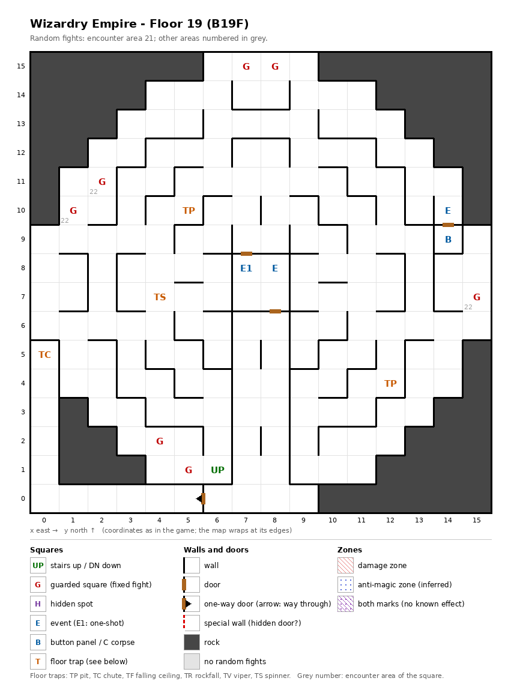

# Floor 19: map, squares, monsters

The nineteenth floor of the maze (B19F), the demons' court of the Emperor of the Abyss; it has no stairs down, and a
one-way corridor leads to the chute inferred to drop to floor 20; how to read the map, coordinates and what each
kind of square does: [maps/README.md](README.md).

## 1. Overview

- 57 squares are solid rock, filling the four corners; the rest is a maze of short walls with only 3 doors and
  1 one-way door (computed from the map). Every open square can be reached on foot from the stairs.
- **Entrance:** the stairs up at (6, 1), from floor 18. **No stairs down.**
- **The way on:** the one-way door (6, 0) → (5, 0) opens on an 11-square corridor along the south and west edges,
  (0, 0)-(5, 0) and (0, 1)-(0, 5), that ends at the **chute** at (0, 5); once through the door there is no way back
  on foot (computed from the map). The chute is inferred to drop the party to floor 20, since no stairs link the two
  floors ([dungeon.md](../dungeon.md)); where it lands was not traced. The walk from the stairs up to the chute is 38
  moves, or 44 avoiding every guarded square and the other traps (computed from the map).
- **7 guarded squares**, **4 events** (the demons' court, a junk pile, a key-hole door; the court is a one-shot
  event), **a button panel**, **4 floor traps** (the chute, 2 pits, a spinner); no hidden spots.
- **Random fights** come from encounter area 21 on every square except three guarded squares, which use area 22, the
  monsters of floor 20.
- **Monsters:** levels 4-22, up to 4 groups of 1 to 3 (computed from the formations): giants, a formation of three
  kinds of dragon, golems and casters; the area-22 guards bring floor 20's giants, genies and undead. Guard chests
  here are Gold at best ([dungeon.md](../dungeon.md), chest quality by floor).

## 2. Squares

| Square (x, y) | What | On this floor |
|---|---|---|
| (6, 1) | Stairs up | To floor 18. No stairs down. |
| (0, 5) | Chute | Drops the party to a lower floor, inferred to be floor 20 (how far: not traced). Skipped when floating. At the end of the one-way corridor. |
| (6, 0) → (5, 0) | One-way door | Passable only westward, into the corridor to the chute. |
| (7, 8) | Demons' court (one-shot event) | "Demons of every kind are here": the court of the Emperor of the Abyss, "The Emperor awaits you" ([dungeon.md](../dungeon.md)); what follows was not traced. 16 moves from the stairs (computed from the map). |
| (8, 8) | Junk pile (event) | "All kinds of junk are piled up like a mountain": a random find or nothing (odds not traced). Next to the court. |
| (14, 9) | Button panel | Buttons A-E: the Maze Elevator (inferred); where they lead was not traced. |
| (14, 10) | Key-hole (event) | "Beside the door is a hole for slipping something in": a door that is inferred to need an item (not traced which). |
| (5, 10), (12, 4) | Pit, strength 20 | Skipped when floating. |
| (4, 7) | Spinner | Turns the party to a random facing. |
| (7, 15) + (8, 15), (4, 2) + (5, 1) | Guarded squares, two pairs | Fight from area 21, then a chest. One once-per-visit mark per pair (see Open questions). |
| (2, 11) + (1, 10) | Guarded squares, a pair | Fight from area 22 (floor 20's monsters), then a chest. One once-per-visit mark for both. |
| (15, 7) | Guarded square | Fight from area 22, then a chest. |

How much damage the pits do, and what their strength changes, was not traced.

## 3. Monsters

| Area | Where | Formations (one is picked per fight) |
|---|---|---|
| 21 | everywhere, 4 guarded squares | Ettin ×3 + Hill Giant ×3 + Cyclops ×0-1 + Poison Giant ×3, or Mist Dragon ×2 + ShadowDragon ×2 + Deep Dragon ×1, or Doll Golem ×1-2 + Gargoyle ×1-2 + High Wizard ×3 + Mist Dragon ×2, or Cleric ×1-2 + Mystic ×1-2 + High Wizard ×3 + Mstr. Priest ×3 |
| 22 | 3 guarded squares | Cyclops ×2 + Troll ×3 + Frost Giant ×3 + Titan ×2, or Ifrit ×2 + Fire Elem. ×1-2 + Fire Giant ×3 + Phoenix ×3, or Juggernaut ×2 + Djinni ×1 + Dao ×2-3 + Marid ×3, or Mummy ×1-3 + Ghast ×2 + Necromancer ×3 + DragonZombie ×3. Stats: [floor-20.md](floor-20.md). |

| Monster | Lv | HP | AC | Swings | Damage | Spells | Special | EXP | Gold |
|---|---|---|---|---|---|---|---|---|---|
| Ettin | 11 | 12d8 | 3 | 2 | 4d19 | - | - | 3020 | 110 |
| Hill Giant | 11 | 14d8 | 3 | 1 | 3d7+7 | - | - | 3420 | 110 |
| Cyclops | 12 | 15d8 | 5 | 1 | 4d11 | - | - | 3830 | 120 |
| Poison Giant | 14 | 19d8 | 3 | 1 | 3d13+11 | - | poison, poison breath | 7600 | 140 |
| Mist Dragon | 21 | 45d8+7 | -12 | 3 | 6d10+5 | Mage 6, Priest 5 | acid breath | 56430 | 190 |
| ShadowDragon | 22 | 50d8+15 | -11 | 3 | 8d7+5 | Mage 7, Priest 6 | frost breath | 88880 | 210 |
| Deep Dragon | 22 | 60d8+23 | -12 | 3 | 7d10+5 | Mage 7, Priest 7 | stone breath | 99990 | 210 |
| Doll Golem | 10 | 12d8 | 4 | 1 | 4d7 | - | decapitation | 1100 | 100 |
| Gargoyle | 4 | 6d8 | 5 | 4 | 1d5 | - | - | 430 | 50 |
| High Wizard | 14 | 16d4 | 1 | 2 | 2d4+8 | Mage 6 | - | 6380 | 140 |
| Cleric | 11 | 11d6 | 0 | 2 | 1d6+6 | Priest 5 | calls 25% | 2340 | 110 |
| Mystic | 5 | 8d6 | 6 | 1 | 1d7 | Mage 1, Priest 1 | flees 10% | 530 | 50 |
| Mstr. Priest | 16 | 21d6 | -6 | 4 | 1d6+10 | Priest 7 | calls 25% | 8530 | 160 |

Spells: the school and the highest spell level cast. Full stats and resistances:
[monsters_table.md](../monsters_table.md).

**Notes for play:** one formation in four is five dragons: two Mist Dragons, two Shadow Dragons and a Deep Dragon
(level 22, 60d8+23 = 83-503 HP, stone breath, Mage 7 and Priest 7 spells). Mist Dragons also appear in a second
formation, with High Wizards. The Ettin has the hardest single hit here (4d19, up to 76), and the Master Priest casts
Priest spells up to level 7 (all computed from the table).

## 4. Open questions

- Where the chute at (0, 5) lands, and whether it really leads to floor 20 (inferred).
- What the demons' court leads to, and the odds of the junk pile.
- Which item the key-hole asks for and where the buttons lead.
- Three pairs of guarded squares ((7, 15) and (8, 15), (4, 2) and (5, 1), (2, 11) and (1, 10)) each share one
  "already fought" mark; whether beating one of a pair also clears the other for that visit was not traced.
- Damage of the pits.
- The walls of this map were not checked in the game.

Tech: [dungeon.md §4 Floors](../../tech/dungeon.md#4-floors), [§3 Event catalogue](../../tech/dungeon.md#3-event-catalogue),
[§2 Square types](../../tech/dungeon.md#2-square-types); `python3 tools/designtables/floormap.py 19 --list`.
