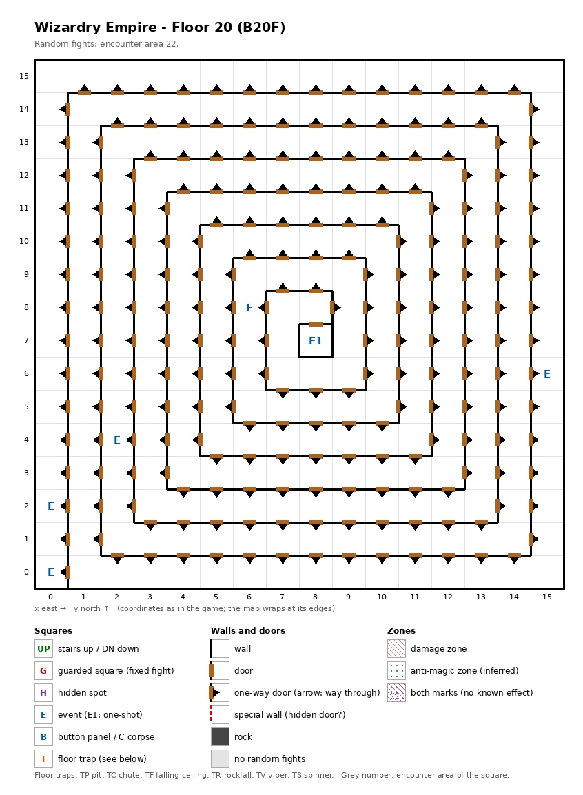

# Floor 20: map, squares, monsters

The twentieth floor of the maze (B20F), the throne of the Emperor of the Abyss and the final battle with Demon Adish:
one long spiral corridor with no stairs; how to read the map, coordinates and what each kind of square does:
[maps/README.md](README.md).

## 1. Overview

- No solid rock, no rooms: the walls form a **spiral**. Counting only the sides that can be crossed both ways, the
  whole floor is **one corridor 256 squares long**, winding inward from (0, 0) in the south-west corner to the
  Emperor's throne at (8, 7) in the middle; walking it end to end takes 255 moves (computed from the map). The only
  ordinary door is the throne's, on the north side of (8, 7).
- **222 one-way doors** sit in the spiral's walls, and every one of them leads **outward**, from one turn of the
  spiral to the turn around it. They are short cuts out, never in: from the throne the party can reach (0, 0) in
  17 moves, while the way in is the full corridor (computed from the map).
- **No stairs** at all ([dungeon.md](../dungeon.md)). The party is inferred to arrive by the chute of floor 19, since no
  stairs link the two floors (inferred); where it lands was not traced. How the party leaves floor 20 was not
  traced either (no stairs, no button panel).
- **6 events:** the Emperor of the Abyss (a one-shot event), the maid, the demonic seal and 3 signs. Along the
  corridor from (0, 0): the seal at the start, the maid after 2 moves, signs after 39, 114 and 242 moves, the throne
  after 255 (computed from the map).
- **No guarded squares**, so no chests on this floor; no traps, no hidden spots.
- **Random fights** come from encounter area 22 on every square.
- **Monsters:** levels 4-18, up to 4 groups of 1 to 3 (computed from the formations): giants and Titans, fire
  creatures, the four genies, undead with Necromancers.

## 2. Squares

| Square (x, y) | What | On this floor |
|---|---|---|
| (8, 7) | Emperor of the Abyss (one-shot event) | "On a giant throne sits the Emperor of the Abyss": the final battle with Demon Adish ([dungeon.md](../dungeon.md)). Which monsters the fight holds was not traced. The inner end of the spiral. |
| (0, 0) | Demonic seal (event) | "A mighty demonic seal has been placed here"; what it does was not traced. The outer end of the spiral. |
| (0, 2) | Maid (event) | "A pretty girl in a maid's outfit is here. 'If you...'": a service that was not traced. She also appears on floors 7 and 30. |
| (15, 6), (2, 4), (6, 8) | Sign (event) | Which sign text stands where was not traced. |
| 222 sides in the spiral's walls | One-way doors | Passable only outward (the arrows on the map); from the other side they are walls. |

## 3. Monsters

| Area | Where | Formations (one is picked per fight) |
|---|---|---|
| 22 | everywhere | Cyclops ×2 + Troll ×3 + Frost Giant ×3 + Titan ×2, or Ifrit ×2 + Fire Elem. ×1-2 + Fire Giant ×3 + Phoenix ×3, or Juggernaut ×2 + Djinni ×1 + Dao ×2-3 + Marid ×3, or Mummy ×1-3 + Ghast ×2 + Necromancer ×3 + DragonZombie ×3 |

| Monster | Lv | HP | AC | Swings | Damage | Spells | Special | EXP | Gold |
|---|---|---|---|---|---|---|---|---|---|
| Cyclops | 12 | 15d8 | 5 | 1 | 4d11 | - | - | 3830 | 120 |
| Troll | 7 | 8d8+6 | 4 | 2 | 2d5+4 | - | - | 720 | 70 |
| Frost Giant | 12 | 16d8+5 | 0 | 1 | 3d9+9 | - | - | 4090 | 120 |
| Titan | 17 | 30d8 | 0 | 1 | 7d7+14 | - | - | 9330 | 160 |
| Ifrit | 12 | 14d8 | -2 | 1 | 7d9 | - | fire breath | 4900 | 130 |
| Fire Elem. | 8 | 10d8 | 2 | 1 | 4d9 | - | - | 800 | 80 |
| Fire Giant | 13 | 17d8+5 | -1 | 1 | 3d11+10 | - | - | 5440 | 130 |
| Phoenix | 15 | 21d8 | -2 | 3 | 3d9 | Mage 7 | fire breath | 8000 | 150 |
| Juggernaut | 17 | 40d8 | 0 | 1 | 11d11 | - | - | 9470 | 170 |
| Djinni | 12 | 14d8 | -2 | 1 | 5d11 | - | lightning breath | 4800 | 120 |
| Dao | 13 | 14d8 | -2 | 1 | 9d9 | - | stone breath | 5300 | 130 |
| Marid | 13 | 14d8 | -2 | 1 | 11d7 | - | frost breath | 5200 | 130 |
| Mummy | 7 | 6d8+5 | 3 | 1 | 1d13 | - | fear, paralysis | 650 | 70 |
| Ghast | 4 | 4d8 | 4 | 3 | 1d5 | - | paralysis, flees 5% | 390 | 40 |
| Necromancer | 16 | 26d4 | -1 | 3 | 2d5+10 | Mage 7 | - | 8120 | 160 |
| DragonZombie | 18 | 25d8 | -2 | 3 | 4d9 | Mage 5 | poison, poison breath | 12000 | 170 |

Spells: the school and the highest spell level cast. Full stats and resistances:
[monsters_table.md](../monsters_table.md). The same area holds the three area-22 guarded squares of floor 19.

**Notes for play:** six monsters breathe (Ifrit and Phoenix fire, Djinni lightning, Dao stone, Marid frost, Dragon
Zombie poison). The Juggernaut has the most HP (40d8, up to 320) and the hardest hit (11d11, 11-121); the Phoenix
and the Necromancer cast Mage spells up to level 7 (all computed from the table). On the way in the corridor has no
door before the throne, so every one of the 255 moves is a plain step for the random-fight chance (computed from
the map; rates in [monsters.md](../monsters.md)).

## 4. Open questions

- Where the chute from floor 19 lands, and how the party leaves floor 20.
- Which monsters the Emperor of the Abyss fight holds, and what happens after it.
- What the demonic seal at (0, 0) does, what the maid offers, and which sign text stands where.
- Whether crossing a one-way side here counts as walking through a door for the fight chance (the sides are open on
  one face and wall on the other, not doors).
- The walls of this map were not checked in the game.

Tech: [dungeon.md §4 Floors](../../tech/dungeon.md#4-floors), [§3 Event catalogue](../../tech/dungeon.md#3-event-catalogue),
[§1 Map storage](../../tech/dungeon.md#1-map-storage-and-cell-format) (one-way sides); `python3 tools/designtables/floormap.py 20 --list`.
