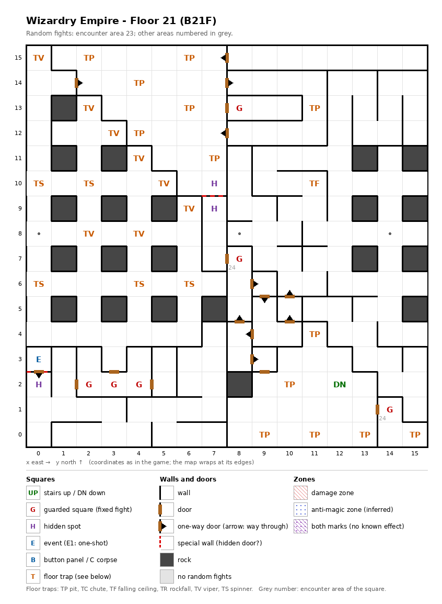

# Floor 21: map, squares, monsters

The first floor of the second, harder area (floors 21-30), B21F: traps among rows of pillars, the Vampire Lord magic
circle, and one-way doors that lead to the stairs down; how to read the map, coordinates and what each kind of square
does: [maps/README.md](README.md).

## 1. Overview

- The auto-map calls this floor **B30** ([findings.md](../findings.md), "Floors 21-30 are numbered B30 to B666 on the
  map").
- 21 squares are solid rock, mostly single pillars in a grid in the west half; 7 doors, 12 one-way doors, 2 secret
  doors and no locked doors (computed from the map).
- **Entrance and exit:** no stairs up; how a party first reaches floor 21 was not traced
  ([findings.md](../findings.md), "Floors 21-30 are not reached by stairs"). Stairs down at (12, 2), to floor 22.
- **The way to the stairs down** (computed from the map):
  - the stairs sit in a **pocket of 25 squares** in the south-east, (8, 0)-(15, 4), entered only by the one-way door
    (8, 3) → (9, 3); from the pocket there is no way back on foot, only the stairs. A party that comes up from
    floor 22 can walk only these 25 squares, with or without the secret doors found;
  - with both secret doors found and the warps followed, the rest of the floor is **one part of 209 squares** where
    every square can be reached from every other. The way runs through the one-way door (1, 14) → (2, 14) into
    the **north part** (39 squares between (1, 15) and (11, 12)), then through the secret door between the hidden
    spots (7, 10) and (7, 9) (Search on either) into the **middle part** (7, 3)-(10, 9), and from there either through
    the door to the pocket or through the one-way doors (10, 4) → (10, 5) → (10, 6) back to the rest of the floor;
  - until that secret door is found, the north part is a dead end and the stairs down cannot be reached.
- **The north strip** (8, 15)-(15, 15), 8 squares with no door in, is entered only by the warp (0, 8), which lands on
  (15, 15); its one-way door (8, 15) → (7, 15) leads on into the north part (computed from the map).
- **(15, 8)** cannot be walked onto: its only open sides lead to the warps (14, 8) and, across the map edge, (0, 8),
  and a party is moved away as soon as it steps on a warp (computed from the map).
- **6 guarded squares**, **1 event** (the Vampire Lord magic circle), **27 floor traps** (13 pits, 8 vipers,
  5 spinners, a ceiling trap), **3 hidden spots** (each facing a secret door) and **3 warps**, all to squares of
  this floor.
- **Random fights** come from encounter area 23 on every square except two guarded squares, which use area 24, the
  monsters of floor 22.
- **Monsters:** levels 5-18, up to 4 groups of 1 to 4 (computed from the formations): priests and bishops,
  Beholders, frost creatures, undead knights; the area-24 guards bring ninja and samurai. Guard chests here are
  Platinum at best ([dungeon.md](../dungeon.md), chest quality by floor).

## 2. Squares

| Square (x, y) | What | On this floor |
|---|---|---|
| (12, 2) | Stairs down | To floor 22. In the south-east pocket. No stairs up. |
| (0, 3) | Magic circle (event) | With a Summoner in the party, a pact for the Vampire Lord summon, from Summoner level 27 (spell level 6) ([spells.md](../spells.md)). The only way in is the secret door from the hidden spot (0, 2) below it. |
| (0, 3) → (0, 2) | One-way door | The way out of the circle, southward; seen from (0, 2) it is the secret door. |
| (8, 3) → (9, 3) | One-way door | Eastward, into the stairs pocket. |
| (1, 14) → (2, 14), (8, 15) → (7, 15) | One-way doors | Into the north part, from the west and from the north strip. |
| (7, 14) → (8, 14), (8, 12) → (7, 12) | One-way doors | Inside the north part. |
| (8, 4) → (8, 5), (9, 4) → (8, 4), (8, 6) → (9, 6), (9, 6) → (9, 5), (10, 4) → (10, 5), (10, 5) → (10, 6) | One-way doors | Inside and out of the middle part. |
| (7, 10) + (7, 9) | Hidden spots, a pair | Each faces a secret door to the other; Search here finds it. Both sides share one mark, so once found from either side it opens both ways. Noticing difficulty 115. The only link from the north part to the middle part and the stairs down. |
| (0, 2) | Hidden spot | Faces a secret door north into the magic circle (0, 3); Search here finds it. Noticing difficulty 120. |
| (0, 8) | Warp | To (15, 15) on this floor: the only way into the north strip. |
| (8, 8) | Warp | To (0, 0) on this floor. |
| (14, 8) | Warp | To (2, 6) on this floor. |
| (2, 15), (6, 15), (4, 14), (6, 13), (11, 13), (4, 12), (7, 11), (11, 4), (10, 2), (9, 0), (11, 0), (13, 0), (15, 0) | Pit, strength 23 | Skipped when floating. The last six are in the stairs pocket. |
| (0, 15), (2, 13), (3, 12), (4, 11), (5, 10), (6, 9), (2, 8), (4, 8) | Viper, strength 23 | Each member's save is level/2 + LUK − 23 ([dungeon.md](../dungeon.md)). |
| (0, 10), (2, 10), (0, 6), (4, 6), (6, 6) | Spinner | Turns the party to a random facing. |
| (11, 10) | Ceiling trap (TF), strength 23 | |
| (8, 13) | Guarded square | Fight from area 23, then a chest. In the north part. |
| (2, 2) + (3, 2) + (4, 2) | Guarded squares, a row of three | Fight from area 23, then a chest. They share one once-per-visit mark: after one is fought, the other two probably stay quiet until the next floor change (inferred). |
| (8, 7) | Guarded square | Fight from area 24, then a chest. In the middle part. |
| (14, 1) | Guarded square | Fight from area 24, then a chest. In the stairs pocket. |

Search finds a secret door with no roll; noticing the hidden spot first is only a hint. For any chance to notice a
spot, a Thief needs LUK/2 + 5 × level of at least its difficulty ([dungeon.md](../dungeon.md), hidden spots and
secret doors). A found secret door stays open for good (inferred).

How much damage pits and the ceiling trap do, and what their strength changes, was not traced. A viper of strength
23 poisons a member on every roll but 99 (1%) unless level/2 + LUK is above 28 (computed from the viper rule: rolls
0-4 always poison).

## 3. Monsters

| Area | Where | Formations (one of 4 slots picked per fight) |
|---|---|---|
| 23 | the whole floor; guarded squares (8, 13), (2, 2), (3, 2), (4, 2) | Beholder ×4 + Freya ×2 + High Priest ×2 + Mstr. Priest ×3, or Snow Lady ×2 + Frost Giant ×3 + Marid ×2 + Gr. Hydra ×3, or Labor Lord ×2 + Priest ×2 + Overlord ×4 + Gunner ×2, or Giant Zombie ×2 + Dullahan ×2 + Damned ×3 + Night Rider ×3 |
| 24 | guarded squares only: (8, 7), (14, 1) | High Ninja ×3 + Kugutsu ×2-4 + Master Ninja ×3 + Shogun ×3, or Snow Lady ×3 + Kirin ×3 + Sphinx ×2 + Arc Renard ×2, or Cutthroat ×4 + Tsujigiri ×1-3 + Daimyo ×3 + Shogun ×2, or High Bishop ×3 + Sorcerer ×4 + High Priest ×2 + Mstr. Bishop ×1. Stats: [floor-22.md](floor-22.md). |

| Monster | Lv | HP | AC | Swings | Damage | Special | Spells | EXP | Gold |
|---|---|---|---|---|---|---|---|---|---|
| Beholder | 11 | 13d8 | 0 | 1 | 3d9 | sleep | Mage 6 | 3150 | 110 |
| Freya | 5 | 5d6 | 4 | 1 | 1d7 | flees 10% | Priest 3 | 520 | 50 |
| High Priest | 15 | 16d6 | -4 | 3 | 1d6+8 | calls 25% | Priest 6 | 6920 | 150 |
| Mstr. Priest | 16 | 21d6 | -6 | 4 | 1d6+10 | calls 25% | Priest 7 | 8530 | 160 |
| Snow Lady | 13 | 16d8 | -3 | 2 | 3d5 | frost breath, flees 10% | Mage 6 | 5800 | 130 |
| Frost Giant | 12 | 16d8+5 | 0 | 1 | 3d9+9 | - | - | 4090 | 120 |
| Marid | 13 | 14d8 | -2 | 1 | 11d7 | frost breath | - | 5200 | 130 |
| Gr. Hydra | 14 | 20d8 | 5 | 4 | 2d11 | poison, poison breath | - | 6200 | 140 |
| Labor Lord | 11 | 13d8 | -1 | 3 | 2d8+7 | - | Priest 5 | 2480 | 110 |
| Priest | 11 | 12d6 | 2 | 2 | 1d7+6 | - | Mage 4, Priest 4 | 2750 | 110 |
| Overlord | 14 | 17d8 | -5 | 4 | 2d9+7 | - | Priest 6 | 6650 | 140 |
| Gunner | 16 | 18d6 | -1 | 4 | 3d9+7 | calls 25% | - | 7860 | 150 |
| Giant Zombie | 12 | 14d8 | 3 | 2 | 4d13 | poison, poison breath, calls 25% | - | 5000 | 120 |
| Dullahan | 11 | 14d8 | 0 | 2 | 4d9 | - | - | 3290 | 110 |
| Damned | 13 | 15d8 | -3 | 1 | 3d9 | paralysis | - | 5300 | 130 |
| Night Rider | 15 | 22d8 | -5 | 3 | 4d9 | paralysis | - | 7180 | 150 |

Full stats: [monsters_table.md](../monsters_table.md).

**Notes for play:** area 23 tops out at level 16 (Master Priest, Gunner), and no monster here drains levels. Eight of
the 16 cast spells, mostly Priest spells (Master Priest up to level 7); the Beholders cast Mage spells up to level 6
and their hits put members to sleep. Four monsters breathe (Snow Lady and Marid frost, Greater Hydra and Giant
Zombie poison); the Night Rider has the most HP (22d8, up to 176) (all computed from the table).

## 4. Open questions

- How a party first reaches floor 21 (no stairs up and no warp from another floor; candidates in
  [dungeon.md](../dungeon.md): the elevator, an event after the ending).
- Damage of the pits and the ceiling trap.
- The walls of this map were not checked in the game.

Tech: [dungeon.md §4 Floors](../../tech/dungeon.md#4-floors), [§2 Square types](../../tech/dungeon.md#2-square-types),
[§2.1 Secret and locked doors](../../tech/dungeon.md#21-secret-and-locked-doors-wall-value-3),
[§5 Not found](../../tech/dungeon.md#5-not-found--open),
[§6 Auto-map](../../tech/dungeon.md#6-auto-map) (warps, floor numbers); `python3 tools/designtables/floormap.py 21 --list`.
