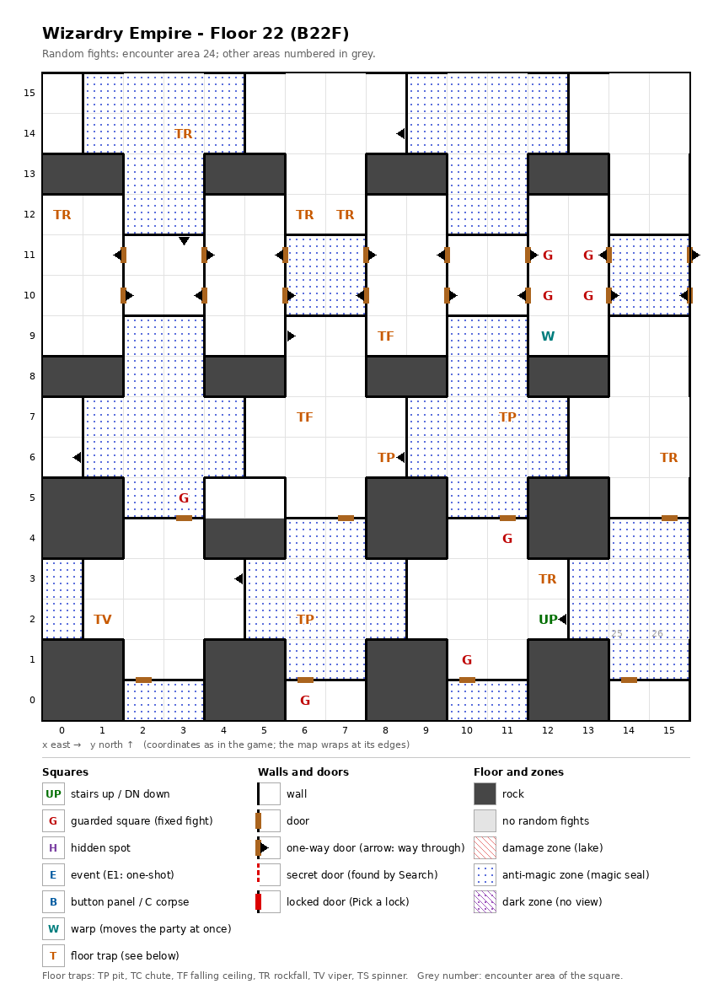

# Floor 22: map, squares, monsters

The second floor of the second, harder area (floors 21-30), B22F: rock blocks in a grid, a band of rooms linked by
one-way doors, wide anti-magic zones and no stairs down; how to read the map, coordinates and what each kind of square
does: [maps/README.md](README.md).

## 1. Overview

- The auto-map calls this floor **B31** ([findings.md](../findings.md), "Floors 21-30 are numbered B30 to B666 on the
  map").
- 46 squares are solid rock, in blocks two squares wide set in a regular grid; 8 doors, 23 one-way doors, no secret
  doors and no locked doors (computed from the map).
- **Entrance and exit:** stairs up at (12, 2), to floor 21, where they lead only into the closed stairs pocket of that
  floor ([floor-21.md](floor-21.md)). **No stairs down**: the way on to floor 23 is the **warp (12, 9)** in the
  guards' room (12, 9)-(13, 12), which moves the party at once to (12, 9) on floor 23
  ([floor-23.md](floor-23.md); [findings.md](../findings.md), "Floors 21-30 are not reached by stairs").
- **One-way doors:** 16 of them sit in the walls that cut the middle of the floor (y = 10-11) into sections two
  squares wide: between every two neighboring sections there are two one-way doors, one each way, in different rows.
  They force detours but cut nothing off: on foot from the stairs the party reaches 208 squares, every open square
  but two, and can walk back from each of them except the warp (12, 9), which leads off the floor (computed from the
  map). The two left out are the closed room (4, 5)-(5, 5), which has no way in on foot.
- **8 guarded squares** (four of them fill the middle of the room (12, 9)-(13, 12)), **12 floor traps** (6 rockfalls,
  3 pits, 2 ceiling traps, a viper) and **1 warp** (to floor 23); no events, no hidden spots.
- **Anti-magic zones** ("magic seal" on the auto-map): 88 of the floor's 210 open squares, in eight blocks (blue
  dots on the map); entering one cancels the party's spell effects.
- **Random fights** come from encounter area 24 on almost every square; two single squares next to the stairs carry
  the areas of deeper floors (below).
- **Monsters:** levels 5-18, up to 4 groups of 1 to 4 (computed from the formations): ninja and samurai, spellcasting
  beasts, bishops and sorcerers. Guard chests here are Platinum at best ([dungeon.md](../dungeon.md), chest quality by
  floor).

## 2. Squares

| Square (x, y) | What | On this floor |
|---|---|---|
| (12, 2) | Stairs up | To floor 21. No stairs down. |
| (13, 2) → (12, 2) | One-way door | Westward onto the stairs, from the east. |
| (14, 2), (15, 2) | Floor with another floor's area | A random fight here would use area 25 at (14, 2) and area 26 at (15, 2), the monsters of floors 23 and 24 (inferred; not seen) ([findings](../findings.md), "Single squares carry another floor's encounter area"). Both in an anti-magic block, just east of the stairs. |
| 16 sides between the sections of the middle band (y = 10-11) | One-way doors | Eastward: (1, 10) → (2, 10), (3, 11) → (4, 11), (5, 10) → (6, 10), (7, 11) → (8, 11), (9, 10) → (10, 10), (11, 11) → (12, 11), (13, 10) → (14, 10), (15, 11) → (0, 11). Westward: (2, 11) → (1, 11), (4, 10) → (3, 10), (6, 11) → (5, 11), (8, 10) → (7, 10), (10, 11) → (9, 11), (12, 10) → (11, 10), (14, 11) → (13, 11), (0, 10) → (15, 10). |
| (1, 6) → (0, 6), (3, 12) → (3, 11), (5, 3) → (4, 3), (5, 9) → (6, 9), (9, 6) → (8, 6), (9, 14) → (8, 14) | One-way doors | Passable only in the direction given. |
| (3, 14), (0, 12), (6, 12), (7, 12), (15, 6), (12, 3) | Rockfall, strength 24 | (3, 14) is in an anti-magic block. |
| (6, 7) | Ceiling trap (TF), strength 24 | |
| (8, 9) | Ceiling trap (TF), strength 28 | |
| (11, 7), (8, 6), (6, 2) | Pit, strength 24 | Skipped when floating. (11, 7) and (6, 2) are in anti-magic blocks; (8, 6) is just past the one-way door from (9, 6). |
| (1, 2) | Viper, strength 24 | Each member's save is level/2 + LUK − 24 ([dungeon.md](../dungeon.md)). |
| (12, 9) | Warp | To floor 23 (12, 9). In the guards' room, the only way down from this floor. |
| (12, 11) + (13, 11) + (12, 10) + (13, 10) | Guarded squares, a block of four | Fight from area 24, then a chest. They share one once-per-visit mark: after one is fought, the other three probably stay quiet until the next floor change (inferred). They fill the middle of the room (12, 9)-(13, 12), which is entered only by the band's one-way doors and left by them or by the warp (12, 9). |
| (3, 5) + (10, 1), (11, 4) + (6, 0) | Guarded squares, two pairs | Fight from area 24, then a chest. Each pair shares one once-per-visit mark: after one is fought, the other probably stays quiet until the next floor change (inferred). (3, 5) is in an anti-magic block. |
| Eight blocks: four of 14 squares around (2, 7), (10, 7), (2, 14) and (10, 14); two of 12 around (6, 2) and (14, 2); the rooms (6, 10)-(7, 11) and (14, 10)-(15, 11) | Anti-magic zone | 88 squares. |
| (4, 5)-(5, 5) | Closed room | No door, no opening and no secret door: it cannot be entered on foot. |

How much damage rockfalls, ceiling traps and pits do, and what their strength changes, was not traced. A viper of
strength 24 poisons a member on every roll but 99 (1%) unless level/2 + LUK is above 29 (computed from the viper rule:
rolls 0-4 always poison).

## 3. Monsters

| Area | Where | Formations (one of 4 slots picked per fight) |
|---|---|---|
| 24 | the whole floor; all 8 guarded squares (also the two area-24 guarded squares of floor 21) | High Ninja ×3 + Kugutsu ×2-4 + Master Ninja ×3 + Shogun ×3, or Snow Lady ×3 + Kirin ×3 + Sphinx ×2 + Arc Renard ×2, or Cutthroat ×4 + Tsujigiri ×1-3 + Daimyo ×3 + Shogun ×2, or High Bishop ×3 + Sorcerer ×4 + High Priest ×2 + Mstr. Bishop ×1 |
| 25 | the single square (14, 2) | Floor 23's area: formations and stats in [floor-23.md](floor-23.md). |
| 26 | the single square (15, 2) | Floor 24's area (also on one guarded square of floor 23): formations and stats in [floor-23.md](floor-23.md). |

| Monster | Lv | HP | AC | Swings | Damage | Special | Spells | EXP | Gold |
|---|---|---|---|---|---|---|---|---|---|
| High Ninja | 10 | 12d6 | -2 | 3 | 2d7+5 | decapitation | - | 1950 | 100 |
| Kugutsu | 6 | 7d8 | 4 | 1 | 1d9 | decapitation | - | 590 | 60 |
| Master Ninja | 14 | 18d6 | -6 | 4 | 2d9+7 | decapitation | - | 6110 | 140 |
| Shogun | 18 | 25d8 | -6 | 5 | 3d9+9 | - | Mage 6 | 13100 | 170 |
| Snow Lady | 13 | 16d8 | -3 | 2 | 3d5 | frost breath, flees 10% | Mage 6 | 5800 | 130 |
| Kirin | 12 | 15d8 | -5 | 3 | 3d7 | decapitation | Mage 7 | 4630 | 130 |
| Sphinx | 13 | 15d8 | 0 | 3 | 4d7 | fear, paralysis, fire breath | Priest 6 | 5700 | 130 |
| Arc Renard | 15 | 20d8 | -5 | 5 | 2d11 | - | Mage 7 | 7720 | 150 |
| Cutthroat | 11 | 12d8 | 0 | 3 | 2d9+5 | calls 25% | Mage 4 | 2620 | 110 |
| Tsujigiri | 5 | 8d8 | 4 | 1 | 2d9 | calls 25%, flees 10% | Mage 1 | 470 | 50 |
| Daimyo | 15 | 20d8 | -4 | 4 | 3d9+7 | - | Mage 5 | 6780 | 150 |
| High Bishop | 15 | 18d6 | -2 | 3 | 1d7+8 | calls 25% | Mage 5, Priest 5 | 7050 | 150 |
| Sorcerer | 10 | 13d4 | 5 | 2 | 2d4+6 | - | Mage 5 | 2210 | 100 |
| High Priest | 15 | 16d6 | -4 | 3 | 1d6+8 | calls 25% | Priest 6 | 6920 | 150 |
| Mstr. Bishop | 16 | 25d6 | -4 | 4 | 1d7+10 | calls 25% | Mage 6, Priest 6 | 8660 | 160 |

Full stats: [monsters_table.md](../monsters_table.md).

**Notes for play:** 12 of the 15 monsters cast spells, up to level 7 (Kirin, Arc Renard); the anti-magic zones cancel
the party's spell effects, and whether they also affect casting in battle was not traced. Four monsters can decapitate
(High Ninja, Kugutsu, Master Ninja, Kirin), and the ninja formation fields three groups of them plus three Shoguns.
The Shogun is the top monster (level 18, 25d8 up to 200 HP, 5 swings); the Arc Renard also swings 5 times. No monster
here drains levels (all computed from the table).

## 4. Open questions

- Whether a random fight on (14, 2) or (15, 2) really uses the other floors' areas (inferred, not seen).
- Damage of rockfalls, ceiling traps and pits; why the ceiling trap at (8, 9) has a higher strength than the rest.
- The walls of this map were not checked in the game.

Tech: [dungeon.md §4 Floors](../../tech/dungeon.md#4-floors), [§2 Square types](../../tech/dungeon.md#2-square-types),
[§1 Map storage](../../tech/dungeon.md#1-map-storage-and-cell-format),
[§6 Auto-map](../../tech/dungeon.md#6-auto-map) (warps, floor numbers); `python3 tools/designtables/floormap.py 22 --list`.
