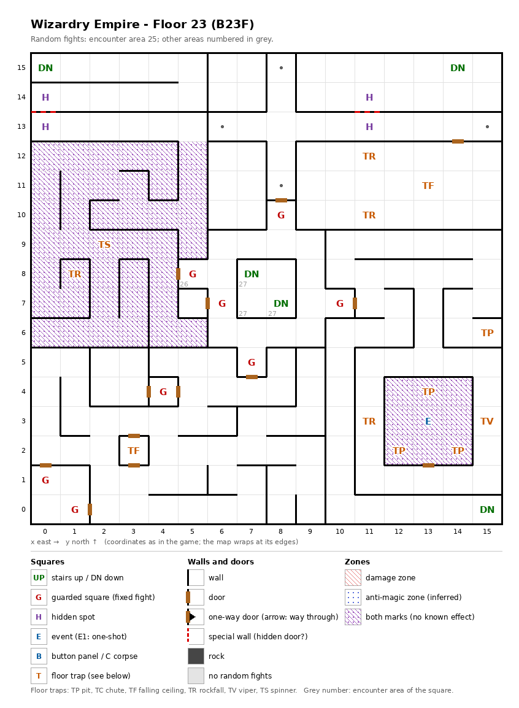

# Floor 23: map, squares, monsters

The third floor of the second, harder area (floors 21-30), B23F. How to read the map, coordinates and what each kind
of square does: [maps/README.md](README.md).

## 1. Overview

- No solid rock; 13 doors, no one-way doors, 2 secret doors and no locked doors (computed from the map).
- **Parts** (computed from the map): with both secret doors found, a **main part of 242 squares** where every square
  can be reached from every other. Before they are found it is three parts: 216 squares around the rest of the floor
  and two strips along the north edge, (0, 14)-(5, 15) (12 squares) and (9, 14)-(15, 15) (14 squares), each joined to
  the main part only by a secret door. Three closed rooms have no way in on foot even with the secret doors found:
  (6, 10)-(7, 12), (6, 14)-(7, 15) and (7, 7)-(8, 8).
- **Entrance and exits:** no stairs up. How a party first reaches floor 23 was not traced
  ([findings.md](../findings.md), "Floors 21-30 are not reached by stairs"). **Five stairs down**, all to floor 24:
  (15, 0) in the main part; (0, 15) and (14, 15) in the two north strips; (7, 8) and (8, 7) in the closed room
  (7, 7)-(8, 8). On foot from each (computed from the map): (15, 0) reaches 216 squares, (0, 15) 12 and (14, 15) 14,
  and all three reach the 242 squares of the main part once the secret doors are found; (7, 8) and (8, 7) reach only
  the 4 squares of their room, so it is entered only by those stairs from floor 24.
- **8 guarded squares**, **1 event** (the Shadow Dragon magic circle), **12 floor traps**, **2 pairs of hidden
  spots** (each pair facing one secret door) and 4 markers.
- **Zones:** 49 squares marked as both zone kinds (no known effect): the west block (0, 6)-(5, 12) except (5, 7) and
  (5, 8), and the 3 × 3 room (12, 2)-(14, 4) around the magic circle.
- **Random fights:** area 25 on almost every square; area 27 (the monsters of floor 25) on (7, 7) and the stairs
  (7, 8), (8, 7); area 26 (the monsters of floor 24) only on the guarded square (5, 8).
- **Monsters:** levels 12-19, up to 4 groups of 1 to 4 (computed from the formations): fighters, ninja, priests,
  bishops and mages, golems, a Balrog. Guard chests here are Platinum at best ([dungeon.md](../dungeon.md), chest
  quality by floor).

## 2. Squares

| Square (x, y) | What | On this floor |
|---|---|---|
| (15, 0), (0, 15), (14, 15), (7, 8), (8, 7) | Stairs down | To floor 24, same square. No stairs up. |
| (13, 3) | Magic circle (event) | Shadow Dragon pact, from Summoner level 31 ([spells.md](../spells.md)). In the both-marks room (12, 2)-(14, 4), entered by the door south of (13, 2); three of the room's squares are pits. |
| (12, 2), (14, 2), (13, 4), (15, 6) | Pit, strength 25 | The first three ring the magic circle. |
| (11, 12), (11, 10) | Rockfall, strength 24 | |
| (1, 8), (11, 3) | Rockfall, strength 25 | (1, 8) is in the west zone block. |
| (13, 11) | Ceiling trap (TF), strength 24 | |
| (3, 2) | Ceiling trap (TF), strength 25 | |
| (15, 3) | Viper, strength 25 | Each member's save is level/2 + LUK − 25 ([dungeon.md](../dungeon.md)). |
| (2, 9) | Spinner | In the west zone block. |
| (0, 14) + (0, 13) | Hidden spots, a pair | Each faces a secret door to the other; Search here finds it. Both sides share one mark, so once found from either side it opens both ways. Noticing difficulty 125. Joins the north-west strip (stairs (0, 15)) to the main part. |
| (11, 14) + (11, 13) | Hidden spots, a pair | Each faces a secret door to the other; Search here finds it. Both sides share one mark, so once found it opens both ways. Noticing difficulty 130. Joins the north-east strip (stairs (14, 15)) to the main part. |
| (8, 15), (6, 13), (15, 13), (8, 11) | Marker | Nothing visible (auto-map memory, inferred). |
| (8, 10) + (6, 7) + (10, 7) + (7, 5) | Guarded squares, sharing one mark with (5, 8) | Fight from area 25, then a chest. The five guards (8, 10), (5, 8), (6, 7), (10, 7), (7, 5) share one once-per-visit mark: after one is fought, the others probably stay quiet until the next floor change (inferred). |
| (5, 8) | Guarded square | Fight from area 26, then a chest. Shares its mark with the four above. |
| (0, 1) + (1, 0) | Guarded squares, a pair | Fight from area 25, then a chest. They share one once-per-visit mark: after one is fought, the other probably stays quiet until the next floor change (inferred). |
| (4, 4) | Guarded square | Fight from area 25, then a chest. |
| West block, room (12, 2)-(14, 4) | Both zone marks | 49 squares, see the overview. |

Search finds a secret door with no roll; noticing the hidden spot first is only a hint. For any chance to notice a
spot, a Thief needs LUK/2 + 5 × level of at least its difficulty ([dungeon.md](../dungeon.md), hidden spots and
secret doors). A found secret door stays open for good (inferred).

How much damage pits, rockfalls and ceiling traps do, and what their strength changes, was not traced. A viper of
strength 25 poisons a member every time except on a roll of 99 (1%) unless level/2 + LUK is above 30 (computed from
the viper rule: rolls 0-4 always poison).

## 3. Monsters

| Area | Where | Formations (one of 4 slots picked per fight) |
|---|---|---|
| 25 | the whole floor; guarded squares (8, 10), (6, 7), (10, 7), (7, 5), (4, 4), (0, 1), (1, 0) | Gladiator ×1-2 + Overlord ×1-3 + High Wizard ×0-2 + Master Ninja ×0-2, or High Bishop ×2 + Daimyo ×2 + High Priest ×2 + Gunner ×3, or Juggernaut ×3 + Iron Golem ×3 + High Wizard ×2 + Kali ×1-2, or Poison Giant ×2-3 + Balrog ×3 + Succubus ×4 |
| 26 | guarded square (5, 8) only | High Bishop ×4 + Mstr. Priest ×2 + High Priest ×2 + Mstr. Bishop ×2, or Archmage ×4 + Juggernaut ×1 + High Wizard ×2 + Kali ×3, or Mstr. Priest ×4 + Mstr. Bishop ×1 + Necromancer ×3 + High Priest ×2, or Mstr. Bishop ×3 + Necromancer ×3 + Swordmaster ×2 + Sagittarius ×2 |
| 27 | (7, 7) and the stairs (7, 8), (8, 7) | Floor 25's area: formations and stats in [floor-25.md](floor-25.md#3-monsters). |

| Monster | Lv | HP | AC | Swings | Damage | Special | Spells | EXP | Gold |
|---|---|---|---|---|---|---|---|---|---|
| Gladiator | 14 | 18d8 | -4 | 4 | 2d9+8 | - | - | 5980 | 140 |
| Overlord | 14 | 17d8 | -5 | 4 | 2d9+7 | - | Priest 6 | 6650 | 140 |
| High Wizard | 14 | 16d4 | 1 | 2 | 2d4+8 | - | Mage 6 | 6380 | 140 |
| Master Ninja | 14 | 18d6 | -6 | 4 | 2d9+7 | decapitation | - | 6110 | 140 |
| High Bishop | 15 | 18d6 | -2 | 3 | 1d7+8 | calls 25% | Mage 5, Priest 5 | 7050 | 150 |
| Daimyo | 15 | 20d8 | -4 | 4 | 3d9+7 | - | Mage 5 | 6780 | 150 |
| High Priest | 15 | 16d6 | -4 | 3 | 1d6+8 | calls 25% | Priest 6 | 6920 | 150 |
| Gunner | 16 | 18d6 | -1 | 4 | 3d9+7 | calls 25% | - | 7860 | 150 |
| Juggernaut | 17 | 40d8 | 0 | 1 | 11d11 | - | - | 9470 | 170 |
| Iron Golem | 15 | 20d8 | 3 | 1 | 5d11 | - | - | 7320 | 150 |
| Kali | 13 | 19d8 | -2 | 8 | 2d9 | - | - | 5570 | 130 |
| Poison Giant | 14 | 19d8 | 3 | 1 | 3d13+11 | poison, poison breath | - | 7600 | 140 |
| Balrog | 19 | 30d8 | -4 | 3 | 7d7 | fire breath | Priest 5 | 20000 | 170 |
| Succubus | 12 | 14d8 | -2 | 1 | 3d9 | level drain 1 | Mage 5 | 4000 | 120 |
| Mstr. Priest | 16 | 21d6 | -6 | 4 | 1d6+10 | calls 25% | Priest 7 | 8530 | 160 |
| Mstr. Bishop | 16 | 25d6 | -4 | 4 | 1d7+10 | calls 25% | Mage 6, Priest 6 | 8660 | 160 |
| Archmage | 18 | 30d4 | -3 | 4 | 2d5+12 | - | Mage 7 | 9870 | 170 |
| Necromancer | 16 | 26d4 | -1 | 3 | 2d5+10 | - | Mage 7 | 8120 | 160 |
| Swordmaster | 16 | 25d8 | -6 | 5 | 2d9+10 | - | - | 8260 | 160 |
| Sagittarius | 16 | 25d6 | -3 | 5 | 3d9+9 | - | - | 8390 | 160 |

Full stats: [monsters_table.md](../monsters_table.md).

**Notes for play:** 11 of the 20 monsters cast spells, up to level 7 (Archmage, Necromancer, Master Priest), and
the guard at (5, 8) fights mostly casters. The Juggernaut has the most HP (40d8, up to 320) and the hardest single
hit (11d11, 11-121); the Kali swings 8 times. The Succubus is the only level drainer, the Master Ninja the only
decapitator (all computed from the table).

## 4. Open questions

- How the party reaches floor 23: no stairs lead up, and floor 22 has no stairs down.
- How the closed rooms (6, 10)-(7, 12) and (6, 14)-(7, 15) are entered, if at all: no door, stairs or secret door leads
  in.
- Damage of pits, rockfalls and ceiling traps.

Tech: [dungeon.md §4 Floors](../../tech/dungeon.md#4-floors), [§2 Square types](../../tech/dungeon.md#2-square-types),
[§2.1 Secret and locked doors](../../tech/dungeon.md#21-secret-and-locked-doors-wall-value-3),
[§1 Map storage](../../tech/dungeon.md#1-map-storage-and-cell-format); `python3 tools/designtables/floormap.py 23 --list`.
