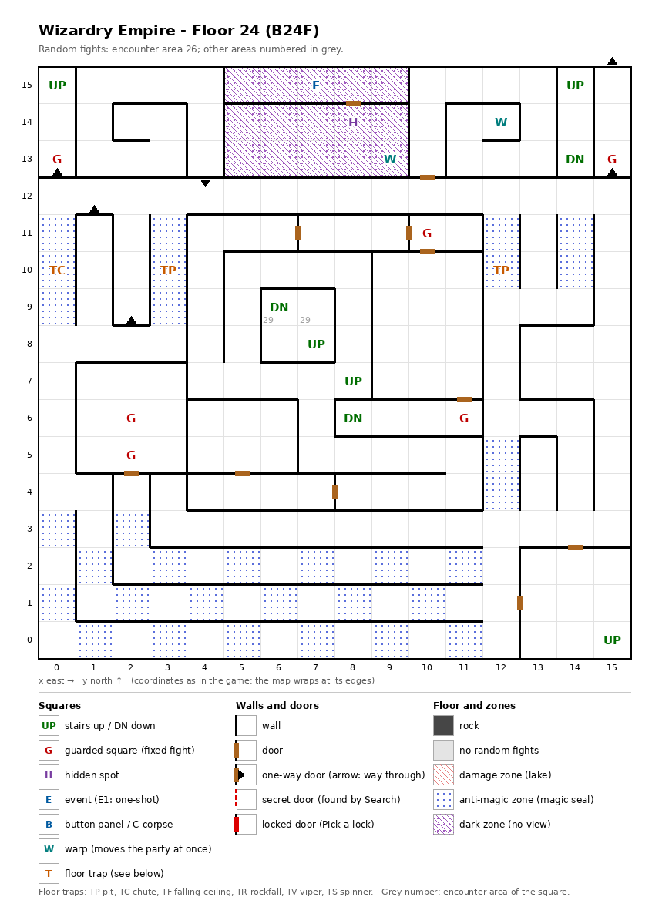

# Floor 24: map, squares, monsters

The fourth floor of the second, harder area (floors 21-30), B24F, between floor 23 above and floor 25 below. How to
read the map, coordinates and what each kind of square does: [maps/README.md](README.md).

## 1. Overview

- The auto-map calls this floor **B271** ([findings.md](../findings.md), "Floors 21-30 are numbered B30 to B666 on the
  map").
- No solid rock; 11 doors, 6 one-way doors, no secret doors and no locked doors (computed from the map).
- **Entrance and exits:** five stairs up to floor 23, at the same squares as floor 23's stairs down: (0, 15),
  (14, 15), (7, 8), (8, 7), (15, 0). Three stairs down to floor 25: (14, 13), (6, 9), (8, 6). Where the chute (0, 10)
  leads was not traced.
- **On foot from each stairs** (computed from the map, warps followed; the floor has no secret or locked doors, so
  nothing changes once doors are found):
  - from the stairs up (15, 0): the **main part**, 189 squares, with the chute (0, 10) and the stairs up (0, 15), but
    no stairs down. It takes in the magic-circle room and the north-west squares (1, 13)-(4, 15) through a loop of
    warps: the warp (12, 14) leads into the magic-circle room at (5, 13), the room's warp (9, 13) leads on to (2, 14),
    and the one-way door (4, 13) → (4, 12) leads back out. The way to (0, 15) is one-way (see the one-way doors
    below);
  - from the stairs up (0, 15): only its corner (0, 13)-(0, 15), 3 squares with the guard (0, 13);
  - from (8, 7) or (8, 6): the **central block** (4, 4)-(11, 11), 60 squares with 2 guarded squares and one stair
    each way;
  - from (7, 8) or (6, 9): a pocket of 4 squares, (6, 8)-(7, 9);
  - from (14, 15) or (14, 13): a pocket of 3 squares, (14, 13)-(14, 15).
  So each stair down shares its part with one stair up, and a party can only pass from floor 23 to floor 25 through
  the stairs, never across this floor.
- **6 guarded squares**, **1 event** (the Magic Gate magic circle), **3 floor traps** (a chute and 2 pits), **1
  hidden spot**, **2 warps** (both to squares of this floor).
- **Zones:** 32 anti-magic squares ("magic seal" on the auto-map; inferred meaning): a checkerboard over the south
  rows (x 0-11, y 0-3), short strips at x 0, 3, 12 and 14 (y 9-11) and (12, 4)-(12, 5). The 15 squares of the
  magic-circle room are a **dark zone** (entering puts out the light: no 3D view, "Pitch darkness!").
- **Random fights:** area 26 on almost every square; area 29 (the monsters of floors 26 and 27) on (7, 9) and the
  stairs (6, 9).
- **Monsters:** levels 13-18; every fight has exactly 10 monsters in 4 groups (computed from the formations):
  priests, bishops, mages, a Juggernaut, Kali, swordsmen. Guard chests here are Platinum at best
  ([dungeon.md](../dungeon.md), chest quality by floor).

## 2. Squares

| Square (x, y) | What | On this floor |
|---|---|---|
| (0, 15), (15, 0) | Stairs up | To floor 23. (15, 0) is in the main part; (0, 15) in its corner, reached from the main part one way only. |
| (14, 15) → (14, 13) | Stairs up, stairs down | A closed pocket of 3 squares: from floor 23 straight on to floor 25. |
| (7, 8) → (6, 9) | Stairs up, stairs down | A closed pocket of 4 squares. Floor 25's stair at (6, 9) leads into another closed pocket. |
| (8, 7), (8, 6) | Stairs up, stairs down | Both in the central block, with 2 guarded squares; floor 23's (8, 7) is in a closed room. |
| (7, 15) | Magic circle (event) | Magic Gate pact, from Summoner level 34 ([spells.md](../spells.md)). Its room (5, 13)-(9, 15) has no door, opening or secret door to the rest of the floor: the party gets in only by the warp (12, 14) and out only by the warp (9, 13) (computed from the map). |
| (8, 14) | Hidden spot | Alone, in the magic-circle room; it faces no secret door, so Search here finds nothing to open (computed from the map; it is the only such spot on floors 21-30). |
| (0, 10) | Chute, strength 25 | Drops the party to a lower floor (how far: not traced); skipped when floating. In an anti-magic strip. |
| (3, 10), (12, 10) | Pit, strength 25 | In anti-magic strips. |
| (12, 14) | Warp | To (5, 13) on this floor: the only way into the magic-circle room. |
| (9, 13) | Warp | To (2, 14) on this floor: the only way out of the magic-circle room, into the north-west squares (1, 13)-(4, 15), which the one-way door (4, 13) → (4, 12) leaves. |
| (0, 13), (15, 13), (2, 6), (2, 5) | Guarded square | Fight from area 26, then a chest. (0, 13) is in the corner of the stairs up (0, 15), the others in the main part. |
| (10, 11), (11, 6) | Guarded square | Fight from area 26, then a chest. Central block. |
| (0, 12) → (0, 13), (15, 12) → (15, 13), (15, 15) → (15, 0), (1, 11) → (1, 12), (2, 8) → (2, 9), (4, 13) → (4, 12) | One-way doors | Passable only in the direction given. Going north at (0, 12) leads past the guard (0, 13) to the stairs up (0, 15) with no way back on foot; going north at (15, 12) leads past the guard (15, 13) and across the map edge to the stairs up (15, 0) (computed from the map). |
| South rows, x 0, 3, 12, 14 strips | Anti-magic zone | 32 squares, see the overview. |
| (5, 13)-(9, 15) | Dark zone | The magic-circle room. No 3D view inside. |

How much damage the pits do, and what the trap strength changes, was not traced.

## 3. Monsters

| Area | Where | Formations (one of 4 slots picked per fight) |
|---|---|---|
| 26 | the whole floor; all 6 guarded squares | High Bishop ×4 + Mstr. Priest ×2 + High Priest ×2 + Mstr. Bishop ×2, or Archmage ×4 + Juggernaut ×1 + High Wizard ×2 + Kali ×3, or Mstr. Priest ×4 + Mstr. Bishop ×1 + Necromancer ×3 + High Priest ×2, or Mstr. Bishop ×3 + Necromancer ×3 + Swordmaster ×2 + Sagittarius ×2 |
| 29 | the single square (7, 9) and the stairs (6, 9) | Floors 26 and 27's area: formations and stats in [floor-27.md](floor-27.md#3-monsters). |

| Monster | Lv | HP | AC | Swings | Damage | Special | Spells | EXP | Gold |
|---|---|---|---|---|---|---|---|---|---|
| High Bishop | 15 | 18d6 | -2 | 3 | 1d7+8 | calls 25% | Mage 5, Priest 5 | 7050 | 150 |
| Mstr. Priest | 16 | 21d6 | -6 | 4 | 1d6+10 | calls 25% | Priest 7 | 8530 | 160 |
| High Priest | 15 | 16d6 | -4 | 3 | 1d6+8 | calls 25% | Priest 6 | 6920 | 150 |
| Mstr. Bishop | 16 | 25d6 | -4 | 4 | 1d7+10 | calls 25% | Mage 6, Priest 6 | 8660 | 160 |
| Archmage | 18 | 30d4 | -3 | 4 | 2d5+12 | - | Mage 7 | 9870 | 170 |
| Juggernaut | 17 | 40d8 | 0 | 1 | 11d11 | - | - | 9470 | 170 |
| High Wizard | 14 | 16d4 | 1 | 2 | 2d4+8 | - | Mage 6 | 6380 | 140 |
| Kali | 13 | 19d8 | -2 | 8 | 2d9 | - | - | 5570 | 130 |
| Necromancer | 16 | 26d4 | -1 | 3 | 2d5+10 | - | Mage 7 | 8120 | 160 |
| Swordmaster | 16 | 25d8 | -6 | 5 | 2d9+10 | - | - | 8260 | 160 |
| Sagittarius | 16 | 25d6 | -3 | 5 | 3d9+9 | - | - | 8390 | 160 |

Full stats: [monsters_table.md](../monsters_table.md).

**Notes for play:** the group sizes in area 26 are fixed, so every fight is 4 groups totalling 10 monsters, two of
the four formations are casters only and the other two have 6 casters in 10: 7 of the 11 monsters cast spells, up
to level 7. There is no level drain, breath or decapitation on this floor. The anti-magic strips cancel the party's
spell effects on the way to the chute and the pits (all computed from the tables and the map).

## 4. Open questions

- What the lone hidden spot (8, 14) in the magic-circle room is for, since it faces no secret door.
- Where the chute at (0, 10) leads.
- Floor 25's fourth stair up, at (15, 0), would put the party on floor 24's (15, 0), which is itself a stair up;
  where it really leads was not checked.
- Damage of the pits.

Tech: [dungeon.md §4 Floors](../../tech/dungeon.md#4-floors), [§2 Square types](../../tech/dungeon.md#2-square-types),
[§2.1 Secret and locked doors](../../tech/dungeon.md#21-secret-and-locked-doors-wall-value-3),
[§1 Map storage](../../tech/dungeon.md#1-map-storage-and-cell-format),
[§6 Auto-map](../../tech/dungeon.md#6-auto-map) (warps, floor numbers); `python3 tools/designtables/floormap.py 24 --list`.
