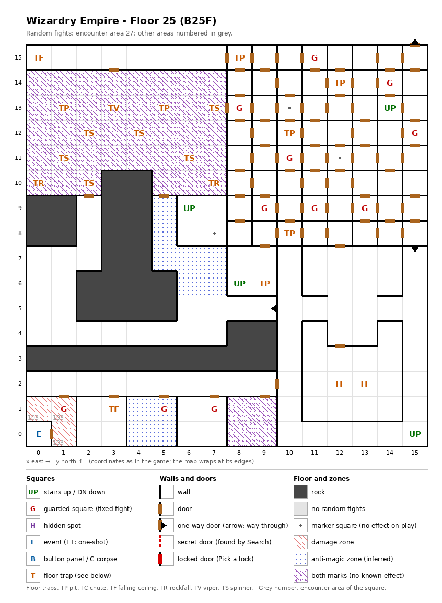

# Floor 25: map, squares, monsters

The fifth floor of the second, harder area (floors 21-30), B25F, the last one reached by stairs. How to read the
map, coordinates and what each kind of square does: [maps/README.md](README.md).

## 1. Overview

- 32 squares are solid rock (two masses in the south-west half); 91 doors, 3 one-way doors, no secret doors and no
  locked doors (computed from the map). 76 of the doors are inside the north-east block (8, 8)-(15, 15), a grid of
  one-square rooms each closed by doors.
- **Entrance and exits:** four stairs up to floor 24: (14, 13), (6, 9), (8, 6), (15, 0); **no stairs down**. How
  floors 26-30 are reached was not traced ([findings.md](../findings.md), "Floors 21-30 are not reached by
  stairs"). The stair at (6, 9) lands in the closed pocket (6, 8)-(7, 9), whose only way out is back up.
- **On foot** (computed from the map): from any of the stairs up (14, 13), (8, 6) and (15, 0) the party reaches
  220 squares, every open square except the closed pocket of 4 squares around the stair up at (6, 9), and each of
  these three stairs from the others.
- **11 guarded squares**, **1 event** (a well), **20 floor traps** (7 pits, 6 spinners, 4 ceiling traps, 2
  rockfalls, 1 viper) and 3 markers.
- **Zones:** a damage zone of 3 squares, (0, 1), (1, 1), (1, 0), with its own monsters (area 103); 11 anti-magic
  squares (inferred meaning) around (5, 7)-(7, 7) and in the room (4, 0)-(5, 1); 42 squares marked as both zone
  kinds (no known effect): the block (0, 10)-(7, 14), where 11 of the traps are, and the room (8, 0)-(9, 1).
- **Random fights:** area 27 everywhere except the damage zone (area 103).
- **Monsters:** levels 3-19, groups of 1 to 7 (computed from the formations). Guard chests are Paulownia at best;
  the damage-zone guard gives worse ones ([dungeon.md](../dungeon.md), chest quality by floor).

## 2. Squares

| Square (x, y) | What | On this floor |
|---|---|---|
| (14, 13), (8, 6), (15, 0) | Stairs up | To floor 24, same square. No stairs down. |
| (6, 9) | Stairs up | To floor 24. In a closed pocket of 4 squares with the marker (7, 8). |
| (0, 0) | Well (event) | "Drink from it?": one random outcome (HP restored, poison, cure, heavy damage or paralysis). The only way in is through the damage zone: (1, 1), then (1, 0) and the door west (computed from the map). |
| (1, 13), (5, 13), (8, 15), (12, 14), (10, 12), (10, 8), (9, 6) | Pit, strength 28 | (1, 13) and (5, 13) in the both-marks block; (9, 6) next to the stair up (8, 6); the others among the door cells. |
| (7, 13), (2, 12), (4, 12), (1, 11), (6, 11), (2, 10) | Spinner | All in the both-marks block. |
| (0, 15), (12, 2), (13, 2), (3, 1) | Ceiling trap (TF), strength 28 | |
| (0, 10), (7, 10) | Rockfall, strength 28 | In the both-marks block. |
| (3, 13) | Viper, strength 28 | In the both-marks block. Each member's save is level/2 + LUK − 28 ([dungeon.md](../dungeon.md)). |
| (10, 13), (12, 11), (7, 8) | Marker | Nothing visible (auto-map memory, inferred). |
| (11, 15), (14, 14), (8, 13), (15, 12), (10, 11), (9, 9), (11, 9), (13, 9) | Guarded square | Fight from area 27, then a chest. Among the door cells. |
| (5, 1) | Guarded square | Fight from area 27, then a chest. In the anti-magic room (4, 0)-(5, 1). |
| (7, 1) | Guarded square | Fight from area 27, then a chest. |
| (1, 1) | Guarded square | Fight from area 103 (the damage zone's monsters), then a chest. In the damage zone. |
| (10, 5) → (9, 5), (15, 8) → (15, 7), (15, 15) → (15, 0) | One-way doors | Passable only in the direction given; the last crosses the map edge onto the stair up (15, 0). |
| (0, 1), (1, 1), (1, 0) | Damage zone | Each member loses maxHP/4 + 1 HP after every action ([dungeon.md](../dungeon.md)). |
| (5, 7)-(5, 9), (6, 6)-(7, 7), (4, 0)-(5, 1) | Anti-magic zone | 11 squares. |
| (0, 10)-(7, 14), (8, 0)-(9, 1) | Both zone marks | 42 squares (rock at (3, 10) and (4, 10)). |

How much damage pits, rockfalls and ceiling traps do, and what their strength changes, was not traced. A viper of
strength 28 poisons a member every time except on a roll of 99 (1%) unless level/2 + LUK is above 33 (computed from
the viper rule: rolls 0-4 always poison).

## 3. Monsters

| Area | Where | Formations (one of 4 slots picked per fight) |
|---|---|---|
| 27 | the whole floor outside the damage zone; 10 guarded squares | Balrog ×3 + Hell Fiend ×2 + Gr. Hydra ×4 + Rakshasa ×3, or Archmage ×1 + High Master ×1 + Lucky Star ×4 + Mstr. Priest ×4, or Sword Dancer ×1 + Archmage ×3 + High Master ×4 + Berserker ×4-6, or Valkyrie ×2 + Swordmaster ×4 + Gladiator ×3-5 + Dark Lord ×1-5 |
| 103 | the damage zone (0, 1), (1, 1), (1, 0); guarded square (1, 1) | Damned ×2 + Ghost ×1-2 + Specter ×1-2 + Wight ×1, or Scylla ×4-7 + Couatl ×3-6 + Lizard King ×3-4 + Lizard Man ×2-5 (2 of 4), or Marid ×1-3 + Djinni ×2-4 + Water Elem. ×3-5 + Air Elem. ×6 |

The Scylla formation fills two of area 103's four slots, so it comes up in half of the zone's fights (computed).

| Monster | Lv | HP | AC | Swings | Damage | Special | Spells | EXP | Gold |
|---|---|---|---|---|---|---|---|---|---|
| Balrog | 19 | 30d8 | -4 | 3 | 7d7 | fire breath | Priest 5 | 20000 | 170 |
| Hell Fiend | 14 | 20d8 | -1 | 2 | 4d11 | fire breath | Priest 3 | 6700 | 140 |
| Gr. Hydra | 14 | 20d8 | 5 | 4 | 2d11 | poison, poison breath | - | 6200 | 140 |
| Rakshasa | 10 | 12d8 | -5 | 3 | 2d7 | flees 10% | Mage 5, Priest 3 | 2080 | 100 |
| Archmage | 18 | 30d4 | -3 | 4 | 2d5+12 | - | Mage 7 | 9870 | 170 |
| High Master | 17 | 25d6 | -8 | 5 | 2d9+10 | decapitation | - | 9060 | 160 |
| Lucky Star | 16 | 25d4 | -3 | 4 | 3d5+9 | - | - | 7990 | 150 |
| Mstr. Priest | 16 | 21d6 | -6 | 4 | 1d6+10 | calls 25% | Priest 7 | 8530 | 160 |
| Sword Dancer | 18 | 30d8 | -9 | 6 | 2d9+12 | - | - | 16200 | 170 |
| Berserker | 4 | 7d8 | 4 | 2 | 2d9 | - | - | 400 | 40 |
| Valkyrie | 19 | 25d8 | -5 | 3 | 4d9+17 | - | Priest 7 | 25480 | 170 |
| Swordmaster | 16 | 25d8 | -6 | 5 | 2d9+10 | - | - | 8260 | 160 |
| Gladiator | 14 | 18d8 | -4 | 4 | 2d9+8 | - | - | 5980 | 140 |
| Dark Lord | 3 | 7d8 | 3 | 1 | 1d9 | flees 10% | Priest 1 | 290 | 30 |
| Damned | 13 | 15d8 | -3 | 1 | 3d9 | paralysis | - | 5300 | 130 |
| Ghost | 10 | 11d8 | 0 | 1 | 1d3 | fear, calls 25%, flees 20% | - | 1000 | 100 |
| Specter | 6 | 7d8+7 | 3 | 1 | 1d9 | level drain 1, calls 25% | - | 800 | 60 |
| Wight | 6 | 4d8+5 | 8 | 1 | 1d5 | level drain 1 | - | 220 | 20 |
| Scylla | 10 | 13d8 | 7 | 8 | 2d5 | fear, paralysis | - | 1300 | 100 |
| Couatl | 9 | 11d8 | 5 | 2 | 2d5 | poison | Mage 3, Priest 5 | 990 | 90 |
| Lizard King | 8 | 8d8+7 | 3 | 1 | 3d6+5 | - | - | 790 | 80 |
| Lizard Man | 3 | 3d8+5 | 5 | 3 | 1d5 | flees 5% | - | 350 | 40 |
| Marid | 13 | 14d8 | -2 | 1 | 11d7 | frost breath | - | 5200 | 130 |
| Djinni | 12 | 14d8 | -2 | 1 | 5d11 | lightning breath | - | 4800 | 120 |
| Water Elem. | 8 | 10d8 | 2 | 1 | 6d7 | - | - | 840 | 80 |
| Air Elem. | 8 | 10d8 | 2 | 1 | 3d11 | - | - | 760 | 80 |

Full stats: [monsters_table.md](../monsters_table.md).

**Notes for play:** area 27 mixes the floor's strongest fighters (Valkyrie and Balrog at level 19, the Sword Dancer
with 6 swings and AC -9) with low-level groups (Dark Lord level 3, Berserker level 4). The Balrog, Hell Fiend and
Greater Hydra breathe. The damage-zone monsters (area 103) are much weaker, levels 3-13, with the only level
drainers of the floor (Specter, Wight). Reaching their guard at (1, 1), and the well behind it, means taking zone
damage on every step (all computed from the tables and the map).

## 4. Open questions

- How the party continues to floors 26-30: floor 25 has no stairs down and no chute.
- Where floor 25's stair up at (15, 0) leads: floor 24's (15, 0) is a stair up as well.
- Odds of the well's outcomes.
- Damage of pits, rockfalls and ceiling traps.

Tech: [dungeon.md §4 Floors](../../tech/dungeon.md#4-floors), [§3 Event catalogue](../../tech/dungeon.md#3-event-catalogue),
[§1 Map storage](../../tech/dungeon.md#1-map-storage-and-cell-format); `python3 tools/designtables/floormap.py 25 --list`.
