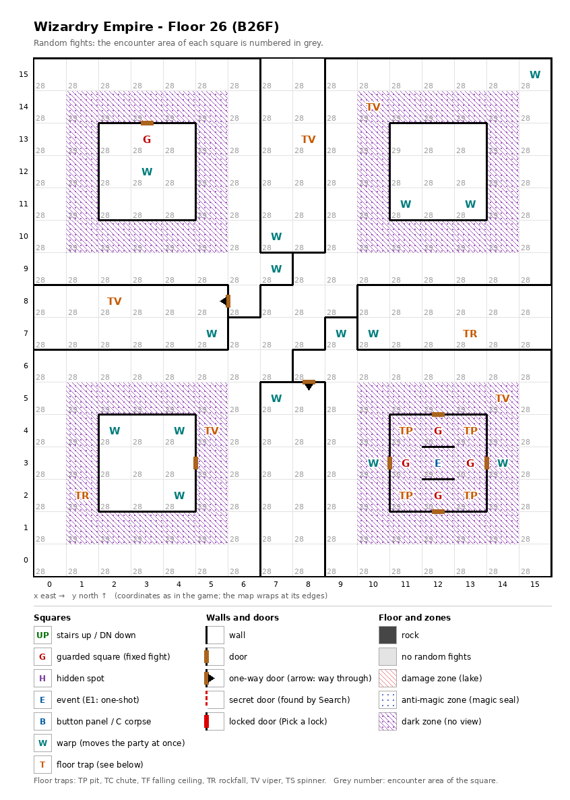

# Floor 26: map, squares, monsters

The sixth floor of the second, harder area (floors 21-30), B26F, the first of the five floors without any stairs. How
to read the map, coordinates and what each kind of square does: [maps/README.md](README.md).

## 1. Overview

- No solid rock; 8 doors (computed from the map). The floor is built around **four square rings** (5 × 5 squares
  each, marked as both zone kinds) set in the four quarters, each around a 3 × 3 room. The walls cut it into **four
  parts that do not connect on foot** (computed from the map, one-way doors counted as passable); one of them is the
  north-east room (11, 11)-(13, 13), closed on all sides.
- **Entrance and exits:** **no stairs**, no chute. How the party reaches floor 26 or leaves it was not traced
  ([findings.md](../findings.md), "Floors 21-30 are not reached by stairs").
- **5 guarded squares**, **1 event** (the Ancient One magic circle), **11 floor traps** (5 vipers, 4 pits, 2
  rockfalls), 15 markers, 2 one-way doors.
- **Zones:** 73 squares marked as both zone kinds (no known effect): the four rings and the whole magic-circle room
  in the south-east.
- **Random fights:** area 28 on the corridors and inner rooms; area 29 (floor 27's monsters) on the 69 both-marks squares
  other than the guards and on (11, 13) inside the closed north-east room; area 30 on 4 guarded squares.
- **Monsters:** levels 4-23, groups of 1 to 7 (computed from the formations): demons, ninja, Musashi, Kunoichi,
  Avengers, vampires and Leviathans. Guard chests are Lacquered at best ([dungeon.md](../dungeon.md), chest quality
  by floor).

## 2. Squares

| Square (x, y) | What | On this floor |
|---|---|---|
| (12, 3) | Magic circle (event) | Ancient One pact, from Summoner level 36 ([spells.md](../spells.md)). Centre of the south-east room (11, 2)-(13, 4): each of the room's four doors opens onto a guarded square, the circle is entered from the west or east guard, and the four corners are pits. |
| (12, 4), (11, 3), (13, 3), (12, 2) | Guarded square | Fight from area 30, then a chest. The four guards of the magic-circle room. |
| (3, 13) | Guarded square | Fight from area 28, then a chest. In the north-west room, just inside its door. |
| (11, 4), (13, 4), (11, 2), (13, 2) | Pit, strength 27 | The corners of the magic-circle room. |
| (10, 14), (14, 5), (5, 4) | Viper, strength 27 | On the rings. Each member's save is level/2 + LUK − 27 ([dungeon.md](../dungeon.md)). |
| (8, 13), (2, 8) | Viper, strength 27 | In the corridors. |
| (1, 2) | Rockfall, strength 27 | On the south-west ring. |
| (13, 7) | Rockfall, strength 27 | In a corridor. |
| (15, 15), (3, 12), (11, 11), (13, 11), (7, 10), (7, 9), (5, 7), (9, 7), (10, 7), (7, 5), (2, 4), (4, 4), (10, 3), (14, 3), (4, 2) | Marker | Nothing visible (auto-map memory, inferred). |
| (6, 8) → (5, 8), (8, 6) → (8, 5) | One-way doors | Passable only in the direction given. |
| (1, 10)-(5, 14), (10, 10)-(14, 14), (1, 1)-(5, 5), (10, 1)-(14, 5) | Both zone marks | The four rings (their 3 × 3 centres excluded, except in the south-east). |

How much damage pits and rockfalls do, and what their strength changes, was not traced. A viper of strength 27
poisons a member every time except on a roll of 99 (1%) unless level/2 + LUK is above 32 (computed from the viper
rule: rolls 0-4 always poison).

## 3. Monsters

| Area | Where | Formations (one is picked per fight) |
|---|---|---|
| 28 | corridors and inner rooms, guarded square (3, 13) | Balrog ×2 + Gr. Demon ×3 + Poison Giant ×3-4 + Hell Fiend ×3, or Musashi ×2 + Cutthroat ×7 + Master Ninja ×5, or Kunoichi ×4 + Master Ninja ×4 + High Ninja ×4 + High Ninja ×1, or Avenger ×3 + Dark Rider ×2 + Lucky Star ×3 + Sagittarius ×2 |
| 29 | the rings | Vampire Lord ×2 + DragonZombie ×3 + Nightcrawler ×3 + U. Beholder ×2, or Valkyrie ×3 + Dark Rider ×3 + Sword Dancer ×1 + Shogun ×4, or Leviathan ×6 + Umber Hulk ×5 + Carrion Worm ×6, or Leviathan ×5 + Troll ×6 + Lion of Hell ×5 + Carrion Worm ×6 |
| 30 | the four guards of the magic-circle room | Leviathan ×5 + Troll ×6 + Lion of Hell ×5 + Carrion Worm ×6, or Leviathan ×6 + Umber Hulk ×5 + Carrion Worm ×6, or Hell Master ×2-3 + Hell Fiend ×0-4 + Succubus ×3-4 + Succubus Qn. ×1, or Yasha ×3 + Musashi ×2 + Daimyo ×7 |

| Monster | Lv | HP | AC | Swings | Damage | Spells | Special | EXP | Gold |
|---|---|---|---|---|---|---|---|---|---|
| Balrog | 19 | 30d8 | -4 | 3 | 7d7 | Priest 5 | fire breath | 20000 | 170 |
| Gr. Demon | 18 | 25d8 | -3 | 2 | 5d11 | Mage 4 | fear, calls 25% | 9600 | 170 |
| Poison Giant | 14 | 19d8 | 3 | 1 | 3d13+11 | - | poison, poison breath | 7600 | 140 |
| Hell Fiend | 14 | 20d8 | -1 | 2 | 4d11 | Priest 3 | fire breath | 6700 | 140 |
| Musashi | 20 | 36d8 | -10 | 14 | 2d8+14 | Musashi* 7 | - | 44050 | 180 |
| Cutthroat | 11 | 12d8 | 0 | 3 | 2d9+5 | Mage 4 | calls 25% | 2620 | 110 |
| Master Ninja | 14 | 18d6 | -6 | 4 | 2d9+7 | - | decapitation | 6110 | 140 |
| Kunoichi | 20 | 31d6 | -9 | 7 | 2d9+13 | Kunoichi* 7 | decapitation | 40960 | 180 |
| High Ninja | 10 | 12d6 | -2 | 3 | 2d7+5 | - | decapitation | 1950 | 100 |
| Avenger | 20 | 35d8 | -10 | 7 | 2d9+13 | Avenger* 7 | - | 31670 | 180 |
| Dark Rider | 18 | 24d8 | -7 | 5 | 2d9+9 | Priest 6 | - | 10000 | 170 |
| Lucky Star | 16 | 25d4 | -3 | 4 | 3d5+9 | - | - | 7990 | 150 |
| Sagittarius | 16 | 25d6 | -3 | 5 | 3d9+9 | - | - | 8390 | 160 |
| Vampire Lord | 23 | 40d8 | -8 | 1 | 2d9 | Mage 6 | level drain 4, calls 25% | 40000 | 180 |
| DragonZombie | 18 | 25d8 | -2 | 3 | 4d9 | Mage 5 | poison, poison breath | 12000 | 170 |
| Nightcrawler | 17 | 36d8 | -4 | 2 | 3d9 | - | poison, level drain 1 | 13000 | 160 |
| U. Beholder | 17 | 24d8 | -4 | 1 | 3d11 | Mage 6 | level drain 1 | 9200 | 160 |
| Valkyrie | 19 | 25d8 | -5 | 3 | 4d9+17 | Priest 7 | - | 25480 | 170 |
| Sword Dancer | 18 | 30d8 | -9 | 6 | 2d9+12 | - | - | 16200 | 170 |
| Shogun | 18 | 25d8 | -6 | 5 | 3d9+9 | Mage 6 | - | 13100 | 170 |
| Leviathan | 21 | 65d8 | 2 | 1 | 4d12+1 | - | - | 65720 | 190 |
| Umber Hulk | 9 | 8d8+10 | 2 | 3 | 3d4+1 | - | fear | 890 | 90 |
| Carrion Worm | 4 | 5d8+3 | 7 | 8 | 2d3 | - | paralysis, flees 10% | 450 | 50 |
| Troll | 7 | 8d8+6 | 4 | 2 | 2d5+4 | - | - | 720 | 70 |
| Lion of Hell | 5 | 7d8 | 4 | 1 | 1d12+3 | - | - | 500 | 50 |
| Hell Master | 22 | 35d8 | -6 | 1 | 11d11 | Mage 6 | level drain 1 | 24000 | 170 |
| Succubus | 12 | 14d8 | -2 | 1 | 3d9 | Mage 5 | level drain 1 | 4000 | 120 |
| Succubus Qn. | 21 | 50d8 | -10 | 4 | 4d11 | Mage 7 | level drain 3 | 57000 | 190 |
| Yasha | 20 | 30d8 | -9 | 6 | 2d9+11 | Mage 7 | - | 28580 | 180 |
| Daimyo | 15 | 20d8 | -4 | 4 | 3d9+7 | Mage 5 | - | 6780 | 150 |

Spells: the school and the highest spell level cast; * = the school is inferred from the order of the spell schools
([monsters_table.md](../monsters_table.md), which also has the full stats and resistances).

**Notes for play:** the Musashi swings 14 times a round for 2d8+14 each (16-30), the most of any monster here.
Two of the four formations on the rings and in the circle room are swarms of 17 or 22 monsters led by 5 or 6
Leviathans (65d8 HP each, up to 520), with 6 Carrion Worms (8 swings, paralysis) in the back. The
Vampire Lord drains 4 levels per hit and the Succubus Queen 3 (all computed from the tables).

## 4. Open questions

- How the party reaches floor 26 and leaves it (no stairs, no chute).
- How the closed north-east room (11, 11)-(13, 13), with its markers, is entered.
- The three guards (12, 4), (11, 3) and (13, 3) share one "already fought" mark; whether beating one clears the
  others for that visit was not traced.
- Damage of pits and rockfalls.

Tech: [dungeon.md §4 Floors](../../tech/dungeon.md#4-floors), [§2 Square types](../../tech/dungeon.md#2-square-types),
[§1 Map storage](../../tech/dungeon.md#1-map-storage-and-cell-format); `python3 tools/designtables/floormap.py 26 --list`.
