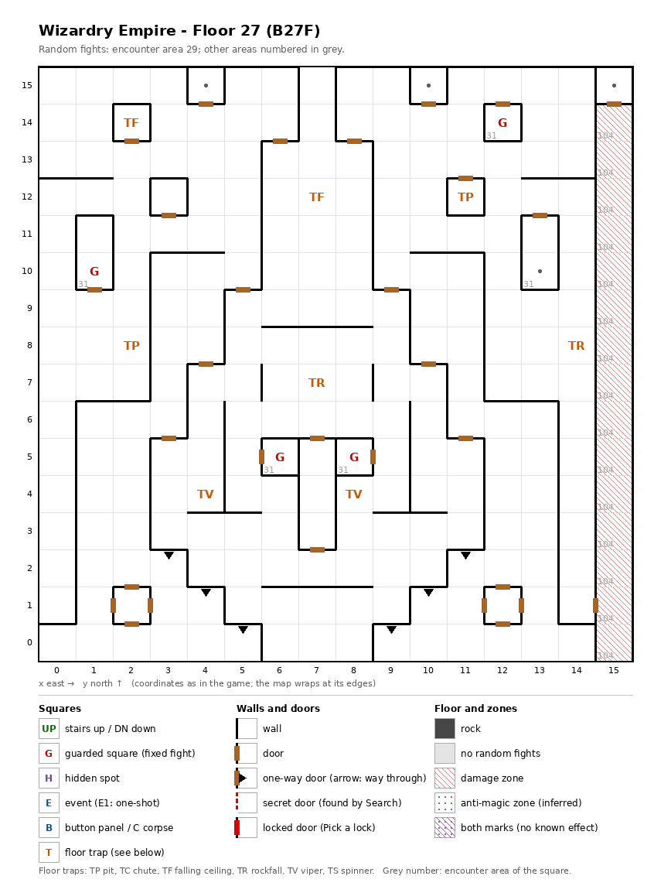

# Floor 27: map, squares, monsters

The seventh floor of the second, harder area (floors 21-30), B27F. How to read the map, coordinates and what each
kind of square does: [maps/README.md](README.md).

## 1. Overview

- No solid rock; 30 doors, many of them closing small one- and two-square rooms, 6 one-way doors, no secret doors and
  no locked doors (computed from the map). The whole floor is one connected maze: every square can be reached from
  every other on foot (computed from the map).
- **Entrance and exits:** **no stairs**, no chute. How the party reaches floor 27 or leaves it was not traced
  ([findings.md](../findings.md), "Floors 21-30 are not reached by stairs").
- **4 guarded squares**, **no events**, **8 floor traps** (2 each of ceiling traps, pits, rockfalls and vipers) and 4
  markers.
- **Zones:** a **damage zone** of 15 squares, the one-square corridor along the east edge from (15, 0) to (15, 14),
  with its own encounter area (104).
- **Random fights:** area 29 everywhere outside the damage zone; area 104 in it; area 31 (floor 29's monsters) on the
  4 guarded squares and on the marker (13, 10).
- **Monsters:** levels 4-23, groups of 1 to 6 (computed from the formations): vampires, a Lich, demons and
  succubi, Valkyries and swordsmen, Leviathan swarms. Guard chests are Lacquered at best ([dungeon.md](../dungeon.md),
  chest quality by floor).

## 2. Squares

| Square (x, y) | What | On this floor |
|---|---|---|
| (12, 14), (1, 10), (6, 5), (8, 5) | Guarded square | Fight from area 31, then a chest. Each in a small room behind a door. |
| (2, 14), (7, 12) | Ceiling trap (TF), strength 28 | |
| (11, 12) | Pit, strength 28 | |
| (2, 8) | Pit, strength 14 | Half the strength of every other trap on the floor. |
| (14, 8), (7, 7) | Rockfall, strength 28 | |
| (4, 4), (8, 4) | Viper, strength 28 | Each member's save is level/2 + LUK − 28 ([dungeon.md](../dungeon.md)). |
| (4, 15), (10, 15), (13, 10) | Marker | Nothing visible (auto-map memory, inferred). Each in a small room. |
| (15, 15) | Marker | In a closed room whose only door leads south into the damage zone (computed from the map). |
| (3, 3) → (3, 2), (4, 2) → (4, 1), (5, 1) → (5, 0), (9, 1) → (9, 0), (10, 2) → (10, 1), (11, 3) → (11, 2) | One-way doors | All passable southward only: two diagonal "stairways" of one-way doors down to the south edge, west and east of the centre. |
| (15, 0)-(15, 14) | Damage zone | Each member loses maxHP/4 + 1 HP after every action ([dungeon.md](../dungeon.md)). Doors at its north end, into (15, 15), and on its west side at (15, 1), from (14, 1). |

How much damage pits, rockfalls and ceiling traps do, and what their strength changes, was not traced. A viper of
strength 28 poisons a member every time except on a roll of 99 (1%) unless level/2 + LUK is above 33 (computed from
the viper rule: rolls 0-4 always poison).

## 3. Monsters

| Area | Where | Formations (one of 4 slots picked per fight) |
|---|---|---|
| 29 | the whole floor outside the damage zone | Vampire Lord ×2 + DragonZombie ×3 + Nightcrawler ×3 + U. Beholder ×2, or Valkyrie ×3 + Dark Rider ×3 + Sword Dancer ×1 + Shogun ×4, or Leviathan ×6 + Umber Hulk ×5 + Carrion Worm ×6, or Leviathan ×5 + Troll ×6 + Lion of Hell ×5 + Carrion Worm ×6 |
| 104 | the damage zone (15, 0)-(15, 14) | Marid ×1-3 + Djinni ×2-4 + Water Elem. ×3-5 + Air Elem. ×6, or an empty formation (3 of 4) |
| 31 | guarded squares (all 4) and the marker (13, 10) | Hell Master ×2-3 + Hell Fiend ×0-4 + Succubus ×3-4 + Succubus Qn. ×1, or Lich ×3 + Vampire Qn. ×3 + Vampire Lord ×2 + Vampire ×3 (2 of 4), or Lich ×2 + Vampire Qn. ×2 + Vampire Lord ×3 + DragonZombie ×3 |

The Lich ×3 formation fills two of area 31's four slots, so it comes up in half of the guard fights (computed). Area
104 has its one real formation in a single slot and empty ones in the other three: what a fight does when it picks
an empty formation was not traced ([findings.md](../findings.md), "Two damage-zone areas have empty formations").

| Monster | Lv | HP | AC | Swings | Damage | Special | Spells | EXP | Gold |
|---|---|---|---|---|---|---|---|---|---|
| Vampire Lord | 23 | 40d8 | -8 | 1 | 2d9 | level drain 4, calls 25% | Mage 6 | 40000 | 180 |
| DragonZombie | 18 | 25d8 | -2 | 3 | 4d9 | poison, poison breath | Mage 5 | 12000 | 170 |
| Nightcrawler | 17 | 36d8 | -4 | 2 | 3d9 | poison, level drain 1 | - | 13000 | 160 |
| U. Beholder | 17 | 24d8 | -4 | 1 | 3d11 | level drain 1 | Mage 6 | 9200 | 160 |
| Valkyrie | 19 | 25d8 | -5 | 3 | 4d9+17 | - | Priest 7 | 25480 | 170 |
| Dark Rider | 18 | 24d8 | -7 | 5 | 2d9+9 | - | Priest 6 | 10000 | 170 |
| Sword Dancer | 18 | 30d8 | -9 | 6 | 2d9+12 | - | - | 16200 | 170 |
| Shogun | 18 | 25d8 | -6 | 5 | 3d9+9 | - | Mage 6 | 13100 | 170 |
| Leviathan | 21 | 65d8 | 2 | 1 | 4d12+1 | - | - | 65720 | 190 |
| Umber Hulk | 9 | 8d8+10 | 2 | 3 | 3d4+1 | fear | - | 890 | 90 |
| Carrion Worm | 4 | 5d8+3 | 7 | 8 | 2d3 | paralysis, flees 10% | - | 450 | 50 |
| Troll | 7 | 8d8+6 | 4 | 2 | 2d5+4 | - | - | 720 | 70 |
| Lion of Hell | 5 | 7d8 | 4 | 1 | 1d12+3 | - | - | 500 | 50 |
| Marid | 13 | 14d8 | -2 | 1 | 11d7 | frost breath | - | 5200 | 130 |
| Djinni | 12 | 14d8 | -2 | 1 | 5d11 | lightning breath | - | 4800 | 120 |
| Water Elem. | 8 | 10d8 | 2 | 1 | 6d7 | - | - | 840 | 80 |
| Air Elem. | 8 | 10d8 | 2 | 1 | 3d11 | - | - | 760 | 80 |
| Hell Master | 22 | 35d8 | -6 | 1 | 11d11 | level drain 1 | Mage 6 | 24000 | 170 |
| Hell Fiend | 14 | 20d8 | -1 | 2 | 4d11 | fire breath | Priest 3 | 6700 | 140 |
| Succubus | 12 | 14d8 | -2 | 1 | 3d9 | level drain 1 | Mage 5 | 4000 | 120 |
| Succubus Qn. | 21 | 50d8 | -10 | 4 | 4d11 | level drain 3 | Mage 7 | 57000 | 190 |
| Lich | 21 | 36d8 | 0 | 1 | 1d11 | paralysis | Mage 7 | 50240 | 180 |
| Vampire Qn. | 22 | 45d8 | -12 | 1 | 2d11 | level drain 3 | Mage 7 | 50000 | 180 |
| Vampire | 10 | 10d8+5 | 1 | 1 | 2d7+4 | paralysis, level drain 1 | - | 1000 | 80 |

Full stats: [monsters_table.md](../monsters_table.md).

**Notes for play:** 8 of the 24 monsters drain levels; every formation of the guards (area 31) has at least one
of them, led by the Vampire Lord (4 levels per hit) and the Vampire Queen and Succubus Queen (3). The Vampire
Queen's AC -12 is the best on the floor. In the damage zone the monsters (levels 8-13, two of them breathing) matter
less than the zone itself (all computed from the tables).

## 4. Open questions

- How the party reaches floor 27 and leaves it (no stairs, no chute).
- What happens when a fight in the damage zone picks an empty formation (3 of its 4 slots).
- Why the pit at (2, 8) has strength 14 when every other trap here has 28, and what trap strength does for pits,
  rockfalls and ceiling traps.

Tech: [dungeon.md §4 Floors](../../tech/dungeon.md#4-floors), [§2 Square types](../../tech/dungeon.md#2-square-types),
[§1 Map storage](../../tech/dungeon.md#1-map-storage-and-cell-format); `python3 tools/designtables/floormap.py 27 --list`.
