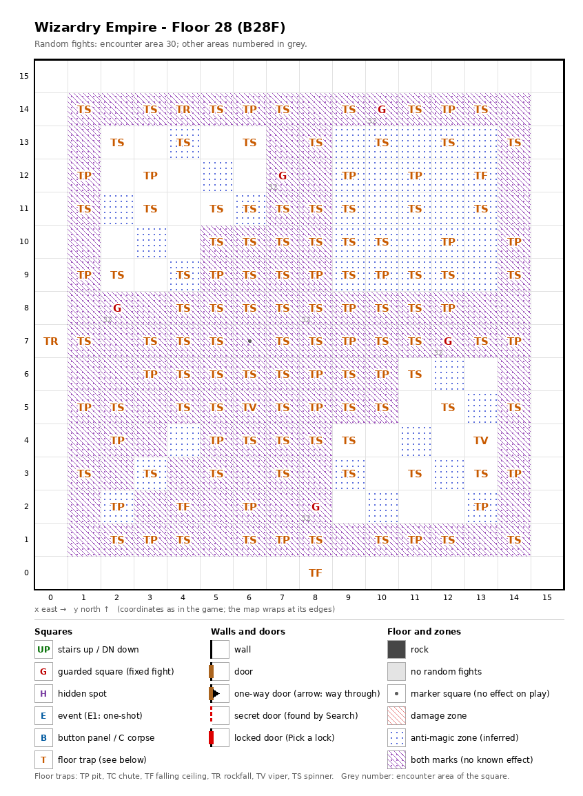

# Floor 28: map, squares, monsters

The eighth floor of the second, harder area (floors 21-30), B28F: a single open hall almost paved with traps. How to
read the map, coordinates and what each kind of square does: [maps/README.md](README.md).

## 1. Overview

- The auto-map calls this floor **B485** ([findings.md](../findings.md), "Floors 21-30 are numbered B30 to B666 on the
  map").
- No solid rock, **no doors** (no one-way, secret or locked doors either) **and no inner walls**: the only walls run
  along the map edge, so the floor is one open 16 × 16 hall that does not wrap (computed from the map).
- **Entrance and exits:** **no stairs**, no chute. A party comes down from floor 27 by the warp there, which lands on
  **(15, 15)**, the north-east corner ([floor-27.md](floor-27.md)). The way on is the **warp (6, 7)**, inside the
  dark zone among the spinners, to (0, 0) on floor 29 ([floor-29.md](floor-29.md)).
- **5 guarded squares**, **no events**, **122 floor traps**, **1 warp** (to floor 29). Of the inner block
  (1, 1)-(14, 14), 196 squares, 120 are traps, 5 guarded squares, 1 the warp and only 70 plain floor; the outer
  frame (rows 0 and 15, columns 0 and 15) is plain except for 2 traps (computed from the map).
- **Zones:** 126 squares of **dark zone** (entering puts out the light: no 3D view, "Pitch darkness!") and 41
  anti-magic squares ("magic seal" on the auto-map; inferred meaning), together 167 of the inner block's 196 (see
  below).
- **Random fights:** area 30 everywhere; area 32 (floor 30's monsters) on the spinner (8, 8) and the guarded squares.
  With no doors on the floor, the chance of a random fight stays at the base rate of 1 in 512 per action (computed
  from the door rule in [monsters.md](../monsters.md)).
- **Monsters:** levels 4-28, groups of 1 to 7 (computed from the formations), including the Star Seizer (level 28)
  in the guards' area. Guard chests are Jet-black at best ([dungeon.md](../dungeon.md), chest quality by floor).

## 2. Squares

Traps by kind (all of strength 29 except the ceiling trap at (8, 0), strength 28):

| Trap | Count | Where |
|---|---|---|
| Spinner | 85 | All over the inner block: 37 in rows 9-14 and 48 in rows 1-8; 60 of them on dark-zone squares, 15 on anti-magic squares, 10 unmarked (computed from the map). |
| Pit | 30 | Mixed in with the spinners: 23 on dark-zone squares, 6 anti-magic, 1 unmarked. |
| Ceiling trap (TF) | 3 | (13, 12), (4, 2), and (8, 0) on the south edge. |
| Viper | 2 | (6, 5), (13, 4). Each member's save is level/2 + LUK − 29 ([dungeon.md](../dungeon.md)). |
| Rockfall | 2 | (4, 14), and (0, 7) on the west edge. |

Spinners turn the party to a random facing; 85 of the inner block's 196 squares do so (computed from the map), and
the hall has no walls to steer by. Every square of the trap list:
`python3 tools/designtables/floormap.py 28 --list`.

| Square (x, y) | What | On this floor |
|---|---|---|
| (10, 14), (7, 12), (2, 8), (12, 7), (8, 2) | Guarded square | Fight from area 32, then a chest. All in the dark zone. |
| (6, 7) | Warp | To floor 29 (0, 0): the only way on from this floor. In the dark zone. |
| (9, 9)-(13, 13) | Anti-magic zone | The whole 5 × 5 square, 25 squares; the other 16 anti-magic squares lie on diagonals in the north-west (x 2-6, y 9-13) and south-east (x 9-13, y 2-6) quarters. |
| Inner block (1, 1)-(14, 14) | Dark zone | 126 squares, no 3D view inside, including the whole outer ring of the block (x or y = 1 or 14). 29 squares of the block carry no mark. |

How much damage pits, rockfalls and ceiling traps do, and what their strength changes, was not traced. A viper of
strength 29 poisons a member every time except on a roll of 99 (1%) unless level/2 + LUK is above 34 (computed from
the viper rule: rolls 0-4 always poison).

## 3. Monsters

| Area | Where | Formations (one of 4 slots picked per fight) |
|---|---|---|
| 30 | the whole hall | Leviathan ×5 + Troll ×6 + Lion of Hell ×5 + Carrion Worm ×6, or Leviathan ×6 + Umber Hulk ×5 + Carrion Worm ×6, or Hell Master ×2-3 + Hell Fiend ×0-4 + Succubus ×3-4 + Succubus Qn. ×1, or Yasha ×3 + Musashi ×2 + Daimyo ×7 |
| 32 | the 5 guarded squares and the spinner (8, 8) | Fire Giant ×4 + Titan ×4 + Iron Golem ×4 + Star Seizer ×1, or Lich ×2 + Vampire Qn. ×2 + Vampire Lord ×3 + DragonZombie ×3, or Demon Lord ×2 + Succubus Qn. ×3 + Arch Demon ×2 + Hell Master ×3, or Yasha ×4 + Musashi ×2 + Kunoichi ×2 + Valiant ×3 |

| Monster | Lv | HP | AC | Swings | Damage | Special | Spells | EXP | Gold |
|---|---|---|---|---|---|---|---|---|---|
| Leviathan | 21 | 65d8 | 2 | 1 | 4d12+1 | - | - | 65720 | 190 |
| Troll | 7 | 8d8+6 | 4 | 2 | 2d5+4 | - | - | 720 | 70 |
| Lion of Hell | 5 | 7d8 | 4 | 1 | 1d12+3 | - | - | 500 | 50 |
| Carrion Worm | 4 | 5d8+3 | 7 | 8 | 2d3 | paralysis, flees 10% | - | 450 | 50 |
| Umber Hulk | 9 | 8d8+10 | 2 | 3 | 3d4+1 | fear | - | 890 | 90 |
| Hell Master | 22 | 35d8 | -6 | 1 | 11d11 | level drain 1 | Mage 6 | 24000 | 170 |
| Hell Fiend | 14 | 20d8 | -1 | 2 | 4d11 | fire breath | Priest 3 | 6700 | 140 |
| Succubus | 12 | 14d8 | -2 | 1 | 3d9 | level drain 1 | Mage 5 | 4000 | 120 |
| Succubus Qn. | 21 | 50d8 | -10 | 4 | 4d11 | level drain 3 | Mage 7 | 57000 | 190 |
| Yasha | 20 | 30d8 | -9 | 6 | 2d9+11 | - | Mage 7 | 28580 | 180 |
| Musashi | 20 | 36d8 | -10 | 14 | 2d8+14 | - | Musashi* 7 | 44050 | 180 |
| Daimyo | 15 | 20d8 | -4 | 4 | 3d9+7 | - | Mage 5 | 6780 | 150 |
| Fire Giant | 13 | 17d8+5 | -1 | 1 | 3d11+10 | - | - | 5440 | 130 |
| Titan | 17 | 30d8 | 0 | 1 | 7d7+14 | - | - | 9330 | 160 |
| Iron Golem | 15 | 20d8 | 3 | 1 | 5d11 | - | - | 7320 | 150 |
| Star Seizer | 28 | 220d8 | -20 | 1 | 26d8 | - | Mage 5, Priest 5 | 130000 | 240 |
| Lich | 21 | 36d8 | 0 | 1 | 1d11 | paralysis | Mage 7 | 50240 | 180 |
| Vampire Qn. | 22 | 45d8 | -12 | 1 | 2d11 | level drain 3 | Mage 7 | 50000 | 180 |
| Vampire Lord | 23 | 40d8 | -8 | 1 | 2d9 | level drain 4, calls 25% | Mage 6 | 40000 | 180 |
| DragonZombie | 18 | 25d8 | -2 | 3 | 4d9 | poison, poison breath | Mage 5 | 12000 | 170 |
| Demon Lord | 23 | 45d8 | -10 | 1 | 11d11+10 | level drain 3 | Mage 7, Priest 3 | 65000 | 190 |
| Arch Demon | 22 | 40d8 | -7 | 1 | 13d10 | level drain 1, calls 25% | Mage 4, Priest 6 | 62000 | 190 |
| Kunoichi | 20 | 31d6 | -9 | 7 | 2d9+13 | decapitation | Kunoichi* 7 | 40960 | 180 |
| Valiant | 20 | 35d8 | -10 | 7 | 2d9+13 | - | Valiant* 7 | 37860 | 180 |

Full stats: [monsters_table.md](../monsters_table.md); * = spell school inferred.

**Notes for play:** the guards' area (32) is a step up from the random fights: one formation is led by the Star
Seizer (220d8 HP, up to 1760; AC -20; 26d8 per hit, 26-208), and every other one has level drainers or the Musashi
and Kunoichi. Random fights are rare here (no doors), so most fights on this floor are the guards' (all computed from the
tables and the map).

## 4. Open questions

- Damage of pits, rockfalls and ceiling traps, and what trap strength does for them.

Tech: [dungeon.md §4 Floors](../../tech/dungeon.md#4-floors), [§2 Square types](../../tech/dungeon.md#2-square-types),
[§1 Map storage](../../tech/dungeon.md#1-map-storage-and-cell-format),
[§6 Auto-map](../../tech/dungeon.md#6-auto-map) (warps, floor numbers); `python3 tools/designtables/floormap.py 28 --list`.
