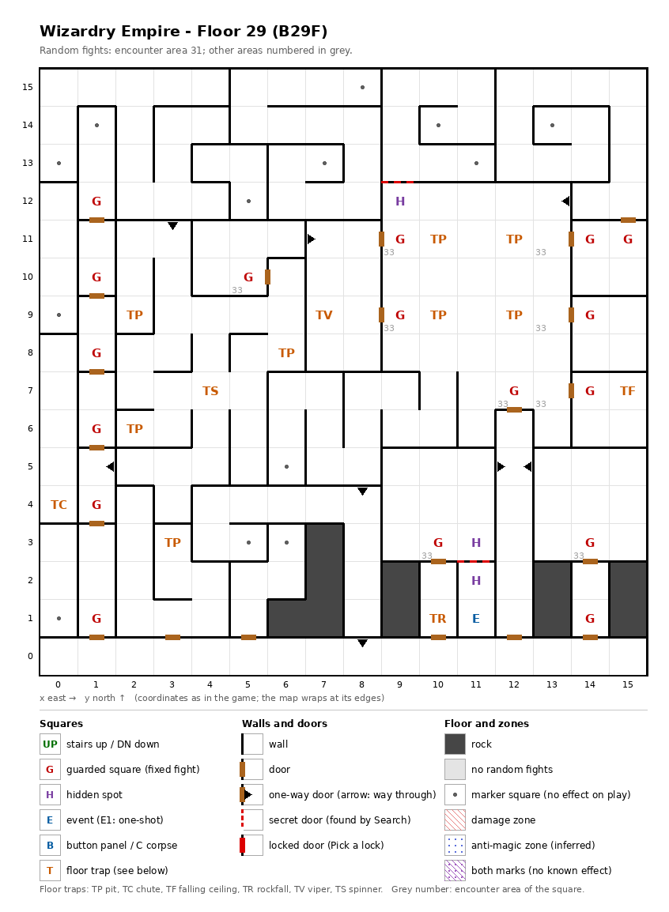

# Floor 29: map, squares, monsters

The ninth floor of the second, harder area (floors 21-30), B29F, the floor of the most guarded squares in that area.
How to read the map, coordinates and what each kind of square does: [maps/README.md](README.md).

## 1. Overview

- 10 squares are solid rock, in short pillars along the south: (6, 1), (7, 1)-(7, 3), (9, 1)-(9, 2), (13, 1)-(13, 2),
  (15, 1)-(15, 2). 21 doors (computed from the map). The walls cut the floor into **eight parts that do not connect
  on foot** (computed from the map, one-way doors counted as passable, special walls as closed): a main part of 206
  squares and seven closed pockets. Three of them line the west edge, (0, 1)-(0, 3), (0, 4)-(0, 8) (with the chute)
  and (0, 9)-(0, 12); two sit in the north, (4, 13)-(5, 13) with (5, 12), and (5, 14)-(8, 15) with (6, 12)-(8, 13);
  and two lie behind special walls: (9, 13)-(11, 15) north of the hidden spot (9, 12), and (11, 1)-(11, 2) with the
  magic circle.
- **Entrance and exits:** **no stairs**. The only floor change on the map is the chute at (0, 4), in a closed pocket
  (computed from the map); how far it drops was not traced. How the party reaches floor 29 was not traced
  ([findings.md](../findings.md), "Floors 21-30 are not reached by stairs").
- **17 guarded squares**, **1 event** (the From Beyond magic circle), **13 floor traps** (8 pits, a chute, a viper,
  a spinner, a ceiling trap, a rockfall), **3 hidden spots** (a pair and a single), 13 markers, 8 one-way doors.
- **Zones:** none.
- **Random fights:** area 31 almost everywhere; area 33 (also used on floor 30) on 6 guarded squares and on (13, 7),
  (13, 9) and (13, 11).
- **Monsters:** levels 8-29, groups of 1 to 8 (computed from the formations): demons, vampires, Liches, the four
  "hero" classes (Avenger, Valiant, Kunoichi, Musashi), and two of the ancient monsters, From Beyond (level 27) and
  the Unspeakable (level 29). Guard chests can reach Bewitching, the best tier
  ([dungeon.md](../dungeon.md), chest quality by floor).

## 2. Squares

| Square (x, y) | What | On this floor |
|---|---|---|
| (11, 1) | Magic circle (event) | From Beyond pact, from Summoner level 37 ([spells.md](../spells.md)). In the closed pocket (11, 1)-(11, 2), whose only link to the rest of the floor is the special wall between the hidden spots (11, 2) and (11, 3). |
| (11, 3) + (11, 2) | Hidden spots, a pair | Facing each other across a special wall: probably a hidden door to the magic circle (inferred). |
| (9, 12) | Hidden spot | Alone; a special wall on its north side faces the closed pocket (9, 13)-(11, 15). |
| (0, 4) | Chute, strength 31 | Drops the party to a lower floor (how far: not traced); skipped when floating. In the closed pocket (0, 4)-(0, 8). |
| (10, 11), (12, 11), (10, 9), (12, 9) | Pit, strength 30 | A square of pits around (11, 10), between the guards (9, 11), (9, 9) and the column of guards at x 14. |
| (2, 9), (6, 8), (2, 6), (3, 3) | Pit, strength 30 | |
| (7, 9) | Viper, strength 30 | Each member's save is level/2 + LUK − 30 ([dungeon.md](../dungeon.md)). |
| (4, 7) | Spinner | |
| (15, 7) | Ceiling trap (TF), strength 30 | |
| (10, 1) | Rockfall, strength 30 | |
| (1, 12), (1, 10), (1, 8), (1, 6), (1, 4), (1, 1) | Guarded square | Fight from area 31, then a chest. Along the column x 1, each just north of a door. |
| (14, 11), (15, 11), (14, 9), (14, 7), (14, 1) | Guarded square | Fight from area 31, then a chest. The east column. |
| (9, 11), (9, 9), (5, 10), (12, 7), (10, 3), (14, 3) | Guarded square | Fight from area 33, then a chest. |
| (8, 15), (1, 14), (10, 14), (13, 14), (0, 13), (7, 13), (11, 13), (5, 12), (0, 9), (6, 5), (5, 3), (6, 3), (0, 1) | Marker | Nothing visible (auto-map memory, inferred). |
| (2, 5) → (1, 5), (3, 12) → (3, 11), (6, 11) → (7, 11), (8, 1) → (8, 0), (8, 5) → (8, 4), (11, 5) → (12, 5), (13, 5) → (12, 5), (14, 12) → (13, 12) | One-way doors | Passable only in the direction given. (11, 5) and (13, 5) both lead into (12, 5) and not back. |

How much damage pits, rockfalls and ceiling traps do, and what their strength changes, was not traced. A viper of
strength 30 poisons a member every time except on a roll of 99 (1%) unless level/2 + LUK is above 35 (computed from
the viper rule: rolls 0-4 always poison).

## 3. Monsters

| Area | Where | Formations (one is picked per fight) |
|---|---|---|
| 31 | everywhere, 11 guarded squares | Hell Master ×2-3 + Hell Fiend ×0-4 + Succubus ×3-4 + Succubus Qn. ×1, or Lich ×3 + Vampire Qn. ×3 + Vampire Lord ×2 + Vampire ×3, or Lich ×2 + Vampire Qn. ×2 + Vampire Lord ×3 + DragonZombie ×3 |
| 33 | 6 guarded squares, (13, 7), (13, 9), (13, 11) | Avenger ×3 + Valiant ×4 + Kunoichi ×3 + Musashi ×1, or Treant ×8 + Rakshasa ×6 + Phoenix ×4 + From Beyond ×1, or Demon Lord ×2 + Succubus Qn. ×3 + Arch Demon ×2 + Hell Master ×3, or Beholder ×4 + Nightcrawler ×4 + Night Rider ×4 + Unspeakable ×1 |

Area 31 shows three formations: one of them fills two of the area's four slots, so it comes up in half the fights
([monsters.md](../monsters.md)); which one was not traced.

| Monster | Lv | HP | AC | Swings | Damage | Spells | Special | EXP | Gold |
|---|---|---|---|---|---|---|---|---|---|
| Hell Master | 22 | 35d8 | -6 | 1 | 11d11 | Mage 6 | level drain 1 | 24000 | 170 |
| Hell Fiend | 14 | 20d8 | -1 | 2 | 4d11 | Priest 3 | fire breath | 6700 | 140 |
| Succubus | 12 | 14d8 | -2 | 1 | 3d9 | Mage 5 | level drain 1 | 4000 | 120 |
| Succubus Qn. | 21 | 50d8 | -10 | 4 | 4d11 | Mage 7 | level drain 3 | 57000 | 190 |
| Lich | 21 | 36d8 | 0 | 1 | 1d11 | Mage 7 | paralysis | 50240 | 180 |
| Vampire Qn. | 22 | 45d8 | -12 | 1 | 2d11 | Mage 7 | level drain 3 | 50000 | 180 |
| Vampire Lord | 23 | 40d8 | -8 | 1 | 2d9 | Mage 6 | level drain 4, calls 25% | 40000 | 180 |
| Vampire | 10 | 10d8+5 | 1 | 1 | 2d7+4 | - | paralysis, level drain 1 | 1000 | 80 |
| DragonZombie | 18 | 25d8 | -2 | 3 | 4d9 | Mage 5 | poison, poison breath | 12000 | 170 |
| Avenger | 20 | 35d8 | -10 | 7 | 2d9+13 | Avenger* 7 | - | 31670 | 180 |
| Valiant | 20 | 35d8 | -10 | 7 | 2d9+13 | Valiant* 7 | - | 37860 | 180 |
| Kunoichi | 20 | 31d6 | -9 | 7 | 2d9+13 | Kunoichi* 7 | decapitation | 40960 | 180 |
| Musashi | 20 | 36d8 | -10 | 14 | 2d8+14 | Musashi* 7 | - | 44050 | 180 |
| Treant | 8 | 10d8 | 2 | 2 | 3d7 | - | - | 710 | 80 |
| Rakshasa | 10 | 12d8 | -5 | 3 | 2d7 | Mage 5, Priest 3 | flees 10% | 2080 | 100 |
| Phoenix | 15 | 21d8 | -2 | 3 | 3d9 | Mage 7 | fire breath | 8000 | 150 |
| From Beyond | 27 | 175d8 | -18 | 1 | 32d10 | Mage 4, Priest 4 | - | 120000 | 240 |
| Demon Lord | 23 | 45d8 | -10 | 1 | 11d11+10 | Mage 7, Priest 3 | level drain 3 | 65000 | 190 |
| Arch Demon | 22 | 40d8 | -7 | 1 | 13d10 | Mage 4, Priest 6 | level drain 1, calls 25% | 62000 | 190 |
| Beholder | 11 | 13d8 | 0 | 1 | 3d9 | Mage 6 | sleep | 3150 | 110 |
| Nightcrawler | 17 | 36d8 | -4 | 2 | 3d9 | - | poison, level drain 1 | 13000 | 160 |
| Night Rider | 15 | 22d8 | -5 | 3 | 4d9 | - | paralysis | 7180 | 150 |
| Unspeakable | 29 | 200d8+55 | -22 | 1 | 27d8 | Mage 6, Priest 6 | fear | 140000 | 240 |

Spells: the school and the highest spell level cast; * = the school is inferred from the order of the spell schools
([monsters_table.md](../monsters_table.md), which also has the full stats and resistances).

**Notes for play:** two of the four formations of area 33 put an ancient monster behind three large groups, From Beyond (175d8 HP, up to 1400; 32d10 per hit, 32-320) or the
Unspeakable (200d8+55, up to 1655; AC -22), the highest-level monster of any encounter area on the maps. From Beyond's hit is the only one in the game that can pass 255
([findings.md](../findings.md), "From Beyond's damage could wrap past 255"). Every formation of area 31 includes
level drainers, up to 4 levels per hit from the Vampire Lord (all computed from the tables).

## 4. Open questions

- How the party reaches floor 29, and where the chute at (0, 4) leads; the chute sits in a closed pocket.
- How the closed pockets (the west-edge ones, the two in the north, and (9, 13)-(11, 15)) are entered; the special
  walls next to the hidden spots are probably hidden doors (inferred).
- Three guarded squares in area 33, (9, 11), (9, 9) and (12, 7), share one "already fought" mark, and (14, 11) and
  (15, 11) share another; whether beating one clears the others for that visit was not traced.
- Damage of pits, rockfalls and ceiling traps.

Tech: [dungeon.md §4 Floors](../../tech/dungeon.md#4-floors), [§2 Square types](../../tech/dungeon.md#2-square-types),
[§1 Map storage](../../tech/dungeon.md#1-map-storage-and-cell-format); `python3 tools/designtables/floormap.py 29 --list`.
