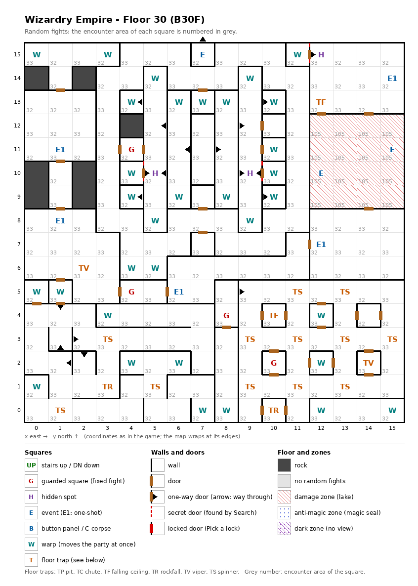

# Floor 30: map, squares, monsters

The last floor of the maze (B30F), the bottom of the second, harder area (floors 21-30) and the floor of the true
final battle. How to read the map, coordinates and what each kind of square does: [maps/README.md](README.md).

## 1. Overview

- The auto-map calls this floor **B666** ([findings.md](../findings.md), "Floors 21-30 are numbered B30 to B666 on the
  map").
- 7 squares are solid rock: (0, 9), (0, 10), (2, 9), (2, 10), (0, 14), (2, 14), (4, 12). 33 doors, 20 one-way doors,
  3 secret doors and no locked doors (computed from the map).
- **Parts** (computed from the map, warps followed). The walls alone cut the floor into five blocks that do not
  connect on foot (the three secret doors only open one-square rooms):
  - the **main part**, 82 squares around the west, north and east: every one-shot event (the final battle included),
    the maid and the well, the guarded square (4, 5);
  - the **south-west block** (0, 0)-(7, 4) with (0, 5), 41 squares;
  - the **middle block** (3, 6)-(11, 15), 77 squares with the guarded square (4, 11) and two hidden spots, itself cut
    by one-way doors into small pieces around its centre (7, 10)-(7, 12);
  - the **south-east block** (8, 0)-(15, 5) without the strip below, 44 squares: the column (8, 0)-(8, 5) with the
    guarded square (8, 4), which leads into the rest (38 squares, the guard (10, 2) and the spinner grid) through the
    one-way door (8, 5) → (9, 5);
  - the **strip** (12, 0)-(15, 0), 4 squares with no door.
  The **33 warps** join them: with all three secret doors found, every one of the 249 open squares can be reached
  from every other.
- **Before the secret doors are found:** the main part (80 squares without the secret room (11, 15) and the warp
  (1, 5)) is left only by the warp (1, 5), which lands on (10, 12) in the middle block. The other blocks then form
  one part of 164 squares with **no way back** to the main part and its events; the way back is the secret door
  from the hidden spot (9, 10) into the room (10, 10), a warp to (1, 9) in the main part (computed from the map).
- **Entrance and exits:** **no stairs**, no chute, and no warp from another floor lands here. How the party reaches
  floor 30 was not traced ([findings.md](../findings.md), "Floors 21-30 are not reached by stairs").
- **4 guarded squares**, **8 events** (5 of them one-shot, among them the true final battle), **18 floor traps** (12
  spinners, 2 each of rockfalls, vipers and ceiling traps), **3 hidden spots** (each facing a secret door) and **33
  warps**, all to squares of this floor.
- **Zones:** a **damage zone** ("lake" on the auto-map) of 16 squares, the room (12, 9)-(15, 12) in the east, with
  the maid and the well inside; its own encounter area (105) lists only empty formations.
- **Random fights:** areas 32 and 33 alternate square by square almost everywhere outside the damage zone, as on
  floor 1; area 105 in the zone.
- **Monsters:** levels 8-29, groups of 1 to 8 (computed from the formations), with the Star Seizer, From Beyond and
  the Unspeakable among them. Guard chests can reach Bewitching, the best tier ([dungeon.md](../dungeon.md), chest
  quality by floor).

## 2. Squares

| Square (x, y) | What | On this floor |
|---|---|---|
| (15, 14) | The last, strongest monster (one-shot event) | The true final battle. |
| (1, 11) | A man in jet black (one-shot event) | "So Adish is dead". |
| (1, 8) | Space tears open (one-shot event) | A rift monster appears. |
| (12, 7) | The Ancient One from the rift (one-shot event) | Something gigantic comes through a rift. |
| (6, 5) | A giant bow (one-shot event) | A giant bow appears, its arrow aimed at the party. |
| (7, 15) | Magic circle (event) | Unspeakable pact, from Summoner level 38 ([spells.md](../spells.md)). The square has walls on three sides, and its north side, across the map edge to (7, 0), lets the party out but not in, so it cannot be walked into. The only way onto it is the warp (11, 15), behind the secret door of the hidden spot (12, 15); leaving north puts the party on (7, 0), a warp to (0, 4) in the south-west block (computed from the map). |
| (15, 11) | Maid (event) | "If you...": a service, not traced. In the damage zone. |
| (12, 10) | Well (event) | "Drink from it?": one random outcome (HP restored, poison, cure, heavy damage or paralysis). In the damage zone. |
| (12, 15), (5, 10), (9, 10) | Hidden spot | Each faces a secret door into a one-square room whose own door opens only outward: (11, 15), (4, 10) and (10, 10). Each room is a warp, so stepping in moves the party on at once (rows below). Search here finds it. Noticing difficulty 165, 155 and 155. |
| (4, 11), (4, 5) | Guarded square | Fight from area 32, then a chest. (4, 11) is in the middle block, (4, 5) in the main part. |
| (8, 4), (10, 2) | Guarded square | Fight from area 33, then a chest. South-east block: (8, 4) in its west column (8, 0)-(8, 5), which only the warp (0, 1) leads into. |
| (11, 5), (13, 5), (9, 3), (11, 3), (13, 3), (15, 3), (9, 1), (11, 1), (13, 1) | Spinner | A grid of spinners on every other square of the south-east block. |
| (3, 3), (5, 1), (1, 0) | Spinner | South-west. |
| (2, 6), (14, 2) | Viper, strength 31 | Each member's save is level/2 + LUK − 31 ([dungeon.md](../dungeon.md)). |
| (3, 1), (10, 0) | Rockfall, strength 31 | |
| (12, 13), (10, 4) | Ceiling trap (TF), strength 31 | |
| (1, 5) | Warp | To (10, 12) on this floor, in the middle block: the main part's only way on before the secret doors are found. A party that walks onto (1, 5) is moved before it can use the one-way door (1, 5) → (1, 4). |
| (11, 15) | Warp | To (7, 15) on this floor, the magic circle. The secret room of the hidden spot (12, 15): the only way onto the circle. |
| (4, 10) | Warp | To (10, 10) on this floor (itself a warp). The secret room of the hidden spot (5, 10). |
| (10, 10) | Warp | To (1, 9) on this floor, in the main part. The secret room of the hidden spot (9, 10): the way back to the main part. |
| (0, 15) → (2, 15), (3, 15) → (1, 15) | Warps (2) | To the second square, on this floor: both inside the main part. |
| (5, 14) → (5, 9), (9, 14) → (9, 9), (4, 13) → (8, 10), (6, 13) → (6, 10), (7, 13) → (7, 9), (8, 13) → (5, 9), (10, 13) → (6, 10), (10, 11) → (7, 11), (4, 9) → (8, 12), (6, 9) → (6, 12), (8, 9) → (5, 13), (10, 9) → (6, 12), (5, 8) → (5, 13), (9, 8) → (9, 13), (4, 6) → (3, 2), (5, 6) → (2, 3) | Warps (16) | To the second square, on this floor. With (4, 10) and (10, 10), the 18 warps of the middle block: they link its pieces; (4, 6) and (5, 6) lead out to the south-west block. |
| (0, 5) → (7, 1), (7, 0) → (0, 4), (3, 4) → (10, 12), (4, 2) → (14, 0), (6, 2) → (13, 0), (0, 1) → (8, 1) | Warps (6) | To the second square, on this floor. The south-west block's warps: two stay inside it; (3, 4) leads to the middle block, (4, 2) and (6, 2) to the strip, (0, 1) to the south-east block's west column. |
| (12, 4) → (7, 7), (12, 2) → (4, 4), (8, 0) → (0, 0), (12, 0) → (5, 4), (15, 0) → (5, 2) | Warps (5) | To the second square, on this floor. Out of the south-east block (to the middle and south-west blocks), its west column and the strip (both to the south-west block). The strip has no door: it is entered and left only by warps. |
| (1, 2) → (1, 3), (1, 3) → (2, 3), (1, 5) → (1, 4), (2, 2) → (1, 2), (2, 3) → (2, 2), (4, 10) → (5, 10), (5, 9) → (4, 9), (5, 13) → (4, 13), (6, 10) → (5, 10), (6, 12) → (5, 12), (7, 11) → (8, 11), (7, 11) → (6, 11), (7, 15) → (7, 0), (8, 5) → (9, 5), (8, 10) → (9, 10), (8, 12) → (9, 12), (9, 9) → (10, 9), (9, 13) → (10, 13), (10, 10) → (9, 10), (11, 15) → (12, 15) | One-way doors | Passable only in the direction given. Four of them form a one-way loop in the south-west, (1, 2)-(2, 3); 12 others are in the middle block, around its one-square rooms; (1, 5) → (1, 4) leads from the main part into the south-west block but starts on a warp square, and (8, 5) → (9, 5) leads out of the south-east block's west column. |
| (12, 9)-(15, 12) | Damage zone | Each member loses maxHP/4 + 1 HP after every action ([dungeon.md](../dungeon.md)). Doors at (12, 12) and (14, 12) on the north side and (14, 9) on the south side. |

Search finds a secret door with no roll; noticing the hidden spot first is only a hint. For any chance to notice a
spot, a Thief needs LUK/2 + 5 × level of at least its difficulty ([dungeon.md](../dungeon.md), hidden spots and
secret doors). A found secret door stays open for good (inferred).

How much damage rockfalls and ceiling traps do, and what their strength changes, was not traced. A viper of strength
31 poisons a member every time except on a roll of 99 (1%) unless level/2 + LUK is above 36 (computed from the viper
rule: rolls 0-4 always poison).

## 3. Monsters

| Area | Where | Formations (one of 4 slots picked per fight) |
|---|---|---|
| 32 | every other square outside the damage zone (alternating with 33); guarded squares (4, 11), (4, 5) | Fire Giant ×4 + Titan ×4 + Iron Golem ×4 + Star Seizer ×1, or Lich ×2 + Vampire Qn. ×2 + Vampire Lord ×3 + DragonZombie ×3, or Demon Lord ×2 + Succubus Qn. ×3 + Arch Demon ×2 + Hell Master ×3, or Yasha ×4 + Musashi ×2 + Kunoichi ×2 + Valiant ×3 |
| 33 | every other square outside the damage zone (alternating with 32); guarded squares (8, 4), (10, 2) | Avenger ×3 + Valiant ×4 + Kunoichi ×3 + Musashi ×1, or Treant ×8 + Rakshasa ×6 + Phoenix ×4 + From Beyond ×1, or Demon Lord ×2 + Succubus Qn. ×3 + Arch Demon ×2 + Hell Master ×3, or Beholder ×4 + Nightcrawler ×4 + Night Rider ×4 + Unspeakable ×1 |
| 105 | the damage zone (12, 9)-(15, 12) | none: all 4 slots are empty formations. What a fight does when it picks one was not traced ([findings.md](../findings.md), "Two damage-zone areas have empty formations"). |

The monsters of the one-shot events (the rift, the giant bow, the Ancient One, the final battle) are not part of
these areas; which fight each event starts was not traced.

| Monster | Lv | HP | AC | Swings | Damage | Special | Spells | EXP | Gold |
|---|---|---|---|---|---|---|---|---|---|
| Fire Giant | 13 | 17d8+5 | -1 | 1 | 3d11+10 | - | - | 5440 | 130 |
| Titan | 17 | 30d8 | 0 | 1 | 7d7+14 | - | - | 9330 | 160 |
| Iron Golem | 15 | 20d8 | 3 | 1 | 5d11 | - | - | 7320 | 150 |
| Star Seizer | 28 | 220d8 | -20 | 1 | 26d8 | - | Mage 5, Priest 5 | 130000 | 240 |
| Lich | 21 | 36d8 | 0 | 1 | 1d11 | paralysis | Mage 7 | 50240 | 180 |
| Vampire Qn. | 22 | 45d8 | -12 | 1 | 2d11 | level drain 3 | Mage 7 | 50000 | 180 |
| Vampire Lord | 23 | 40d8 | -8 | 1 | 2d9 | level drain 4, calls 25% | Mage 6 | 40000 | 180 |
| DragonZombie | 18 | 25d8 | -2 | 3 | 4d9 | poison, poison breath | Mage 5 | 12000 | 170 |
| Demon Lord | 23 | 45d8 | -10 | 1 | 11d11+10 | level drain 3 | Mage 7, Priest 3 | 65000 | 190 |
| Succubus Qn. | 21 | 50d8 | -10 | 4 | 4d11 | level drain 3 | Mage 7 | 57000 | 190 |
| Arch Demon | 22 | 40d8 | -7 | 1 | 13d10 | level drain 1, calls 25% | Mage 4, Priest 6 | 62000 | 190 |
| Hell Master | 22 | 35d8 | -6 | 1 | 11d11 | level drain 1 | Mage 6 | 24000 | 170 |
| Yasha | 20 | 30d8 | -9 | 6 | 2d9+11 | - | Mage 7 | 28580 | 180 |
| Musashi | 20 | 36d8 | -10 | 14 | 2d8+14 | - | Musashi* 7 | 44050 | 180 |
| Kunoichi | 20 | 31d6 | -9 | 7 | 2d9+13 | decapitation | Kunoichi* 7 | 40960 | 180 |
| Valiant | 20 | 35d8 | -10 | 7 | 2d9+13 | - | Valiant* 7 | 37860 | 180 |
| Avenger | 20 | 35d8 | -10 | 7 | 2d9+13 | - | Avenger* 7 | 31670 | 180 |
| Treant | 8 | 10d8 | 2 | 2 | 3d7 | - | - | 710 | 80 |
| Rakshasa | 10 | 12d8 | -5 | 3 | 2d7 | flees 10% | Mage 5, Priest 3 | 2080 | 100 |
| Phoenix | 15 | 21d8 | -2 | 3 | 3d9 | fire breath | Mage 7 | 8000 | 150 |
| From Beyond | 27 | 175d8 | -18 | 1 | 32d10 | - | Mage 4, Priest 4 | 120000 | 240 |
| Beholder | 11 | 13d8 | 0 | 1 | 3d9 | sleep | Mage 6 | 3150 | 110 |
| Nightcrawler | 17 | 36d8 | -4 | 2 | 3d9 | poison, level drain 1 | - | 13000 | 160 |
| Night Rider | 15 | 22d8 | -5 | 3 | 4d9 | paralysis | - | 7180 | 150 |
| Unspeakable | 29 | 200d8+55 | -22 | 1 | 27d8 | fear | Mage 6, Priest 6 | 140000 | 240 |

Full stats: [monsters_table.md](../monsters_table.md); * = spell school inferred.

**Notes for play:** the two areas have seven different formations (one is shared), and three of them end in an ancient
monster behind three large groups: the Star
Seizer (220d8 HP, up to 1760; AC -20), From Beyond (32d10 per hit, 32-320, the only hit that can pass 255,
[findings.md](../findings.md), "From Beyond's damage could wrap past 255") and the Unspeakable (AC -22). Three of
the seven have level drainers. The maid and the well sit in the damage zone, so every visit costs each member
maxHP/4 + 1 HP for every action in the zone (all computed from the tables and the map).

## 4. Open questions

- How the party reaches floor 30, and how it leaves after the final battle.
- Which monsters the one-shot events fight (the rift, the giant bow, the Ancient One from the rift, the true final
  battle), and whether they stay done for good apart from the per-visit reset.
- What the maid offers, the odds of the well, and what a fight in the damage zone does with its empty formations.
- Whether a warp that lands on another warp ((4, 10) → (10, 10)) moves the party on again, and whether the warp
  (11, 15) runs the magic circle when it lands the party on it. A Teleport landing sets off neither; for warps it was
  not traced (the walking counts above assume the landing square does not fire).
- Damage of rockfalls and ceiling traps.

Tech: [dungeon.md §4 Floors](../../tech/dungeon.md#4-floors), [§3 Event catalogue](../../tech/dungeon.md#3-event-catalogue),
[§2.1 Secret and locked doors](../../tech/dungeon.md#21-secret-and-locked-doors-wall-value-3),
[§1 Map storage](../../tech/dungeon.md#1-map-storage-and-cell-format), [§2 Square types](../../tech/dungeon.md#2-square-types),
[§6 Auto-map](../../tech/dungeon.md#6-auto-map) (warps, floor numbers); `python3 tools/designtables/floormap.py 30 --list`.
